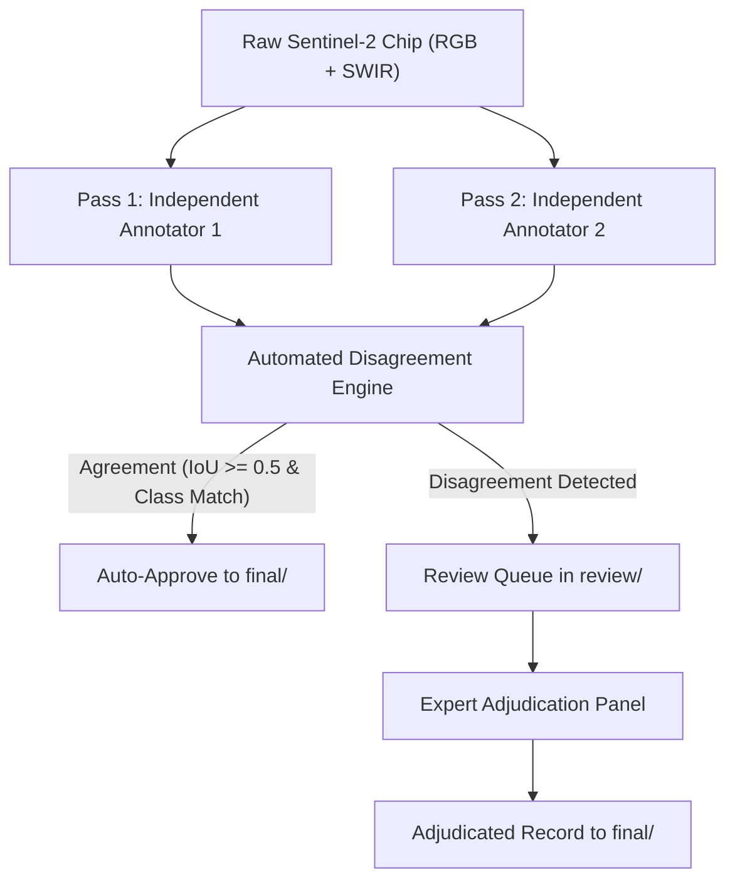

# DS08 Sentinel-2 Annotation Guidelines (v1.0)
**Dataset:** DS08 Real Sentinel-2 Level-2A Optical Adaptation Dataset  
**Phase:** Stage 8.9 — Annotation Protocol, Schema, and QA Specification  
**Status:** SPECIFICATION ONLY (NO ANNOTATIONS PERFORMED)

---

## 1. Executive Purpose & Scope

Dataset **DS08** consists of real Sentinel-2 Level-2A (Bottom-of-Atmosphere Reflectance) imagery over India, acquired across diverse geographic regions (North, Central, South, East, West). The purpose of DS08 is to provide high-quality optical visual evidence to support the vision branch of the multimodal fire-source classification system.

The overarching project source classification taxonomy consists of four final target classes:
1. **Industrial Fire**
2. **Forest Fire**
3. **Agricultural Fire**
4. **Other Thermal Source / Persistent Non-Biomass Thermal Source**

> [!CRITICAL]
> **Separation of Thermal Detections and Optical Ground Truth:**  
> The presence of a NASA FIRMS thermal anomaly detection does **NOT** automatically determine the ground-truth fire class. FIRMS thermal anomalies provide candidate spatial/temporal context only. The Sentinel-2 optical imagery must be independently evaluated by human annotators based on observable physical, spectral, and contextual features.

---

## 2. Authoritative Input Bands & Radiometric Principles

Every DS08 chip is a 5-band GeoTIFF with dimensions $512 \times 512$ pixels at $10.0\text{ m}$ spatial resolution ($5,120\text{ m} \times 5,120\text{ m}$ ground footprint).

The authoritative bands are strictly:
- **Band 1 = B02 (Blue, 490 nm, 10 m)**
- **Band 2 = B03 (Green, 560 nm, 10 m)**
- **Band 3 = B04 (Red, 665 nm, 10 m)**
- **Band 4 = B11 (SWIR-1, 1610 nm, resampled from native 20 m to 10 m via BILINEAR)**
- **Band 5 = B12 (SWIR-2, 2190 nm, resampled from native 20 m to 10 m via BILINEAR)**

### Radiometric Rules:
1. **No Band 8 (NIR):** Band 8 (842 nm) was excluded from the authoritative DS08 specification. Consequently, **NDVI cannot be computed** from this raster. Annotators must never attempt to compute, approximate, or fabricate NDVI.
2. **Values > 1.0:** In Sentinel Hub BOA reflectance products, values exceeding 1.0 may occur. In SWIR bands (B11/B12), values >1.0 frequently indicate intense active radiance emission (thermal combustion emission). In visible bands (B02/B03/B04), values >1.0 indicate localized dense cloud or specular reflectance. **A high SWIR reflectance value alone does NOT prove fire**, and visible saturation must never be mistaken for combustion.

---

## 3. Primary Annotation Unit: Object / Source Region

The primary annotation unit in DS08 is the **OBJECT / SOURCE REGION**.

- Annotators must identify visually observable objects (e.g., industrial plants, storage tanks, smokestacks) or coherent spatial regions (e.g., active burn fronts, smoke plumes, agricultural fields, forest burn scars) spatially and contextually relevant to the thermal anomaly.
- **Do NOT draw an invented physical perimeter:** When active flames or exact combustion perimeters are not clearly resolvable at 10m resolution, annotators must bound the observable visual evidence (e.g., the smoke plume source, the localized SWIR hotspot cluster, or the active field burn zone), rather than attempting to guess a sub-pixel physical flame line.

---

## 4. Required Annotation Geometry

Bounding boxes are the standard geometry for DS08 annotations.

### Coordinate Space:
- Coordinates are expressed in pixel space relative to the $512 \times 512$ raster:
  $$\text{bbox} = \{x_{\min}, y_{\min}, x_{\max}, y_{\max}\}$$
- Constraints:
  $$0 \le x_{\min} < x_{\max} \le 512$$
  $$0 \le y_{\min} < y_{\max} \le 512$$
- Zero-area or inverted boxes ($x_{\min} \ge x_{\max}$ or $y_{\min} \ge y_{\max}$) are strictly invalid and rejected by the validator.
- Boxes must tightly bound the observable target or source region.

---

## 5. Class Definitions

### Class 1 — Industrial Fire (`class_id: 1`)
- **Definition:** A thermal or fire-related visual target spatially associated with an industrial facility or industrial infrastructure, where the available optical imagery provides sufficient visual evidence to support an industrial-source interpretation.
- **Observable Evidence:** Industrial structures, factories, storage tanks, chimneys/flarestacks, cooling towers, refineries, processing plants, industrial yards, and visible smoke or fire emissions emanating directly from such infrastructure.
- **Rule on Proximity:** **Proximity to an industrial facility alone is NOT sufficient.** A thermal anomaly occurring in an agricultural field or forest adjacent to a factory must NOT be classified as an Industrial Fire unless the fire or combustion source originated within or directly impacts the facility.

### Class 2 — Forest Fire (`class_id: 2`)
- **Definition:** A fire, burn scar, or smoke-related visual target occurring in forested or woodland vegetation and supported by the surrounding natural vegetation land-cover context.
- **Observable Evidence:** Dense canopy, woodland vegetation, wildland topography, continuous vegetative burn scars, and diffuse or expanding smoke plumes originating from forested terrain.
- **Negative Exclusions:** Do not classify fires in agricultural cropland, orchards, fallow fields, roadside verges, or urban lots as Forest Fires, regardless of FIRMS reporting.

### Class 3 — Agricultural Fire (`class_id: 3`)
- **Definition:** A fire or burn-related visual target occurring on agricultural or cropland terrain where spatial, structural, and contextual evidence supports crop residue or field burning.
- **Observable Evidence:** Regular geometric field boundaries, rectangular cropland parcels, crop residue blackening, field-scale burn patches, and low-altitude smoke drifting across agricultural plots.
- **Negative Exclusions:** Do not classify every rural or wildland fire as agricultural without clear evidence of cultivated field parcels or crop management context.

### Class 4 — Other Thermal Source / Persistent Non-Biomass Thermal Source (`class_id: 4`)
- **Definition:** A persistent or non-biomass thermal source for which the optical imagery does not support an acute industrial disaster, forest wildfire, or seasonal agricultural burn.
- **Observable Evidence:** Known persistent thermal emitters (e.g., continuous oil/gas flaring, hot slag heaps, brick kilns, thermal power generation discharge, coalfield surface heat) operating under continuous or planned non-emergency conditions.
- **Critical Distinction:** A persistent flaring stack or industrial thermal emitter is classified as **Other Thermal Source**, NOT Industrial Fire, unless there is unequivocal evidence of an acute destructive industrial fire event.

---

## 6. The `UNRESOLVED` Status Policy

`UNRESOLVED` (`class_id: 0`) is a first-class annotation status, but it is **NOT** a 5th fire class.

### When to Assign `UNRESOLVED`:
1. The target is heavily obscured by cloud, heavy haze, or dense cloud shadow.
2. The target region cannot be visually interpreted at 10m optical resolution.
3. The spatial evidence is ambiguous (e.g., boundary between a factory perimeter and an adjacent farm plot is indistinguishable).
4. Multiple source classes remain equally plausible without corroborating evidence.
5. The FIRMS detection coordinate does not correspond to any visually identifiable surface feature or disturbance.

> [!WARNING]
> **Zero Forced Classifications:**  
> Annotators must **NEVER** force an ambiguous observation into one of the four final classes. Preserving honest uncertainty via `UNRESOLVED` prevents label noise from polluting downstream multimodal training.

---

## 7. Visual Evidence Field

Every annotation bounding box must record one or more evidence tags from the following closed vocabulary:

| Evidence Tag | Description |
| :--- | :--- |
| `DIRECT_FIRE_VISIBLE` | Active glowing combustion visible (strong SWIR-2/SWIR-1 hotspot emission with visible flame signature). |
| `SMOKE_VISIBLE` | Visible smoke plume (white, gray, or dark plume drifting from target). |
| `BURN_SCAR_VISIBLE` | Observable post-burn ground surface charring, ash deposition, or canopy blackening. |
| `INDUSTRIAL_INFRASTRUCTURE_VISIBLE` | Clearly identifiable industrial buildings, tanks, stacks, or structural facility components. |
| `FOREST_CONTEXT_VISIBLE` | Continuous natural tree canopy, woodland, or forest reserve terrain. |
| `CROPLAND_CONTEXT_VISIBLE` | Clear agricultural field patterns, furrowed parcels, or farmed crop patches. |
| `PERSISTENT_THERMAL_SOURCE_CONTEXT` | Visible infrastructure characteristic of continuous thermal process (e.g. flare pit, kiln). |
| `NO_CLEAR_VISUAL_EVIDENCE` | Surface is visible but exhibits no discernible fire, smoke, scar, or industrial feature. |

Multiple tags may be selected (e.g., `["INDUSTRIAL_INFRASTRUCTURE_VISIBLE", "SMOKE_VISIBLE"]`).

---

## 8. Confidence Specifications: Geometry vs Source Class

Geometry confidence and source-class confidence measure two orthogonal axes of certainty and must **never** be merged into a single score:

### Geometry Confidence (`geometry_confidence`):
- **`HIGH`:** Target boundaries and edges are sharply defined and clearly discernible in optical bands.
- **`MEDIUM`:** Target is clearly identifiable, but outer boundary or smoke/scar diffusion creates minor boundary ambiguity ($\pm 2\text{--}3$ pixels).
- **`LOW`:** Target is weakly visible, diffuse, or partially occluded, resulting in substantial boundary uncertainty.

### Source Class Confidence (`source_class_confidence`):
- **`HIGH`:** Unequivocal evidence supporting the assigned class (e.g., smokestack actively emitting over a refinery = Industrial Fire; circular crop field with active straw burn = Agricultural Fire).
- **`MEDIUM`:** Strong evidence supporting the assigned class, but secondary interpretations are possible.
- **`LOW`:** Probable class assignment based on weak visual hints; if uncertainty is significant, `UNRESOLVED` must be chosen instead.

---

## 9. Context vs Ground Truth Separation

To prevent circular reasoning and data contamination, contextual metadata is stored strictly in a separate `context_metadata` section of the annotation file and must never be copied into ground-truth fields:
- FIRMS detection ID, coordinates, acquisition timestamp, FRP, and brightness temperature.
- Distance to nearest industrial infrastructure from external GIS databases.
- Temporal gap between satellite pass and thermal sensor overpass.

Annotators must look at the imagery first and use contextual metadata only as supplementary navigational guidance.

---

## 10. Atmospheric Visibility & Obstruction

Each annotation must record atmospheric visibility:
- **`CLEAR`:** Surface is completely unobscured by cloud, thick haze, or shadow.
- **`PARTIALLY_OBSCURED`:** Thin cirrus, semi-transparent smoke, or partial shadow is present, but underlying ground features remain interpretable.
- **`HEAVILY_OBSCURED`:** Dense cumulus cloud, thick cloud shadow, or opaque smoke completely conceals the surface.

> [!IMPORTANT]
> If a target is **`HEAVILY_OBSCURED`**, its class must be assigned as **`UNRESOLVED`**. Never infer a fire class through an opaque cloud.

---

## 11. Multiple Targets & Negative Chips

### Multiple Targets:
- If a chip contains multiple distinct fire/thermal sources or separate industrial complexes, each distinct entity receives its own bounding box with a unique `annotation_id`.
- Do not create redundant duplicate boxes for the same physical entity.

### Negative / No-Target Chips:
- If a chip has clear visibility across the entire scene and exhibits **zero** fire, smoke, burn scars, or thermal infrastructure, the chip is classified as:
  $$\text{chip\_annotation\_status} = \text{"NO\_VISIBLE\_TARGET"}$$
  $$\text{annotations} = []$$
- This is distinct from `UNRESOLVED`: `NO_VISIBLE_TARGET` means the imagery was clear and verified empty; `UNRESOLVED` means the data was insufficient to reach a conclusion.

---

## 12. FIRMS Thermal Point Relationship

For each bounding box, record the spatial relationship to the associated FIRMS coordinate:
- **`INSIDE_OBJECT`:** The FIRMS coordinate falls strictly inside the bounding box.
- **`TOUCHING_OBJECT`:** The FIRMS coordinate is on the boundary or within $50\text{ m}$ (5 pixels) of the box.
- **`NEAR_OBJECT`:** The FIRMS coordinate is within $500\text{ m}$ (50 pixels) of the box.
- **`OUTSIDE_VISIBLE_OBJECT`:** The FIRMS coordinate is $>500\text{ m}$ away from any annotated box.
- **`NO_VISIBLE_TARGET`:** No box exists to relate to the point.

---

## 13. Two-Pass Annotation Protocol & Adjudication

### Workflow Overview:

### Disagreement Categories:
1. **`CLASS_DISAGREEMENT`:** Annotators assigned different source classes (e.g., Industrial Fire vs Other Thermal Source).
2. **`GEOMETRY_DISAGREEMENT`:** Bounding box IoU is $< 0.50$.
3. **`VISIBILITY_DISAGREEMENT`:** Conflicting visibility ratings (e.g., CLEAR vs HEAVILY_OBSCURED).
4. **`EVIDENCE_DISAGREEMENT`:** Disjoint visual evidence tags.
5. **`UNRESOLVED_DISAGREEMENT`:** One annotator assigned a source class while the other assigned UNRESOLVED.

### Adjudication Protocol:
1. **Preserve Provenance:** Both independent annotations are permanently retained in `data/reference/ds08/annotations/draft/`.
2. **Log Disagreement:** Specific disagreement category and delta are recorded in `data/reference/ds08/annotations/review/`.
3. **Dual-Band Review:** The senior adjudicator examines both the 10m true-color (RGB: B04, B03, B02) and false-color SWIR (B12, B11, B04) previews.
4. **Context Review:** Independent verification of FIRMS temporal gap and auxiliary high-resolution reference layers.
5. **Assign Consensus Label:** Senior adjudicator records the final resolved class, geometry, and formal `adjudication_reasoning`.
6. **Zero Model Authority:** Automated model predictions (e.g. YOLO, TCN) must **NEVER** be used to settle an adjudication.

---

## 14. Pilot Quality Assurance (QA) Metrics

Upon completion of human labeling, the following QA metrics are computed across the pilot cohort:
1. **Inter-Annotator Agreement (Cohen's Kappa $\kappa$):**
   $$\kappa = \frac{p_o - p_e}{1 - p_e}$$
   Evaluates chance-adjusted class concordance between independent passes.
2. **Class Concordance Rate (%):**
   Percentage of chips where Annotator 1 and Annotator 2 agreed on the exact class label.
3. **Unresolved Rate (%):**
   Percentage of chips designated as `UNRESOLVED`. Expected to range between $5\%\text{--}15\%$ due to cloud/atmospheric dynamics.
4. **Mean Bounding Box IoU:**
   $$\text{IoU} = \frac{\text{Area}(B_1 \cap B_2)}{\text{Area}(B_1 \cup B_2)}$$
   Mean IoU across matched target boxes; target $\text{IoU} \ge 0.70$.
5. **Evidence Jaccard Similarity:**
   Average Jaccard index between the evidence tag sets: $J(E_1, E_2) = \frac{|E_1 \cap E_2|}{|E_1 \cup E_2|}$.
6. **Adjudication Escalation Rate (%):**
   Percentage of pilot chips requiring senior adjudication review (target $\le 20\%$).

---

## 15. The Nine Critical Labeling Invariants

Every annotator must strictly memorize and adhere to these nine inviolable rules:

- **RULE 1: FIRMS thermal anomaly $\ne$ fire ground truth.**  
  Satellite thermal detections indicate radiant heat, not verified optical ground truth.
- **RULE 2: Industrial proximity $\ne$ Industrial Fire.**  
  Proximity to an industrial facility does not make an adjacent agricultural or forest burn an industrial fire.
- **RULE 3: Persistent thermal source $\ne$ acute fire.**  
  Routine flaring, hot infrastructure, or continuous manufacturing emissions are NOT Industrial Fires.
- **RULE 4: Cloud-obscured target $\ne$ inferred fire.**  
  Never guess or infer what lies beneath clouds or dense cloud shadows.
- **RULE 5: Unknown evidence $\ne$ forced class.**  
  When in doubt, always use `UNRESOLVED`. Honest uncertainty is superior to noisy labels.
- **RULE 6: YOLO predictions $\ne$ ground truth.**  
  Model predictions must never be used to generate, modify, or bias human annotations.
- **RULE 7: Visual evidence and contextual metadata must remain strictly separable.**  
  Ground-truth bounding boxes and classes must be derived from optical visual evidence.
- **RULE 8: Do not infer fire from a reflectance value > 1.0.**  
  Values $>1.0$ occur in clouds, specular roofs, and hot emitters; radiometric scale alone does not determine class.
- **RULE 9: Do not use B08 or invent NDVI.**  
  Band 8 is not present in the authoritative DS08 raster; vegetation health must be judged from visible context.
