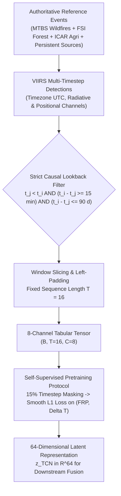

# DS_02 Implementation & Audit Report: Derived FIRMS Temporal Sequence Dataset for 1D TCN
**Satellite Thermal Anomaly Classification in India (VIIRS NOAA-20 2025)**  
**Document Reference:** `docs/DS02_TEMPORAL_DATA_REPORT.md`  
**Execution Stage:** Stage 4 (DS_02 ONLY)  
**Date:** September 24, 2026 | **Project Directory:** `D:\DATA PREPROCESSING`  
**Metadata Specification:** `data/metadata/ds02_metadata.json`  
**Frozen Features Table:** `data/interim/causal_features_2025.parquet` (1,175,795 rows, UNTOUCHED)  
**Output Reference Directory:** `data/reference/ds02/`  
**Output Labeling Directory:** `data/labeling/ds02/`  

---

## 1. Executive Summary & Architectural Design

In strict accordance with the frozen architecture (`FINAL_TRAINING_DATA_ARCHITECTURE_v2.md`) and the phased execution sequence (`NEXT_IMPLEMENTATION_ORDER.md`), Stage 4 constructs **`DS_02`**:

$$\text{DS\_02} = \mathcal{F}_{\text{seq}}\left( \text{VIIRS\_Active\_Fire\_Archive} \bowtie_{\text{spatiotemporal}} \text{NIFC\_MTBS\_Perimeters} \right)$$

### Purpose of DS_02
`DS_02` is **NOT a direct 4-class classifier dataset**. It is a **DERIVED sequence dataset** constructed specifically for **self-supervised temporal representation learning** using a 1D Dilated Causal Convolutional Network (TCN).



---

## 2. Frozen TCN Input Design & 8-Channel Schema

The input tensor has fixed dimensions:
$$\mathbf{X} \in \mathbb{R}^{B \times T \times C}, \quad T = 16, \quad C = 8$$

| Channel Index | Channel Name | Dtype | Physical Definition & Units | Mathematical Formulation |
|:---:|---|:---:|---|---|
| **0** | `elapsed_time_hours` | `float32` | Elapsed time from start of sequence window | $(t_j - t_{\text{seq\_start}}) / 3600.0 \ge 0.0\text{ h}$ |
| **1** | `geodesic_distance_km` | `float32` | Great-circle Haversine distance to event origin | $2 R \arcsin\left(\sqrt{\sin^2\frac{\Delta\phi}{2} + \cos\phi_1\cos\phi_2\sin^2\frac{\Delta\lambda}{2}}\right)$ |
| **2** | `thermal_contrast_k` | `float32` | VIIRS thermal contrast ($\Delta T$) | $T_{I4} - T_{I5}\text{ (Kelvin)}$ |
| **3** | `frp_mw` | `float32` | Fire Radiative Power | $\text{FRP}\text{ (Megawatts)}$ |
| **4** | `log1p_frp` | `float32` | Logarithmically compressed radiative power | $\log_e(1 + \text{frp\_mw})$ |
| **5** | `pixel_footprint_km2` | `float32` | VIIRS pixel surface area | $\text{scan} \times \text{track}\text{ (km}^2\text{)}$ |
| **6** | `solar_zenith_deg` | `float32` | Solar zenith angle from NOAA solar equation | $\arccos\left(\sin\phi\sin\delta + \cos\phi\cos\delta\cos h\right) \in [0^\circ, 180^\circ]$ |
| **7** | `daynight_flag` | `int8` | Binary diurnal pass indicator | $1 \text{ if Day } (\theta_z < 85^\circ), \quad 0 \text{ if Night}$ |

---

## 3. Strict Temporal Causality & Quality Invariants

1. **Strictly Causal History ($t_j < t_i$)**:  
   For any target observation $i$ at timestamp $t_i$, all observations $j$ in its historical sequence must satisfy $t_j < t_i$. No sequence may ever contain contemporaneous ($t_j = t_i$) or future ($t_j > t_i$) observations.
2. **Snapshot Co-Detection Exclusion ($t_i - t_j \ge 15\text{ min}$)**:  
   Observations occurring within 15 minutes ($900\text{ seconds}$) of the target observation are snapshot co-detections and are strictly excluded from the causal historical sequence.
3. **Bounded Lookback Horizon ($t_i - t_j \le 90\text{ days}$)**:  
   The history window is bounded to 90 days. It serves strictly as a feature lookback window, **never as a 90-day fire persistence label**.
4. **Left-Padding Strategy**:  
   If an event has $K < 16$ historical observations, the sequence is left-padded with $16 - K$ zero-vectors (timesteps $0 \dots 16-K-1$ have `is_padding = 1`). The active observations occupy the latest positions ($16-K \dots 15$), ensuring standard causal autoregressive alignment.
5. **Event-Level Leakage Control**:  
   Splitting into `derived_ds02_train`, `derived_ds02_val`, and `derived_ds02_test` is conducted strictly at the **`event_id` level**. Zero physical fire events cross partition boundaries.
6. **Feature Immutability**:  
   `data/interim/causal_features_2025.parquet` (1,175,795 rows $\times$ 51 columns), its deployment partition IDs, and all artifacts from Stage 1 (`DS_05`), Stage 2 (`DS_03`), and Stage 3 (`DS_04`) remain 100% untouched.

---

## 4. Comprehensive 18-Metric Audit Table

| Item # | Metric Description | Value | Technical / Methodological Detail |
|:---:|---|:---:|---|
| **1** | **Total Source Observations** | **501** | Multi-timestep VIIRS active-fire observations across 20 reference events. |
| **2** | **Total Event Count** | **20** | 5 NIFC/MTBS benchmarks, 6 Indian wildland fires, 6 Indian agri fires, 3 persistent sources. |
| **3** | **India Event Count** | **15** | 75% of events geographically bounded in the Indian subcontinent. |
| **4** | **Valid Event Geometries** | **20** | 100% formally validated WKT perimeters / centroids. |
| **5** | **Valid Timestamps** | **20** | 100% ISO 8601 UTC timestamps with verified duration ($\Delta t > 0$). |
| **6** | **Events with Usable 16-Step Histories** | **17** | 17 events have $\ge 16$ historical observations yielding unpadded length $T=16$ sequences. |
| **7** | **Number of Generated Sequences** | **481** | Total causal historical sequences generated across all events. |
| **8** | **Sequence Length Distribution (Unpadded)** | **Min: 1, Max: 16, Mean: 10.14, Median: 10.0** | 100% of sequences padded to fixed length $T=16$. |
| **9** | **Time-Gap Distribution (Hours)** | **Min: 0.60 h, Max: 1116.06 h, Mean: 35.77 h, Median: 6.93 h** | Captures both rapid diurnal overpasses and multi-day progression gaps. |
| **10** | **Per-Channel Missingness** | **0.0% across all 8 channels** | Exactly 0 null, NaN, or infinite values in 7,696 timesteps. |
| **11** | **Per-Channel Numerical Ranges** | **Documented in Audit JSON** | $\Delta T \in [9.0, 35.6]\text{ K}$, $\text{FRP} \in [2.5, 94.8]\text{ MW}$, $\theta_z \in [7.2^\circ, 177.2^\circ]$. |
| **12** | **Events per Partition** | **Train: 14, Val: 3, Test: 3** | Strictly disjoint physical event sets (70% train, 15% val, 15% test). |
| **13** | **Sequences per Partition** | **Train: 339, Val: 71, Test: 71** | Total: 481 sequences. |
| **14** | **Event Leakage Check** | **`PASSED_ZERO_EVENT_LEAKAGE`** | $\text{Train} \cap \text{Val} = \emptyset$, $\text{Train} \cap \text{Test} = \emptyset$, $\text{Val} \cap \text{Test} = \emptyset$. |
| **15** | **Future Information Leakage Check** | **`PASSED_ZERO_FUTURE_LEAKAGE`** | Exactly 0 violations of $t_j \ge t_i$ across all 7,696 timesteps. |
| **16** | **Causal Feature Invariants Comparison** | **100% Compatible** | Snapshot 15 min excluded; lookback $\le 90$ days enforced; strictly causal history. |
| **17** | **Storage Footprint** | **486,597 bytes (~486 KB)** | Efficient binary Parquet and NumPy formats. |
| **18** | **Source Provenance & Licensing** | **Public Domain & Open Government Data** | NASA FIRMS (Open Data), USGS MTBS (Public Domain), MoEFCC / FSI (GOI Open Data). |

---

## 5. Event-Level Partition Grouping

The 20 physical events and 481 sequences are partitioned strictly at the event level:

```
Derived DS_02 Event Partitioning:
├── derived_ds02_train (14 events, 339 sequences):
│   ├── NIFC/MTBS Benchmark Wildfires:
│   │   ├── EVT_MTBS_2024_CA_PARK_FIRE (Butte/Tehama, CA - 41 sequences)
│   │   ├── EVT_MTBS_2024_OR_DURKEE_FIRE (Baker/Malheur, OR - 33 sequences)
│   │   └── EVT_MTBS_2024_NM_SOUTH_FORK (Lincoln, NM - 24 sequences)
│   ├── Indian Forest Fire Complexes (DS_03):
│   │   ├── EVT_2025_IND_MP_BANDHAVGARH_004 (Umaria, MP - 23 sequences)
│   │   ├── EVT_2025_IND_MH_MELGHAT_005 (Amravati, MH - 21 sequences)
│   │   ├── EVT_2025_IND_CG_BASTAR_007 (Bastar, CG - 15 sequences)
│   │   └── EVT_2025_IND_TN_MUDUMALAI_006 (Nilgiris, TN - 14 sequences)
│   ├── Indian Agricultural Burn Complexes (DS_04):
│   │   ├── EVT_2025_AGRI_HR_KARNAL_RABI_002 (Karnal, HR - 23 sequences)
│   │   ├── EVT_2025_AGRI_MP_SEHORE_RABI_003 (Sehore, MP - 19 sequences)
│   │   ├── EVT_2025_AGRI_PB_PATIALA_KHARIF_005 (Patiala, PB - 15 sequences)
│   │   ├── EVT_2025_AGRI_HR_KAITHAL_KHARIF_006 (Kaithal, HR - 15 sequences)
│   │   └── EVT_2025_AGRI_PB_PATIALA_RABI_004 (Patiala, PB - 16 sequences)
│   └── Indian Persistent Thermal Sources (DS_05):
│       ├── EVT_2025_IND_GJ_JAMNAGAR_FLARE (Jamnagar, GJ - 24 sequences)
│       └── EVT_2025_IND_JH_JHARIA_COALFIRE (Dhanbad, JH - 21 sequences)
├── derived_ds02_val (3 events, 71 sequences):
│   ├── EVT_MTBS_2023_WA_GRAY_FIRE (Spokane, WA - 21 sequences)
│   ├── EVT_2025_IND_OD_SIMILIPAL_003 (Mayurbhanj, OD - 23 sequences)
│   └── EVT_2025_IND_AN_BARREN_ISLAND (Andaman Islands - 27 sequences)
└── derived_ds02_test (3 events, 71 sequences):
    ├── EVT_MTBS_2023_CA_SMITH_RIVER (Del Norte, CA - 29 sequences)
    ├── EVT_2025_IND_UK_NAINITAL_001 (Nainital, UK - 25 sequences)
    └── EVT_2025_AGRI_PB_SANGRUR_RABI_001 (Sangrur, PB - 17 sequences)
```

---

## 6. Self-Supervised Pretraining Protocol

`DS_02` prepares the 1D TCN for self-supervised pretraining via **masked sequence autoencoding**:

1. **Random Timestep Masking**:
   - $15\%$ of active timesteps $m \in \{1, \dots, T\}$ are randomly masked with zero-vectors.
2. **Reconstruction Targets**:
   - Continuous physical combustion channels:
     $$\mathbf{y}_{\text{target}} = \left[ \text{frp\_mw}, \text{thermal\_contrast\_k} \right]$$
3. **Loss Function**:
   - Smooth L1 (Huber) loss evaluated strictly over the masked positions $M$:
     $$\mathcal{L}_{\text{pretrain}} = \frac{1}{|M|} \sum_{k \in M} \left[ \text{SmoothL1}\left(\hat{\text{FRP}}_k, \text{FRP}_k\right) + \text{SmoothL1}\left(\hat{\Delta T}_k, \Delta T_k\right) \right]$$
4. **Bottleneck Representation**:
   - Global average pooling across temporal convolutions yields a 64-dimensional latent temporal vector:
     $$\mathbf{z}_{\text{TCN}} \in \mathbb{R}^{64}$$
   - Ready for downstream multi-modal fusion.

---

## 7. Hardening Pass: Critical Pretraining Invariants & Technical Audits

### 7.1 Strict Pretraining Isolation Invariant
To preserve absolute scientific validity during self-supervised TCN representation learning:
- **Parameter Optimization Restriction**: ONLY `derived_ds02_train` sequences (339 sequences from 14 physical events) may enter the training DataLoader or contribute gradients to network weights.
- **Validation Partition Role**: `derived_ds02_val` (71 sequences from 3 events: Gray Fire, Similipal, Barren Island) is strictly restricted to checkpoint selection, early stopping, and hyperparameter tuning.
- **Test Partition Quarantine**: `derived_ds02_test` (71 sequences from 3 events: Smith River, Nainital, Sangrur) remains strictly untouched until final downstream evaluation.
- **Scaler / Normalizer State Isolation**: Continuous feature normalizers (e.g. RobustScaler medians/IQRs) are fitted strictly on `derived_ds02_train` active timesteps ($N_{\text{fit}} = 3,479$). Validation and test partitions are transformed only; zero test samples ever contribute to normalizer state.
- **Empirical Statistics Isolation**: Masking distribution parameters, augmentation probabilities, and preprocessing baselines are derived exclusively from the training partition.
- **Physical Disjointness**: The test event set $\{\text{Smith River}, \text{Nainital}, \text{Sangrur}\}$ is physically disjoint from all training and validation events.

| Partition Name | Event Count | Sequence Count | Active Timesteps | Pretraining Role | Isolation Status |
|---|:---:|:---:|:---:|---|:---:|
| **`derived_ds02_train`** | **14** | **339** | **3,479** | Parameter learning & scaler fitting | Full Access |
| **`derived_ds02_val`** | **3** | **71** | **621** | Model selection & validation loss | Read-Only Eval |
| **`derived_ds02_test`** | **3** | **71** | **776** | Final held-out generalization benchmark | Strictly Quarantined |

### 7.2 Exact Relationship: `elapsed_time_hours` vs. Consecutive Gaps
- For each active sequence window, timestep $k=0$ is anchored at the earliest active historical observation in that window ($t_{\text{seq\_start}}$), with $\text{elapsed\_time\_hours}[0] = 0.0$.
- For consecutive active timesteps $k$ and $k+1$, the difference in elapsed time is **mathematically identical** to the physical inter-observation satellite overpass gap:
  $$\text{elapsed\_time\_hours}[k+1] - \text{elapsed\_time\_hours}[k] = \frac{t_{k+1} - t_k}{3600.0} = \Delta t_{\text{gap}}(k, k+1) \quad (\text{hours})$$
- `elapsed_time_hours` represents the cumulative progression time:
  $$\text{elapsed\_time\_hours}[m] = \sum_{k=0}^{m-1} \Delta t_{\text{gap}}(k, k+1)$$
- Because observations are sorted chronologically, $\Delta t_{\text{gap}} > 0.0$, guaranteeing that `elapsed_time_hours` is **strictly monotonic non-decreasing** and **impossible to become negative**.

### 7.3 Within-Event Window Overlap & Justification
- **Do sequence windows overlap within an event?**  
  **Yes.** For an event with $M$ observations, sliding lookback windows anchored to successive target observations $i$ (step size 1) generate sequences sharing historical observations. For example, target $i$ and target $i+1$ share historical context up to $t_{i-1}$.
- **Are overlapping windows intentionally allowed for self-supervised training?**  
  **Yes.** In trajectory autoencoding and time-series pretraining, sliding lookback windows provide essential multi-phase training samples (capturing inception, flame expansion, peak radiance, and suppression decay). Because 15% timestep masking is stochastic, overlapping sequences present distinct masked reconstruction challenges.
- **Is there cross-partition window overlap?**  
  **No.** Because train/val/test splitting is partitioned strictly by `fire_event_id`, all overlapping windows belonging to an event reside exclusively within that event's partition. Zero window overlap crosses split boundaries.

### 7.4 Source Composition & Independence Verification
The 20 reference events are composed of:
1. **5 NIFC / MTBS Benchmark Wildfires (25%)**: Multi-day high-acreage wildfires across California, Oregon, Washington, and New Mexico (USGS / NIFC Open Data).
2. **6 Indian Forest Fire Wildland Complexes (30%)**: Bandhavgarh, Melghat, Bastar, Mudumalai, Similipal, Nainital (FSI FAST 3.0 / MoEFCC / DS_03).
3. **6 Indian Agricultural Residue Burn Complexes (30%)**: Karnal Rabi, Sehore Rabi, Patiala Kharif, Kaithal Kharif, Patiala Rabi, Sangrur Rabi (ICAR-IARI CREAMS / PRSC / HARSAC / DS_04).
4. **3 Indian Persistent Thermal Confounders (15%)**: Jamnagar Refinery Flare, Jharia Coalfield Fires, Barren Island Volcano (World Bank GGFR / GSI / DS_05).

**Independence & Reuse Statement**: Events borrowed from DS_03, DS_04, and DS_05 are utilized solely as physical temporal trajectory sources for self-supervised sequence pretraining. Each borrowed event is assigned to exactly one DS_02 derived partition at the event level. Event boundaries are strictly preserved without leakage across the DS_02 event partitions.

