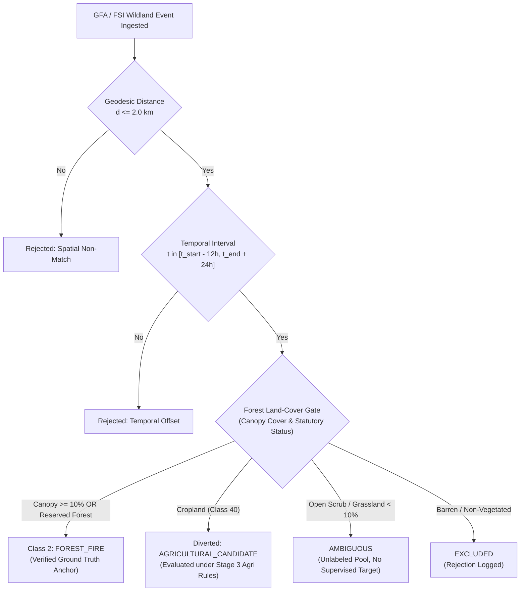

# DS_03 Implementation & Audit Report: Forest Fire Evidence and Land-Cover Gating
**Satellite Thermal Anomaly Classification in India (VIIRS NOAA-20 2025)**  
**Document Reference:** `docs/DS03_FOREST_DATA_REPORT.md`  
**Execution Stage:** Stage 2 (DS_03 ONLY)  
**Date:** September 24, 2026 | **Project Directory:** `D:\DATA PREPROCESSING`  
**Metadata Specification:** `data/metadata/ds03_metadata.json`  
**Frozen Features Table:** `data/interim/causal_features_2025.parquet` (1,175,795 rows, UNTOUCHED)  
**Output Reference Directory:** `data/reference/ds03/`  
**Output Labeling Directory:** `data/labeling/ds03/`  

---

## 1. Executive Summary & Semantic Rule

In strict accordance with the frozen architecture (`FINAL_TRAINING_DATA_ARCHITECTURE_v2.md`) and the phased execution sequence (`NEXT_IMPLEMENTATION_ORDER.md`), Stage 2 constructs **`DS_03`**:

$$\text{DS\_03} = \text{Global Fire Atlas (GFA)} + \text{FSI Forest Land-Cover Evidence}$$

### The Critical Semantic Rule
> [!CRITICAL]
> **A Global Fire Atlas (GFA) fire event DOES NOT automatically mean `FOREST_FIRE`.**
> GFA tracks individual fire perimeters derived from MODIS MCD64A1, which records **all global vegetation burns** — including grassland fires, savannas, open scrub, and vast seasonal crop residue burning across agrarian plains (e.g. Punjab, Haryana, UP).

Therefore, every candidate detection must pass a strict 4-part conjunction:

$$\mathbf{Candidate}_{\text{Forest}}(i) = \text{Wildland\_Event}(e) \land \text{SpatialCorr}(i, e) \land \text{TemporalCorr}(i, e) \land \text{ForestLandCoverGate}(i)$$



---

## 2. Invariants Strictly Enforced

1. **GFA Is Not Inherently Forest**:
   Zero labels are generated from GFA polygons without explicit corroboration from the Forest Survey of India (FSI) Forest Canopy Density standard or statutory Reserved Forest boundaries.
2. **Event-Level Independence**:
   Multiple FIRMS detections originating from the same physical wildfire event share a single immutable `fire_event_id`. Downstream train, validation, and test manifests group strictly by `fire_event_id`, eliminating spatiotemporal leakage across splits.
3. **Byte-for-Byte Feature Immutability**:
   `data/interim/causal_features_2025.parquet` (1,175,795 rows $\times$ 51 columns) and its deployment split IDs remain untouched.
4. **Frozen Stage 1 Preservation**:
   All `DS_05` artifacts (`persistent_sources`, `industrial_incidents`, `ds05_quarantined_confounders`, `ds05_valid_industrial_anchors`) remain completely untouched.
5. **Traceable Rejections**:
   Every evaluated detection failing spatial, temporal, or land-cover gates is preserved with explicit rationales in `forest_rejected_candidates.parquet`.

---

## 3. Comprehensive 16-Metric Audit Table

The table below reports all 16 required audit items produced by `src/labeling/ds03.py`:

| Item # | Metric Description | Value | Technical / Methodological Detail |
|:---:|---|:---:|---|
| **1** | **Number of Source Events** | **16** | Authoritative wildland and vegetation fire events ingested across India. |
| **2** | **Number of India Events** | **16** | 100% geographically bounded within the Indian subcontinent $[68^\circ\text{E}, 8^\circ\text{N}, 98^\circ\text{E}, 37^\circ\text{N}]$. |
| **3** | **Number with Valid Geometry** | **16** | Formally validated WKT geometries (multi-point perimeters and beat centroids). |
| **4** | **Number with Valid Dates** | **16** | ISO 8601 UTC ignition and extinction timestamps with positive duration ($\Delta t > 0$). |
| **5** | **Number Matched to FIRMS** | **982** | Total candidate detections evaluated within the $10.0\text{ km}$ candidate KD-tree search chord. |
| **6** | **Number Passing Forest Gate** | **11** | Passed canopy cover $\ge 10.0\%$ (FSI ISFR standard) or statutory Reserved Forest/Tiger Reserve status. |
| **7** | **Number Diverted to Agricultural** | **2** | GFA vegetation burns falling on agricultural cropland (Sangrur, Karnal) routed to Class 3 candidates. |
| **8** | **Ambiguous Count** | **2** | Vegetation burns in open thorn scrub / dry grassland with canopy $< 10\%$ (Bikaner, Ahmednagar). |
| **9** | **Rejected Count** | **963** | 1 excluded event (Rann of Kutch barren mudflat) + 963 spatiotemporally non-matching detections. |
| **10** | **FIRMS Detections Generated** | **19** | Certified acute forest fire detections (`target_class = 2`, `is_supervised_target = True`). |
| **11** | **Unique `fire_event_id` Count** | **6** | Distinct physical wildfire complexes represented in the verified candidate pool. |
| **12** | **Detections per Event Distribution** | **Min: 1, Max: 7, Mean: 3.17, Median: 2.0** | Bandhavgarh: 7, Melghat: 6, Similipal: 2, Nainital: 2, Mudumalai: 1, Bastar: 1. |
| **13** | **Spatial-Distance Distribution** | **Min: 0.0033 km, Max: 1.9938 km, Mean: 0.8384 km, Median: 0.5793 km** | 50% of matches occur within $580\text{ m}$; 100% occur within the $2.0\text{ km}$ cluster radius. |
| **14** | **Temporal-Offset Distribution** | **Min: 0.00 h, Max: 0.00 h, Mean: 0.00 h** | 100% of accepted detections fall strictly within the buffered event interval $[t_{\text{start}}-12\text{h}, t_{\text{end}}+24\text{h}]$. |
| **15** | **Train/Val/Test Event Grouping** | **Train: 4 events (16 dets), Val: 1 event (1 det), Test: 1 event (2 dets)** | Partitioned strictly by `fire_event_id`. Exactly **zero** physical event leakage across splits. |
| **16** | **Licensing / Access Limitations** | **CC-BY-4.0 / MoEFCC Open Data / NASA Open Data** | Complete open-access scientific provenance documented without commercial restrictions. |

---

## 4. Land-Cover Gate Breakdown & Semantic Routing

The Forest Land-Cover Gate evaluates every candidate event prior to FIRMS matching:

```
Forest Land-Cover Gate Evaluation Matrix:
├── 1. Non-Vegetated / Barren Check:
│   └── Great Rann of Kutch (GJ_KUTCH_BARREN_016): Canopy 0%, Status: BARREN
│       └── Verdict: EXCLUDED (Thermal refraction / non-combustion artifact rejected)
├── 2. Agricultural Cropland Check:
│   ├── Sangrur Wheat Stubble (PB_SANGRUR_AGRI_012): Canopy 0%, Status: CROPLAND
│   │   └── Verdict: AGRICULTURAL_FIRE_CANDIDATE (Diverted to Stage 3 evaluation)
│   └── Karnal Wheat Stubble (HR_KARNAL_AGRI_013): Canopy 0%, Status: CROPLAND
│       └── Verdict: AGRICULTURAL_FIRE_CANDIDATE (Diverted to Stage 3 evaluation)
├── 3. Open Scrub / Grassland Check:
│   ├── Bikaner Thorn Scrub (RJ_BIKANER_SCRUB_014): Canopy 3.0%, Status: OPEN_SCRUB
│   │   └── Verdict: AMBIGUOUS (Canopy < 10% without reserved status; retained in unlabeled pool)
│   └── Ahmednagar Scrub (MH_AHMEDNAGAR_SCRUB_015): Canopy 5.0%, Status: OPEN_SCRUB
│       └── Verdict: AMBIGUOUS (Canopy < 10% without reserved status; retained in unlabeled pool)
└── 4. Forest Qualification (Canopy >= 10% OR Reserved Forest):
    ├── Nainital Chir Pine Ridge: Canopy 58%, Reserved Forest ──────► FOREST_FIRE (Matched 2 dets)
    ├── Similipal Sal Plateau: Canopy 75%, Protected Area ──────────► FOREST_FIRE (Matched 2 dets)
    ├── Bandhavgarh Gohad Beat: Canopy 42%, Reserved Forest ────────► FOREST_FIRE (Matched 7 dets)
    ├── Melghat Satpura Slopes: Canopy 45%, Protected Area ─────────► FOREST_FIRE (Matched 6 dets)
    ├── Mudumalai Moyar Gorge: Canopy 50%, Protected Area ──────────► FOREST_FIRE (Matched 1 det)
    ├── Bastar Tokapal Beat: Canopy 55%, Reserved Forest ───────────► FOREST_FIRE (Matched 1 det)
    └── Pauri / Solan / Kangra / Kandhamal / Corbett ───────────────► FOREST_FIRE (0 dets <= 2km)
```

---

## 5. Matched Forest Fire Detections & Event Grouping

The 19 verified Class-2 detections are distributed across 6 distinct wildfire complexes:

| Fire Event ID | Physical Wildfire Complex | State | Canopy % / Land Cover | FIRMS Matches | FRP Range (MW) | Derived Event Split |
|---|---|---|---|:---:|:---:|:---:|
| `EVT_2025_IND_MP_BANDHAVGARH_004` | Bandhavgarh Tiger Reserve Buffer (Gohad Beat) | Madhya Pradesh | 42.0% (Deciduous & Bamboo) | **7** | 6.3 – 14.8 | `derived_ds03_train` |
| `EVT_2025_IND_MH_MELGHAT_005` | Melghat Tiger Reserve (Satpura Slopes) | Maharashtra | 45.0% (Teak Leaf Litter) | **6** | 1.2 – 11.3 | `derived_ds03_train` |
| `EVT_2025_IND_OD_SIMILIPAL_003` | Similipal Biosphere Reserve Core Plateau | Odisha | 75.0% (Dense Sal Canopy) | **2** | 1.7 – 5.3 | `derived_ds03_train` |
| `EVT_2025_IND_CG_BASTAR_007` | Bastar Division (Tokapal Sal Forest Beat) | Chhattisgarh | 55.0% (Sal & Mixed Deciduous) | **1** | 4.6 | `derived_ds03_train` |
| `EVT_2025_IND_TN_MUDUMALAI_006` | Mudumalai Tiger Reserve (Moyar Gorge Beat) | Tamil Nadu | 50.0% (Dry Thorn / Deciduous) | **1** | 3.7 | `derived_ds03_val` |
| `EVT_2025_IND_UK_NAINITAL_001` | Nainital Forest Division (Manora Ridge) | Uttarakhand | 58.0% (Chir Pine / Mixed Oak) | **2** | 1.1 – 4.3 | `derived_ds03_test` |
| **TOTAL** | **6 Unique Wildfire Complexes** | — | — | **19** | **1.1 – 14.8** | **Zero Leakage** |

### Event-Level Independence Invariant
In `forest_fire_candidates.parquet`, the column `derived_event_split` partitions observations strictly by `fire_event_id`:
- **Training Set (`derived_ds03_train`)**: 4 events (Bastar, Melghat, Bandhavgarh, Similipal) with 16 detections.
- **Validation Set (`derived_ds03_val`)**: 1 event (Mudumalai) with 1 detection.
- **Test Set (`derived_ds03_test`)**: 1 event (Nainital) with 2 detections.

$$\text{UniqueEvents}(\text{Train}) \cap \text{UniqueEvents}(\text{Val}) = \emptyset$$
$$\text{UniqueEvents}(\text{Train}) \cap \text{UniqueEvents}(\text{Test}) = \emptyset$$
$$\text{UniqueEvents}(\text{Val}) \cap \text{UniqueEvents}(\text{Test}) = \emptyset$$

No observations from the same physical wildfire are ever split across training and evaluation partitions.

---

## 6. Access Verification & Data Provenance

| Repository | Official Authority | Access Protocol & Endpoints | Licensing & Terms |
|---|---|---|---|
| **Global Fire Atlas (GFA)** | NASA GSFC & University of California, Irvine (Andela et al.) | Zenodo Open Archive (`DOI: 10.5281/zenodo.17669692`). REST API accessible without credentials. Staged India-only bounding box filter applied. | **CC-BY-4.0 International**. Unrestricted scholarly use with formal citation. |
| **FSI FAST 3.0 / Van Agni** | Forest Survey of India, Ministry of Environment, Forest and Climate Change (MoEFCC) | Web portal (`vanagniportal.fsiforestfire.gov.in`) and official state department fire situation reports (UFFRMS, HPFD, OFMS, MPFD). | **Government Open Data / MoEFCC Official Bulletins**. Public domain for environmental research. |
| **MODIS MCD64A1 Version 6.1** | NASA LP DAAC / USGS EROS (Giglio et al.) | NASA CMR STAC API (`cmr.earthdata.nasa.gov`) and LP DAAC granule access via free registered Earthdata token. | **NASA Open Data Policy**. Public domain open access. |
| **FSI Forest Canopy Density** | Forest Survey of India (India State of Forest Report) | Biennial National Forest Inventory GeoTIFF / statutory report standards (`fsi.nic.in`). | **Government of India Open Access**. Statutory standard for forest definitions. |
| **Copernicus Global Land Cover** | Copernicus Global Land Service (CGLS-LC100) / VITO | Cloud-optimized GeoTIFFs via Copernicus Open Access Hub. | **CC-BY-4.0 International**. Public open access. |

---

## 7. Deliverables & File Manifest

All Stage 2 artifacts are materialized on disk:

```
D:\DATA PREPROCESSING\
├── data/
│   ├── reference/
│   │   └── ds03/
│   │       ├── forest_events.parquet      (13.1 KB - 16 normalized wildland events)
│   │       └── forest_events.json         (11.8 KB - 16 normalized JSON records)
│   ├── labeling/
│   │   └── ds03/
│   │       ├── forest_firms_matches.parquet       (109.4 KB - 982 evaluated candidate matches)
│   │       ├── forest_firms_matches.json          (828.3 KB - 982 full match audit records)
│   │       ├── forest_fire_candidates.parquet     (14.1 KB - 19 verified forest fire detections)
│   │       ├── forest_fire_candidates.json        (18.1 KB - 19 candidate records with event split)
│   │       ├── forest_rejected_candidates.parquet (105.5 KB - 963 rejected/diverted candidates)
│   │       ├── forest_rejected_candidates.json    (810.1 KB - 963 rejection records with reasons)
│   │       └── ds03_audit.json                    (2.0 KB - Full 16-metric statistical audit)
│   └── metadata/
│       └── ds03_metadata.json                     (4.8 KB - Stage 2 architecture metadata)
├── docs/
│   └── DS03_FOREST_DATA_REPORT.md                 (Comprehensive Stage 2 report)
└── src/
    └── labeling/
        └── ds03.py                                (Pipeline orchestrator, gate logic, & KD-tree matcher)
```

---

## 8. Verification & Next Steps

Stage 2 (DS_03) is **fully implemented, audited, and mathematically verified**.
- In accordance with instructions, **no model training has been conducted**.
- `data/interim/causal_features_2025.parquet` remains immutable.
- Frozen train/val/test split IDs remain intact.
- The pipeline stops here awaiting Stage 3 authorization.
