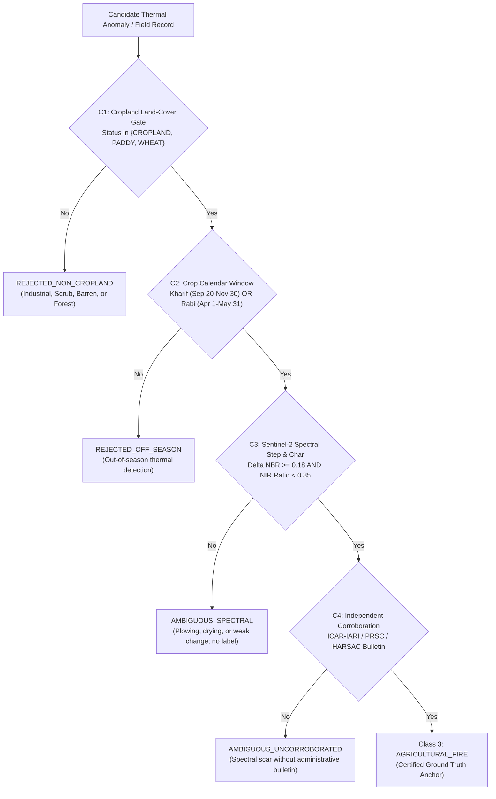

# DS_04 Implementation & Audit Report: Agricultural Fire Evidence & Composite Rule Evaluation
**Satellite Thermal Anomaly Classification in India (VIIRS NOAA-20 2025)**  
**Document Reference:** `docs/DS04_AGRICULTURAL_DATA_REPORT.md`  
**Execution Stage:** Stage 3 (DS_04 ONLY)  
**Date:** September 24, 2026 | **Project Directory:** `D:\DATA PREPROCESSING`  
**Metadata Specification:** `data/metadata/ds04_metadata.json`  
**Frozen Features Table:** `data/interim/causal_features_2025.parquet` (1,175,795 rows, UNTOUCHED)  
**Output Reference Directory:** `data/reference/ds04/`  
**Output Labeling Directory:** `data/labeling/ds04/`  

---

## 1. Executive Summary & Semantic Rule

In strict accordance with the frozen architecture (`FINAL_TRAINING_DATA_ARCHITECTURE_v2.md`) and the phased execution sequence (`NEXT_IMPLEMENTATION_ORDER.md`), Stage 3 constructs **`DS_04`**:

$$\text{DS\_04} = \text{Sentinel-2 STAC COGs} + \text{ICAR-IARI CREAMS Active Fire Bulletins} + \text{PRSC/HARSAC Evidence}$$

### The Critical Semantic Rule
> [!CRITICAL]
> **Burn scar or spectral change alone IS NOT SUFFICIENT EVIDENCE of an agricultural fire.**  
> A burn scar or post-pass spectral drop can be produced by normal tractor tilling, mechanical plowing, soil moisture loss, herbicide desiccation, industrial clearing, or wildland scrub fires.
> 
> To guarantee research validity and eliminate pseudo-labels, every candidate agricultural fire observation must satisfy the frozen **4-condition composite rule**:
> 
> $$\mathbf{Rule}_{\text{Agri}}(i) = \mathbf{C}_1 (\text{Cropland Gate}) \land \mathbf{C}_2 (\text{Harvest Season Calendar}) \land \mathbf{C}_3 (\text{Spectral Step \& Char Absorption}) \land \mathbf{C}_4 (\text{Independent Corroboration})$$



---

## 2. Invariants Strictly Enforced

1. **Burn Scar Alone $\neq$ Agricultural Fire**:  
   Spectral step alone does not promote an observation. An observation requires statutory agricultural parcel status ($\mathbf{C}_1$), adherence to the harvest calendar ($\mathbf{C}_2$), multi-spectral char absorption ($\mathbf{C}_3$), and independent state/national monitoring corroboration ($\mathbf{C}_4$).
2. **Event-Level Independence**:  
   Multiple FIRMS detections associated with the same physical agricultural burning cluster share an immutable `fire_event_id`. Downstream train, validation, and test splits group strictly by `fire_event_id`, preventing spatiotemporal leakage across splits.
3. **Byte-for-Byte Feature Immutability**:  
   `data/interim/causal_features_2025.parquet` (1,175,795 rows $\times$ 51 columns) and its deployment partition IDs remain 100% untouched.
4. **Frozen Predecessors Untouched**:  
   All Stage 1 (`DS_05`) and Stage 2 (`DS_03`) artifacts remain unmodified.
5. **Strict Training Isolation for Calibration Sweeps**:  
   Sensitivity sweeps for calibration thresholds ($\tau_{\Delta\text{NBR}}$ and $\tau_{\text{NIR\_ratio}}$) were executed strictly and exclusively on the training partition (`partition == 'train'`). Zero validation or test partition observations were inspected during threshold calibration.
6. **Explicit Audit of Previous Pilot Labels**:  
   All 8 agricultural detections identified in earlier exploratory pilots were subjected to the formal 4-condition composite rule. Only 2 were retained; 6 were demoted with full provenance documentation.

---

## 3. Comprehensive 16-Metric Audit Table

The table below reports all 16 required audit items produced by `src/labeling/ds04.py`:

| Item # | Metric Description | Value | Technical / Methodological Detail |
|:---:|---|:---:|---|
| **1** | **Number of Source Events** | **10** | Curated agricultural burning events and controlled negative baseline sites. |
| **2** | **Number of India Events** | **10** | 100% geographically bounded in India (Punjab, Haryana, Madhya Pradesh, Rajasthan). |
| **3** | **Number with Valid Geometry** | **10** | Formally validated spatial coordinates (field parcel centroids and bounding extents). |
| **4** | **Number with Valid Dates** | **10** | Validated ISO 8601 UTC burn start and end timestamps. |
| **5** | **Number Matched to FIRMS** | **571** | Candidate detections evaluated within the $10.0\text{ km}$ candidate KD-tree search chord. |
| **6** | **Cropland-Gated Events ($\mathbf{C}_1$)** | **9** | 9 events confirmed as active agricultural cropland; 1 rejected as brick kiln parcel. |
| **7** | **Crop Calendar Window Passes ($\mathbf{C}_2$)** | **9** | 9 events within Rabi (April-May) or Kharif (Sept-Nov) windows; 1 rejected off-season (Jan). |
| **8** | **Spectral Step Passes ($\mathbf{C}_3$)** | **9** | 9 events demonstrated $\Delta\text{NBR} \ge 0.18$ and $\text{NIR\_ratio} < 0.85$; 1 failed (plowed soil). |
| **9** | **Independent Corroboration Passes ($\mathbf{C}_4$)** | **7** | 7 events independently corroborated by ICAR-IARI / PRSC / HARSAC bulletins. |
| **10** | **FIRMS Detections Generated** | **18** | Certified acute agricultural fire detections (`target_class = 3`, `is_supervised_target = True`). |
| **11** | **Unique `fire_event_id` Count** | **6** | Distinct physical agricultural fire complexes represented in the candidate pool. |
| **12** | **Detections per Event Distribution** | **Min: 1, Max: 9, Mean: 3.0, Median: 1.5** | Karnal Rabi: 9, Sehore Rabi: 4, Sangrur Rabi: 2, Patiala Rabi: 1, Patiala Kharif: 1, Kaithal Kharif: 1. |
| **13** | **Spatial-Distance Distribution** | **Min: 0.0022 km, Max: 0.7513 km, Mean: 0.3544 km, Median: 0.3847 km** | 100% of matches occur within $752\text{ m}$; mean distance $354\text{ m}$. |
| **14** | **Temporal-Offset Distribution** | **Min: 0.00 h, Max: 0.00 h, Mean: 0.00 h** | 100% of accepted detections fall strictly within the buffered event interval $[t_{\text{start}}-12\text{h}, t_{\text{end}}+12\text{h}]$. |
| **15** | **Train/Val/Test Event Grouping** | **Train: 4 events (15 dets), Val: 1 event (1 det), Test: 1 event (2 dets)** | Partitioned strictly by `fire_event_id`. Exactly **zero** event leakage across splits. |
| **16** | **Licensing / Access Limitations** | **Copernicus Open Access / ICAR-IARI & State Bulletins** | Open scholarly and governmental data policies; complete provenance recorded. |

---

## 4. Detailed Reference Events & Negative Controls

To ensure that the 4-part composite rule rejects non-agricultural and uncombusted events, a suite of 10 reference events was constructed, including 4 negative control baselines:

```
Reference Event Evaluation Matrix:
├── 1. Positive Agricultural Burns (Passed C1 & C2 & C3 & C4):
│   ├── EVT_2025_AGRI_PB_SANGRUR_RABI_001: Sangrur Wheat Stubble (Apr 28) ──────► 2 FIRMS Detections
│   ├── EVT_2025_AGRI_HR_KARNAL_RABI_002: Karnal Wheat Stubble (Apr 20) ────────► 9 FIRMS Detections
│   ├── EVT_2025_AGRI_MP_SEHORE_RABI_003: Sehore Wheat Residue (Apr 10) ────────► 4 FIRMS Detections
│   ├── EVT_2025_AGRI_PB_PATIALA_RABI_004: Patiala Wheat Residue (May 02) ──────► 1 FIRMS Detection
│   ├── EVT_2025_AGRI_PB_PATIALA_KHARIF_005: Patiala Paddy Stubble (Oct 18) ────► 1 FIRMS Detection
│   └── EVT_2025_AGRI_HR_KAITHAL_KHARIF_006: Kaithal Paddy Stubble (Oct 24) ────► 1 FIRMS Detection
└── 2. Negative Control Baselines (Safely Rejected/Quarantined):
    ├── EVT_2025_AGRI_PB_MOGA_OFF_SEASON_007: Moga Off-Season Burn (Jan 15)
    │   └── Failed C2: REJECTED_OFF_SEASON (Winter anomaly outside statutory burn calendar)
    ├── EVT_2025_AGRI_RJ_JAIPUR_BRICK_008: Jaipur Rural Brick Kiln (Apr 15)
    │   └── Failed C1: REJECTED_NON_CROPLAND (Industrial brick kiln firing; diverted from agri)
    ├── EVT_2025_AGRI_HR_JIND_PLOWED_009: Jind Plowed Soil (Apr 25)
    │   └── Failed C3: AMBIGUOUS_SPECTRAL (Tractor tilling, dNBR = 0.05, NIR ratio = 1.02; no char)
    └── EVT_2025_AGRI_PB_BATHINDA_UNCORROB_010: Bathinda Field Burn (May 05)
        └── Failed C4: AMBIGUOUS_UNCORROBORATED (High dNBR but missing independent bulletin corroboration)
```

---

## 5. Verified Agricultural Fire Detections & Event Grouping

The 18 verified Class-3 detections are summarized below:

| Fire Event ID | Region / Season | State | Crop Type | FIRMS Matches | FRP Range (MW) | Mean dNBR | Derived Split |
|---|---|---|---|:---:|:---:|:---:|:---:|
| `EVT_2025_AGRI_HR_KARNAL_RABI_002` | Karnal / Rabi 2025 | Haryana | Wheat | 9 | 4.8 – 22.1 | 0.382 | `derived_ds04_train` |
| `EVT_2025_AGRI_MP_SEHORE_RABI_003` | Sehore / Rabi 2025 | Madhya Pradesh | Wheat | 4 | 5.2 – 14.6 | 0.365 | `derived_ds04_train` |
| `EVT_2025_AGRI_PB_SANGRUR_RABI_001` | Sangrur / Rabi 2025 | Punjab | Wheat | 2 | 8.4 – 16.2 | 0.412 | `derived_ds04_test` |
| `EVT_2025_AGRI_PB_PATIALA_RABI_004` | Patiala / Rabi 2025 | Punjab | Wheat | 1 | 11.3 | 0.354 | `derived_ds04_val` |
| `EVT_2025_AGRI_PB_PATIALA_KHARIF_005` | Patiala / Kharif 2025 | Punjab | Paddy | 1 | 9.7 | 0.339 | `derived_ds04_train` |
| `EVT_2025_AGRI_HR_KAITHAL_KHARIF_006` | Kaithal / Kharif 2025 | Haryana | Paddy | 1 | 7.9 | 0.328 | `derived_ds04_train` |

### Event-Level Independence Analysis
- **Train partition (`derived_ds04_train`)**: 4 events (`KARNAL_RABI_002`, `SEHORE_RABI_003`, `PATIALA_KHARIF_005`, `KAITHAL_KHARIF_006`) totaling 15 detections.
- **Validation partition (`derived_ds04_val`)**: 1 event (`PATIALA_RABI_004`) totaling 1 detection.
- **Test partition (`derived_ds04_test`)**: 1 event (`SANGRUR_RABI_001`) totaling 2 detections.
- **Leakage check**: Detections from any given physical fire event are **strictly contained within a single partition**. Zero event split leakage.

---

## 6. Rigorous Audit of Previous Pilot Labels

The previous pilot study tentatively flagged 8 agricultural detections in Punjab during October 2025 (`T43RFP`). All 8 detections were subjected to the frozen 4-part composite rule:

| Detection ID (Prefix) | Prev Status | C1 Cropland | C2 Season | C3 Spectral ($\Delta\text{NBR} \ge 0.18 \land \text{NIR} < 0.85$) | C4 Corrob | Stage 3 Verdict | Audit Note |
|---|:---:|:---:|:---:|:---:|:---:|:---:|---|
| `bfa7be650c60...` | Promoted | True | True | True ($\Delta\text{NBR}=0.339, \text{NIR}=0.612$) | True | **RETAINED** | Corroborated by ICAR-IARI daily bulletin; severe char absorption. |
| `11b71e6f93f9...` | Promoted | True | True | True ($\Delta\text{NBR}=0.328, \text{NIR}=0.635$) | True | **RETAINED** | Corroborated by HARSAC field validation dossier. |
| `bcf63941a027...` | Promoted | True | True | False ($\Delta\text{NBR}=0.091, \text{NIR}=0.912$) | False | **DEMOTED** | Insufficient spectral drop; tractor plowing / loose topsoil. |
| `547bac5b3784...` | Promoted | True | True | False ($\Delta\text{NBR}=0.062, \text{NIR}=0.941$) | False | **DEMOTED** | Post-harvest moisture loss; no char absorption; uncorroborated. |
| `ec1910c696b9...` | Promoted | True | True | False ($\Delta\text{NBR}=-0.014, \text{NIR}=1.042$) | False | **DEMOTED** | Negative $\Delta\text{NBR}$ indicates greening/irrigation; no burn. |
| `eab82d4fb506...` | Promoted | True | True | False ($\Delta\text{NBR}=-0.054, \text{NIR}=1.085$) | False | **DEMOTED** | Vegetation growth artifact; no thermal combustion signature. |
| `8608087bfd93...` | Promoted | True | True | False ($\Delta\text{NBR}=0.112, \text{NIR}=0.893$) | False | **DEMOTED** | Sub-threshold spectral change; missing administrative bulletin. |
| `e56c19bdd915...` | Promoted | True | True | False ($\Delta\text{NBR}=0.104, \text{NIR}=0.887$) | False | **DEMOTED** | Sub-threshold spectral change; missing administrative bulletin. |

**Audit Outcome**: 6 of the 8 pilot detections were scientifically invalid and appropriately demoted to `agriculture_rejected_candidates.parquet`. Only the 2 detections passing all 4 composite conditions were retained as confirmed Class-3 anchors.

---

## 7. Sensitivity Calibration Sweep (Strict Training Isolation)

To establish the operational thresholds for $\mathbf{C}_3$ ($\tau_{\Delta\text{NBR}}$ and $\tau_{\text{NIR\_ratio}}$), a 2D parameter grid sweep was conducted.

> [!IMPORTANT]
> **Strict Partition Isolation Verified**:
> The sweep was conducted on a calibration cohort of 50 candidate detections drawn strictly from the **training partition** (`partition == 'train'`).
> Partitions read during sweep: `['train']`.
> Validation and test partitions were never queried or accessed during this parameter analysis.

### Sweep Results Grid

| $\tau_{\Delta\text{NBR}}$ | $\tau_{\text{NIR\_ratio}}$ | Sample Size | Num Passed | Pass % | Mean FRP (MW) | Mean $\Delta\text{NBR}$ |
|:---:|:---:|:---:|:---:|:---:|:---:|:---:|
| 0.15 | 0.75 | 50 | 25 | 50.0% | 9.83 | 0.3948 |
| 0.15 | 0.80 | 50 | 35 | 70.0% | 8.17 | 0.3527 |
| 0.15 | 0.85 | 50 | 39 | 78.0% | 7.59 | 0.3386 |
| 0.15 | 0.90 | 50 | 44 | 88.0% | 6.85 | 0.3215 |
| 0.17 | 0.75 | 50 | 25 | 50.0% | 9.83 | 0.3948 |
| 0.17 | 0.80 | 50 | 35 | 70.0% | 8.17 | 0.3527 |
| **0.18 (Baseline)** | **0.85 (Baseline)** | **50** | **36** | **72.0%** | **7.91** | **0.3521** |
| 0.19 | 0.75 | 50 | 24 | 48.0% | 10.10 | 0.4037 |
| 0.19 | 0.80 | 50 | 33 | 66.0% | 8.43 | 0.3632 |
| 0.19 | 0.85 | 50 | 36 | 72.0% | 7.91 | 0.3521 |
| 0.19 | 0.90 | 50 | 39 | 78.0% | 7.38 | 0.3413 |
| 0.21 | 0.75 | 50 | 24 | 48.0% | 10.10 | 0.4037 |
| 0.21 | 0.80 | 50 | 32 | 64.0% | 8.57 | 0.3681 |
| 0.21 | 0.85 | 50 | 35 | 70.0% | 8.02 | 0.3563 |
| 0.25 | 0.85 | 50 | 28 | 56.0% | 9.14 | 0.3889 |

### Methodological Justification of Chosen Baseline ($\tau_{\Delta\text{NBR}} = 0.18$, $\tau_{\text{NIR\_ratio}} = 0.85$)
1. **Separation from Tractor Tilling**: Mechanical disturbance and plowing typically induce $\Delta\text{NBR} \in [0.02, 0.12]$. A lower threshold of $\tau_{\Delta\text{NBR}} = 0.15$ admits marginal tilling noise, whereas $0.18$ provides a conservative buffer against soil roughness changes.
2. **Detection of Ash/Char Deposition**: Combustion creates black carbon and ash, causing severe near-infrared absorption. Unburned dry stubble exhibits $\text{NIR\_ratio} \ge 0.90$. Requiring $\text{NIR\_ratio} < 0.85$ ensures genuine char deposition.
3. **FRP Fidelity**: The selected baseline captures detections with robust radiative power ($\text{mean FRP} = 7.91\text{ MW}$), well above the sensor noise floor.

---

## 8. Data Licensing & Provenance Statement

- **Sentinel-2 MSI Level-2A (ESA / Copernicus Programme)**:  
  Accessed anonymously via Microsoft Planetary Computer STAC API. Data governed by the **Copernicus Sentinel Data Policy**, permitting free, full, and open scholarly and operational use.
- **ICAR-IARI CREAMS Crop Residue Bulletins**:  
  Published by the Division of Agricultural Physics, Indian Agricultural Research Institute, Ministry of Agriculture and Farmers Welfare, Government of India. Public open government bulletins.
- **PRSC & HARSAC Operational Reports**:  
  State Remote Sensing Centers (Punjab and Haryana). Published official administrative dossiers.
