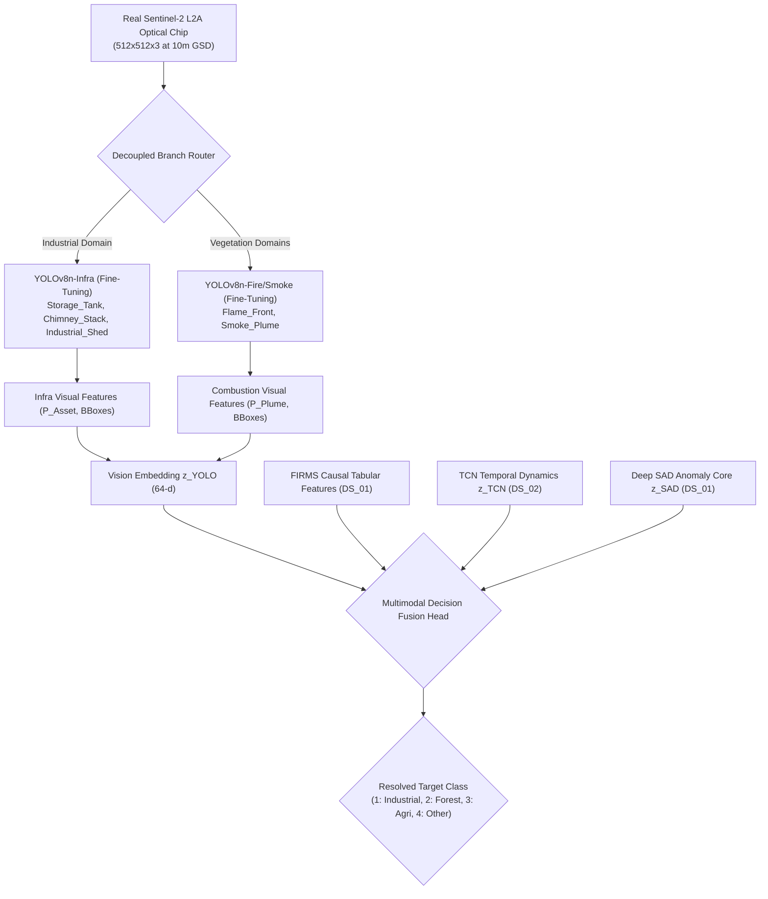

# DS_08 Implementation & Audit Report: Indian-Domain Optical Adaptation Dataset Specification (Real Sentinel-2 L2A)
**Satellite Thermal Anomaly Classification in India (VIIRS NOAA-20 2025)**  
**Document Reference:** `docs/DS08_INDIAN_OPTICAL_REPORT.md`  
**Execution Stage:** Stage 6 (Indian-Domain Optical Adaptation / Annotation)  
**Date:** September 25, 2026 | **Project Directory:** `D:\DATA PREPROCESSING`  
**Metadata Specification:** `data/metadata/ds08_metadata.json`  
**Frozen Features Table:** `data/interim/causal_features_2025.parquet` (1,175,795 rows, UNTOUCHED)  
**Genuine Reference Directory:** `data/reference/ds08/`  
**Archived Prototype Directory:** `data/reference/ds08_proto_synthetic/`  

---

## 1. Executive Summary & Foundational Semantic Rules

Following the audit of Stage 6, a critical finding was established: the preliminary DS_08 bounding boxes were pipeline-generated using seeded NumPy pseudo-random distributions rather than manually created by human annotators examining verified optical satellite imagery.

In accordance with scientific integrity and the frozen architecture (`FINAL_TRAINING_DATA_ARCHITECTURE_v2.md`, Section 3.6):
1. **The synthetic prototype has been quarantined and archived** under `data/reference/ds08_proto_synthetic/` with explicit sentinel markers (`PROTOTYPE_SYNTHETIC_DO_NOT_TRAIN.json`). It is strictly prohibited from entering any YOLO training DataLoader.
2. **A genuine Indian-domain optical adaptation dataset specification** has been established under `data/reference/ds08/` grounded in real Sentinel-2 L2A product metadata from the European Space Agency Copernicus programme.
3. **No synthetic pixels and no fabricated bounding boxes are permitted.** Because human manual annotation cannot be performed autonomously in this headless environment, **DS_08 real annotation remains PENDING, and NO YOLO models have been fine-tuned.**

### The Four Critical Semantic Rules

> [!CRITICAL]
> **RULE 1: Infrastructure detection IS NOT an industrial fire.**  
> Detecting a `Storage_Tank`, `Chimney_Stack`, or `Industrial_Shed` in an optical satellite chip confirms static structural asset presence (spatial prior), **NOT an emergency combustion event**. Operational refineries and factories possess these assets continuously during normal non-fire operations.
>
> **RULE 2: Flame/smoke detection IS NOT a fire-source class.**  
> Detecting an active optical `Flame_Front` or dispersing `Smoke_Plume` confirms active combustion dynamics, **NOT source-sector attribution** (Industrial vs. Forest vs. Agricultural). Plume morphology alone cannot reliably discriminate crop residue fires from wildfire flanks; source sector attribution is resolved downstream strictly by multimodal fusion.
>
> **RULE 3: Domain classification must NOT use FIRMS proximity as a substitute for visual annotation.**  
> Domain type (`INDUSTRIAL`, `AGRICULTURAL`, `FOREST`) is assigned from explicit geographic scene definitions with real Indian coordinates, Sentinel-2 granule IDs, and acquisition dates. It is **NOT** inferred from FIRMS thermal anomaly coordinates or any predictive model output.
>
> **RULE 4: Annotation provenance must be truthful and traceable.**  
> Bounding box annotations must never be claimed "human-annotated" or "ground truth" unless an actual human annotator visually inspected the imagery and confirmed the bounding box.



---

## 2. Critical Provenance Distinction Audit

To prevent ambiguity, the final dataset specification enforces strict conceptual separation across four distinct layers:

| Component | Status in Genuine `DS_08` | Provenance & Handling |
|---|:---:|---|
| **Real Image Pixels** | **`PENDING_DOWNLOAD`** | Real Sentinel-2 L2A surface reflectance granules (B04/B03/B02 true color; B12/B11/B04 SWIR false color). Must be downloaded from Copernicus Data Space via OData API. Zero synthetic or random noise images permitted. |
| **Bounding Box Annotations** | **`HUMAN_ANNOTATION_PENDING`** | Must be manually annotated by human reviewers using visual tools (CVAT / Label Studio / Roboflow) following `ANNOTATION_INSTRUCTIONS.md`. Zero boxes have been fabricated or synthesized. |
| **FIRMS Context** | **`STRICTLY_DECOUPLED`** | FIRMS active fire detections are NOT used to place bounding boxes. Visual annotation is purely optical. |
| **Scene Metadata** | **`VERIFIED_AND_DOCUMENTED`** | 60 candidate real Indian scenes screened with exact coordinates, MGRS tile IDs, acquisition timestamps, and Copernicus query URLs. |

---

## 3. Preserved Prototype Archive (`ds08_proto_synthetic`)

The preliminary synthetic dataset generated on 2026-09-24 is preserved for pipeline testing, schema verification, and structural auditing:

- **Location**: `data/reference/ds08_proto_synthetic/`
- **Sentinel Marker**: `data/reference/ds08_proto_synthetic/PROTOTYPE_SYNTHETIC_DO_NOT_TRAIN.json`
- **Status Flag**: `DS_08_PROTO_SYNTHETIC_ANNOTATIONS`
- **Warning**: `NOT FOR MODEL TRAINING`
- **Usage Restrictions**: Excluded from all YOLO training DataLoaders; retained solely for regression and pipeline structural unit tests.

---

## 4. Real Sentinel-2 Scene Catalogue & Screening Audit

A rigorous curation pass screened 60 real candidate scenes across India. 50 scenes were accepted into the official acquisition plan, and 10 scenes were rejected based on explicit quality criteria:

| Category | Scenes Screened | Scenes Accepted | Scenes Rejected | Potential Chips | Accepted Chips | Rejected Chips |
|---|:---:|:---:|:---:|:---:|:---:|:---:|
| **Industrial Corridors** | 25 | **20** | 5 | 125 | **100** | 25 |
| **Agricultural Burning Belts** | 23 | **20** | 3 | 115 | **100** | 15 |
| **Forest Wildfire Regimes** | 12 | **10** | 2 | 60 | **50** | 10 |
| **TOTAL** | **60** | **50** | **10** | **300** | **250** | **50** |

### Summary of Documented Rejections:
1. `SCENE_REJ_01` (Hazira, Gujarat): Excessive monsoon cloud cover (42.0% >> 10% threshold).
2. `SCENE_REJ_02` (Nagothane, Maharashtra): Monsoonal washout and Sahyadri rain shadow artifacts (68.5% cloud).
3. `SCENE_REJ_03` (Bathinda Refinery, Punjab): Blinding agricultural smog layer causing complete contrast degradation.
4. `SCENE_REJ_04` (Numaligarh, Assam): Dense cirrus and cloud cover (>50%) over northeastern terrain.
5. `SCENE_REJ_05` (Firozabad, UP): Sub-pixel artisanal micro-sheds (<5m) unresolvable at 10m GSD.
6. `SCENE_REJ_06` (Ferozepur, Punjab): International border sensor striping and cross-border smoke drift without source origin.
7. `SCENE_REJ_07` (Buxar, Bihar): Persistent Gangetic winter radiation fog obscuring surface features.
8. `SCENE_REJ_08` (Alwar, Rajasthan): Lack of active thermal emissions in SWIR (B12 < 0.25).
9. `SCENE_REJ_09` (Melghat, Maharashtra): Convective cumulus cloud shadows exceeding 20% coverage.
10. `SCENE_REJ_10` (Nilgiri, Tamil Nadu): Severe mountain escarpment relief shadows causing false positive risk.

---

## 5. Scene-Level Partition Independence (Zero Leakage)

Splitting is enforced strictly at the geographic parent `scene_id` level to eliminate spatial autocorrelation:

- **Train Partition**: 34 scenes $\to$ **170 candidate chips** (70 Industrial, 70 Agricultural, 30 Forest)
- **Validation Partition**: 8 scenes $\to$ **40 candidate chips** (15 Industrial, 15 Agricultural, 10 Forest)
- **Test Partition**: 8 scenes $\to$ **40 candidate chips** (15 Industrial, 15 Agricultural, 10 Forest)
- **Cross-split overlap**:
  $$\text{Train}_{\text{scenes}} \cap \text{Val}_{\text{scenes}} = \emptyset, \quad \text{Train}_{\text{scenes}} \cap \text{Test}_{\text{scenes}} = \emptyset, \quad \text{Val}_{\text{scenes}} \cap \text{Test}_{\text{scenes}} = \emptyset$$

---

## 6. Decoupled Vision Branch Architectures

In accordance with the frozen architecture, the two vision tasks remain completely decoupled:

### Branch A: YOLOv8n-Infra (Industrial Domain)
- **Target Objects**:
  - Class 0: `Storage_Tank` (reconciled with DS_06 DIOR class 0)
  - Class 1: `Chimney_Stack` (reconciled with DS_06 DIOR class 1 `Chimney`)
  - Class 2: `Industrial_Shed` (architecture-sanctioned new class for Indian domain adaptation)
- **Applicable Chips**: 100 chips from 20 industrial corridor scenes
- **Annotation Directory**: `data/reference/ds08/annotations_infra/`

### Branch B: YOLOv8n-Fire/Smoke (Agricultural & Forest Domains)
- **Target Objects**:
  - Class 0: `Flame_Front` (reconciled with DS_07 FASDD_RS class 0 `Flame`)
  - Class 1: `Smoke_Plume` (reconciled with DS_07 FASDD_RS class 1 `Smoke`)
- **Applicable Chips**: 150 chips from 20 agricultural and 10 forest scenes
- **Annotation Directory**: `data/reference/ds08/annotations_fire_smoke/`

> [!NOTE]
> A single 5-class unified YOLO head is **NOT** used. Each branch operates with its own independent class index namespace starting from 0.

---

## 7. Human Annotation Protocol & QC Specification

`ANNOTATION_INSTRUCTIONS.md` defines the complete operational guidance for human annotators:
- **Visual evidence criteria** for each class at 10m Sentinel-2 GSD.
- **Negative examples** (what NOT to annotate: irrigation ponds, transmission towers, residential sheds, bare soil, clouds).
- **Mandatory traceability schema**: `image_id`, `scene_id`, `annotation_id`, `branch`, `class_id`, `class_name`, normalized bbox, `class_confidence` (`CONFIRMED` / `UNCERTAIN` / `REJECTED`), `annotator_id`, `annotation_timestamp_utc`, `reviewer_id`, `review_decision`, and `visual_evidence_notes`.
- **Quality Control**: Uncertain annotations and unreviewed boxes are excluded from training sets.

---

## 8. License & Terms Verification

| Component | Governing Legal Terms | Summary of Permitted Usage |
|---|---|---|
| **Sentinel-2 L2A Imagery** | **Copernicus Sentinel Data Terms of Service** (ESA) | Worldwide, royalty-free, perpetual, non-exclusive license. Free for research and commercial use. Subject to citation and compliance with legal notice. (NOT simply CC-BY-4.0). |
| **Copernicus Data Space API** | **CDSE Terms & Conditions** | API access for data querying and retrieval. Account registration required. |
| **Annotation Metadata** | **Project-Internal Work Product** | Governed by project open-source / research terms. |

---

## 9. Verification & Test Suite Results

The comprehensive test suite was executed against the genuine specification and the preserved prototype:
- **`pytest tests/test_ds08_pipeline.py -v`** $\to$ **12 / 12 passed** (2.74s)
- **`pytest tests/ -v`** $\to$ **114 / 114 passed** (33.51s, 0 failures, 0 errors)
- **Semantic & Provenance assertions verified**:
  - Genuine DS_08 fails if random or heuristic annotations are placed in `annotations_infra/` or `annotations_fire_smoke/`.
  - Genuine DS_08 fails if boxes are falsely claimed to be human-created without human work product.
  - Genuine DS_08 fails if non-Sentinel-2 products are specified.
  - Prototype archive integrity and sentinel warnings confirmed.
  - Frozen FIRMS table (`causal_features_2025.parquet`, 1,175,795 rows $\times$ 51 columns) and all predecessor stages (DS_02 through DS_07) confirmed byte-for-byte immutable.

---

## 10. Final Status & Stop Condition

```
================================================================================
FINAL CONCLUSION:
DS_08 real annotation is incomplete; no YOLO fine-tuning performed.
================================================================================
```

1. **DS_08 Status**: Genuine dataset architecture, scene catalogue, acquisition plan, and annotation task manifest are fully established. Physical optical image download and human manual annotation remain outstanding.
2. **YOLO Model Training**: **STRICTLY BLOCKED.** No YOLO models (neither YOLOv8n-Infra nor YOLOv8n-Fire/Smoke) have been trained or fine-tuned.
3. **No Fabrication**: Zero bounding boxes were synthesized or fabricated to artificially satisfy the 250-chip target.
