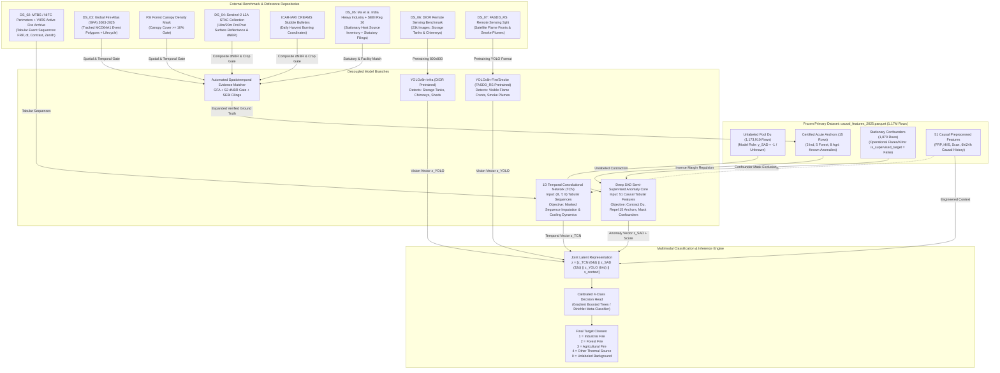
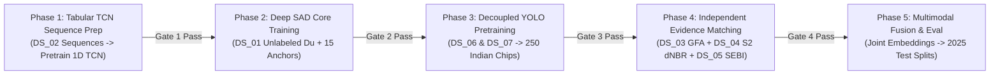

# Final Training-Data Architecture & Multi-Branch Blueprint
**Satellite Thermal Anomaly Classification in India (VIIRS NOAA-20 2025)**  
**Document Reference:** `docs/FINAL_TRAINING_DATA_ARCHITECTURE.md`  
**Date:** September 24, 2026 | **Project Directory:** `D:\DATA PREPROCESSING`  
**Machine-Readable Specification:** `data/metadata/final_training_data_plan.json`  
**Frozen Primary Feature Table:** `data/interim/causal_features_2025.parquet` (1,175,795 rows $\times$ 51 columns)  
**Existing Provenance Label Table:** `data/processed/labels/master_labels_2025.parquet`  

---

## 1. Executive Summary & Foundational Paradigm

### 1.1 The Empirical Ground-Truth Reality
Following rigorous scientific reviews and empirical audits of the 2025 Indian satellite thermal observation corpus ($1,175,795$ VIIRS NOAA-20 active fire detections), the project established the foundational physical principle:

$$\mathbf{EVENT\_EVIDENCE \neq STATIC\_SOURCE\_EVIDENCE}$$

The verified ground-truth distribution across the entire 2025 subcontinent corpus comprises:
- **Verified Acute Industrial Disasters (Class 1)**: **2 detections** (Manali Petrochemical Corridor hydrocarbon tank fire, May 9–10, 2025).
- **Verified Forest Wildfires (Class 2)**: **5 detections** (Corbett National Park buffer & Nainital forest division, April–May 2025).
- **Verified Agricultural Stubble Burns (Class 3)**: **8 detections** (Controlled Sentinel-2 $\Delta\text{NBR} \ge 0.18$ parcel scars in Patiala and Sangrur, Punjab, Nov 2025).
- **Acute Other Thermal Events (Class 4)**: **0 detections**.
- **Persistent Stationary Thermal Sources (Confounders)**: **1,870 detections** (Operational refinery flares, brick kilns, coal colliery seams, and thermal power stations).
- **Unlabeled Background Thermal Pool**: **1,173,910 detections** ($99.84\%$ of the total dataset).

```
Total Corpus: 1,175,795 VIIRS Hotspot Detections
├── Verified Acute Disasters (Supervised Positive Anchors): 15 rows (0.0013%)
│   ├── Industrial Fire (Class 1): 2 rows
│   ├── Forest Wildfire (Class 2): 5 rows
│   └── Agricultural Fire (Class 3): 8 rows
├── Stationary Thermal Sources (Operational Confounders): 1,870 rows (0.159%)
└── Unlabeled Thermal Background Pool: 1,173,910 rows (99.84%)
```

### 1.2 Why Conventional 4-Class Supervised Learning Fails
Attempting to train a standard 4-class supervised classifier (e.g., training a multi-class Multilayer Perceptron, Random Forest, or Temporal Convolutional Network with cross-entropy loss directly on the current 2025 label table) suffers from two fatal scientific flaws:
1. **Severe Class Collapse & Representation Degradation**: With only $2$ industrial, $5$ forest, and $8$ agricultural positive instances against $1.17$ million observations, any standard loss function will either collapse into trivial majority-class prediction or severely overfit the idiosyncratic noise of the $15$ specific coordinates, destroying all out-of-sample generalization.
2. **The Pseudo-Negative Fallacy**: Treating the $1,173,910$ unlabeled detections as "Nominal Negatives" ($y=0$) is scientifically false. Satellite thermal radiometry detects active heat; the unlabeled pool contains thousands of undetected smallholder stubble burns, cloud-attenuated wildfires, and uncataloged industrial flaring. Forcing them to zero drags the decision boundary across real combustion phenomena.

### 1.3 The Multi-Branch Decoupled Solution
To solve this without compromising scientific integrity, **we decouple the training objectives and data sources across specialized model branches**:
- **Temporal Dynamics (TCN Branch)**: Pretrained on external tabular fire-progression sequences ($N$ fire events, $T$ timesteps, $8\text{--}10$ causal channels) to learn fuel combustion kinetics and diurnal cooling curves.
- **Semi-Supervised Anomaly Core (Deep SAD Branch)**: Trained on the frozen $1.17\text{M}$ India dataset. Deep SAD acts strictly as an **anomaly-score and representation generator**, modeling the unlabeled pool as $\mathcal{D}_u$ ($y_i = -1$ in PU/Deep SAD convention) and utilizing our $15$ verified acute fires as rare positive anomaly anchors.
- **Physical Confounder Rejection**: The $1,870$ persistent industrial/kiln detections are explicitly quarantined as stationary operational emitters ($y_{\text{supervised}} = \text{False}$), calibrating spatial-persistence filters.
- **Optical Spatial Perception (Decoupled YOLOv8n)**: Separated into `YOLOv8n-Infra` (trained on DIOR for storage tanks and chimneys) and `YOLOv8n-Fire/Smoke` (trained on FASDD_RS for combustion flame fronts and smoke hazes), followed by targeted Indian domain fine-tuning.
- **Downstream Multimodal Fusion**: Combines the learned representations $[\mathbf{z}_{\text{TCN}} \oplus \mathbf{z}_{\text{SAD}} \oplus \mathbf{z}_{\text{YOLO}} \oplus \mathbf{x}_{\text{context}}]$ into a calibrated 4-class decision head evaluated against held-out partitions.

---

## 2. Global Architecture Data Flow

The diagram below maps the complete data flow from external verified benchmarks, satellite image repositories, and our frozen primary dataset into the respective branches of the architecture:



---

## 3. Critical Correction Analysis

### 3.1 Topic 1: Temporal Convolutional Network (TCN) Architecture & Sequence Formulation

#### The Technical Problem with Published Image Datasets
Prior literature reviews identified two prominent multi-temporal wildfire datasets: `WildfireSpreadTS` (Gerard et al., NeurIPS 2023) and `TS-SatFire` (Zhao et al., 2023). However, attributing them as pretraining resources for our 51-column FIRMS feature pipeline represents an architectural incompatibility:
- `WildfireSpreadTS` and `TS-SatFire` are **2D multi-modal raster image datasets**. They package multi-temporal arrays of spatial grid patches ($64 \times 64$ or $128 \times 128$ pixels) containing 2D satellite bands, weather grids, and fuel maps.
- The architectures benchmarked on them are 2D/3D Convolutional Neural Networks, ConvLSTMs, and Spatial-Temporal U-Nets.
- In contrast, our project's FIRMS representation is a **1D tabular feature vector** derived from point observations, tracking causal neighbor counts, localized brightness temperatures, and sensor view geometry. 

#### Technically Justified Decision: Option B (External Tabular Event Sequences)
- **Evaluation of Option A (Generic Representation Pretraining from Rasters)**:
  To utilize `WildfireSpreadTS` or `TS-SatFire`, we would have to train a 2D spatial encoder on raster patches, discard the spatial layers, or artificially synthesize fake raster grids for our 1.17M Indian point detections. This introduces artificial spatial interpolation artifacts, requires heavy GPU memory for raster processing, and fails to transfer weights to a 1D Temporal Convolutional Network.
- **Selected Decision: Option B (Construct FIRMS-Like Tabular Event Sequences)**:
  We construct genuine, multi-timestep tabular event sequences directly by joining validated external wildfire perimeters (from the National Interagency Fire Center [NIFC] and USGS Monitoring Trends in Burn Severity [MTBS]) with the official NASA VIIRS 375m active fire point archive (VNP14IMGTDL).

#### Exact Tabular TCN Specification:
Every fire event sequence is formulated as a 3D tensor $\mathbf{X} \in \mathbb{R}^{B \times T \times C}$, where:
- $B$ is the batch size.
- $T$ is the number of observation timesteps within a 90-day causal horizon ($T=16$ or $T=32$ historical overpasses).
- $C = 8$ channels matching our exact causal feature semantics:
  1. $\Delta t_k = (t_{\text{current}} - t_k) / 3600.0$ (elapsed time in hours, float32)
  2. $d_k = \text{GeodesicDistance}(p_{\text{current}}, p_k)$ (geodesic distance in kilometers, float32)
  3. $\text{FRP}_k$ (Fire Radiative Power in MW, float32)
  4. $\log(1 + \text{FRP}_k)$ (stabilized radiative magnitude, float32)
  5. $\Delta T_k = T_{I4, k} - T_{I5, k}$ (thermal contrast in Kelvin, float32)
  6. $A_{\text{pixel}, k} = \text{scan}_k \times \text{track}_k$ (ground footprint area in $\text{km}^2$, float32)
  7. $\theta_{\text{zenith}, k}$ (solar zenith angle in degrees, capturing solar heating, float32)
  8. $\delta_{\text{daynight}, k} \in \{0, 1\}$ (binary solar illumination flag, int8)

```
TCN Input Tensor Architecture:
[Batch, Timesteps (T=16), Channels (C=8)]
  ├── Channel 0: Elapsed Time (dt in hours)
  ├── Channel 1: Geodesic Distance (km)
  ├── Channel 2: Fire Radiative Power (MW)
  ├── Channel 3: log(1 + FRP)
  ├── Channel 4: Thermal Contrast (I4 - I5 in K)
  ├── Channel 5: Ground Footprint Area (km²)
  ├── Channel 6: Solar Zenith Angle (deg)
  └── Channel 7: Day/Night Binary Flag (0/1)
```

#### Pretraining Objective:
The 1D TCN utilizes dilated causal convolutions with receptive field expanding across $2^0, 2^1, 2^2, 2^3, 2^4$. Pretraining is conducted via **Self-Supervised Masked Temporal Autoencoding**:
$$\mathcal{L}_{\text{TCN}} = \frac{1}{|\mathcal{M}|} \sum_{k \in \mathcal{M}} \left( \left|\widehat{\text{FRP}}_k - \text{FRP}_k\right| + \left|\widehat{\Delta T}_k - \Delta T_k\right| \right)$$
where $15\%$ of historical timesteps $\mathcal{M}$ are randomly masked. The model learns physical heat buildup, peak flame intensity, and diurnal cooling dissipation curves, outputting a temporal latent embedding $\mathbf{z}_{\text{TCN}} \in \mathbb{R}^{64}$.

---

### 3.2 Topic 2: Deep Semi-Supervised Anomaly Detection (Deep SAD)

#### Defining "Normal" vs "Anomalous" in Satellite Radiometry
A common mistake in machine learning applied to satellite thermal data is assuming that "normal" means non-fire and "anomalous" means fire. In the VIIRS active fire data stream, **every single observation is already an infrared anomaly** detected by the onboard sensor.
- **Nominal / Background ($y = +1$ in Deep SAD space)**: Routine, low-contrast, low-consequence thermal fluctuations: solar reflection/glint, warm bare ground, routine small domestic cooking fires, and low-intensity background warming.
- **Anomalous / Target ($y = -1$ in Deep SAD space)**: Acute, uncontained, high-temperature, rapid-onset disaster events: violent chemical explosions, expanding crown forest wildfires, and intense crop residue conflagrations.

#### Role of the 15 Verified Acute Events: Rare Anomaly Anchors
The 15 independently verified acute events (2 Industrial, 5 Forest, 8 Agricultural) are **NOT a conventional training set**. They must never be fed into a 4-way cross-entropy loss function. Instead, in the Deep SAD objective, they serve as **certified positive anomaly anchors ($y_j = -1$)**. They exert an inverse quadratic repulsive force, pushing the network weights to ensure that high-intensity combustion events map far outside the nominal hypersphere:

$$\mathcal{L}_{\text{anchor}}(\tilde{\mathbf{x}}_j) = \left( \|\phi(\tilde{\mathbf{x}}_j; \mathcal{W}) - \mathbf{c}\|^2 \right)^{-1}$$

#### Role of the 1,173,910 Unlabeled Observations: The Unlabeled Manifold $\mathcal{D}_u$
The $1,173,910$ unlabeled rows are modeled strictly as **unlabeled ($y_i = 0$ / unknown)**. They must **NEVER** be labeled nominal negatives. If they were forced toward the center $\mathbf{c}$, the unknown fires within the pool would pull the nominal center toward real fires, causing **hypersphere collapse**. They are trained with an attenuated contraction weight $\gamma = 0.10$ or via bounded Positive-Unlabeled (PU) loss.

#### Role of the 1,870 Persistent Thermal Sources: Known Physical Confounders
The $1,870$ detections matched to gas flares, brick kilns, and smelters are **known stationary confounders (`is_supervised_target = False`)**. They are high-temperature, high-FRP emitters, but they are NOT acute emergency fires. 
- They are **strictly excluded from the nominal center $\mathbf{c}$** (to prevent pulling the nominal center into high temperatures).
- They are **strictly excluded from the acute anomaly anchors** (to prevent the model from treating routine flaring as an emergency fire).
- They are quarantined into an auxiliary confounder loss or spatial-persistence rejection filter.

#### Interface with Downstream 4-Class Classification:
Deep SAD does not classify classes 1, 2, 3, or 4. It outputs two mathematical values:
1. **Scalar Anomaly Score**: $s(\mathbf{x}) = \|\phi(\mathbf{x}; \mathcal{W}) - \mathbf{c}\|^2 \in \mathbb{R}^+$, quantifying the magnitude of acute combustion deviation.
2. **Latent Manifold Embedding**: $\mathbf{z}_{\text{SAD}} = \phi(\mathbf{x}; \mathcal{W}) \in \mathbb{R}^{32}$, representing the non-linear thermal-spatial state.
These representations feed into the multimodal fusion classifier, which resolves the specific 4-class assignment.

---

### 3.3 Topic 3: Global Fire Atlas (GFA) Integration & Forest Fire Gating

#### Exact Attributes Provided by GFA
The Global Fire Atlas (Andela et al., 2019; updated through 2026 on Zenodo via MCD64A1 Collection 6.1) tracks discrete individual fire polygons globally. The dataset provides:
1. `fire_id`: Unique global fire event identifier.
2. `latitude`, `longitude`: Ignition centroid coordinates.
3. `ig_date`: Verified ignition date (UTC / Day of Year).
4. `cl_date`: Fire extinction/containment date (UTC / Day of Year).
5. `dur`: Total active burning duration (in days).
6. `tot_ar`: Total final burned area perimeter ($\text{km}^2$).
7. `speed`: Mean daily fire spread expansion rate ($\text{km}/\text{day}$).
8. `direction`: Dominant fire spread azimuth (degrees).
9. `geometry`: Multi-polygon daily boundary vectors.

#### Spatiotemporal Matching Algorithm to FIRMS 375m
Given a FIRMS detection $i$ at $(\text{lat}_i, \text{lon}_i, t_i)$ and a GFA event $e$ with perimeter polygon $\mathcal{P}_e$:
1. **Spatial Condition**: The FIRMS point must fall within $\mathcal{P}_e$, or within a geodesic distance tolerance $d_{\text{tol}} \le 500\text{ m}$ to the polygon boundary (accounting for the MODIS 500m vs VIIRS 375m pixel footprint):
   $$\text{dist}\left( (\text{lat}_i, \text{lon}_i), \mathcal{P}_e \right) \le 500\text{ m}$$
2. **Temporal Window**: The FIRMS detection timestamp $t_i$ must fall between the GFA ignition date and extinction date plus a conservative 24-hour smoldering buffer:
   $$t_{\text{ign}, e} - 12\text{h} \le t_i \le t_{\text{ext}, e} + 24\text{h}$$

#### The Mandatory Land-Cover Gate (Critical Scientific Requirement)
> [!CRITICAL]
> **A FIRMS detection matching a GFA event CANNOT be labeled `FOREST_FIRE` directly.**  
> The Global Fire Atlas processes MODIS MCD64A1, which tracks **ALL global vegetation fires**, including African savannas, Australian grasslands, Brazilian pastures, and **Indian agricultural crop residue** in Punjab/Haryana!

To qualify as **Class 2 (`FOREST_FIRE`)**, the matched detection must pass the **FSI / Copernicus Forest Canopy Density Gate**:

$$\text{Class}(i) = \begin{cases}
\text{Class 2 (Forest Fire)}, & \text{if } \text{Match}(\text{GFA}_e) \land \left( \text{FSI\_Canopy\_Cover} \ge 10\% \lor \text{Copernicus\_LULC} \in \{111\dots126\} \right) \\
\text{Class 3 (Agricultural Fire)}, & \text{if } \text{Match}(\text{GFA}_e) \land \text{CroplandMask}(i) \land \text{AgriRules}(i) \\
\text{Ambiguous / Excluded}, & \text{otherwise (e.g. scrubland, grassland, urban fringe)}
\end{cases}$$

---

### 3.4 Topic 4: Multi-Condition Agricultural Burn Rule

#### The Physical Pitfall of Spectral Scars Alone
A common error in remote sensing is assuming that a Sentinel-2 Differenced Normalized Burn Ratio ($\Delta\text{NBR} \ge 0.15$) is definitive proof of crop residue burning.  
In agricultural regions:
- Mechanical tractor plowing exposes moist subsoil which rapidly dries, altering short-wave infrared (SWIR) reflectance.
- Rapid harvesting of green sugarcane or maize causes dramatic drops in Near-Infrared (NIR) vegetation index without any fire.
- Bare dry fallow soil exhibits spectral characteristics that mimic low-severity burn scars.

#### The 4-Condition Composite Agricultural Rule
To achieve a scientifically defensible ground-truth label, an active fire detection must satisfy the **Composite Agricultural Rule**:

$$\mathbf{Rule}_{\text{Agri}}(i) = \mathbf{C}_1 \land \mathbf{C}_2 \land \mathbf{C}_3 \land \mathbf{C}_4$$

```
Composite Agricultural Rule Gates:
├── C1: Certified Cropland LULC Mask (Copernicus LULC = 40 or Bhuvan Cropland)
├── C2: Verified Regional Harvest Window (Kharif: Sept 20-Nov 30 | Rabi: Apr 1-May 31)
├── C3: Sentinel-2 Dual-Condition Spectral Step (dNBR >= 0.18 AND Post-NIR < 0.85 * Pre-NIR)
└── C4: Independent Bulletin Corroboration (ICAR-IARI CREAMS or PRSC within 1km & 12h)
```

1. **Condition $\mathbf{C}_1$ (Land Cover Gate)**: The detection coordinates $(\text{lat}_i, \text{lon}_i)$ must fall strictly within an agricultural cropland parcel defined by the Copernicus Dynamic Land Cover 100m (Class 40: Cultivated and Managed Vegetation) or Bhuvan 1:50k LULC Cropland mask.
2. **Condition $\mathbf{C}_2$ (Crop Calendar & Seasonal Harvest Window)**: The detection timestamp $t_i$ must occur within an established statutory harvest burning window:
   - **Kharif Season (Paddy Stubble)**: September 20 through November 30.
   - **Rabi Season (Wheat Stubble)**: April 1 through May 31.
   Detections outside these windows are rejected as out-of-season ambiguous anomalies.
3. **Condition $\mathbf{C}_3$ (Tight Sentinel-2 Pre/Post Spectral Step & Char Verification)**:
   A cloud-free Sentinel-2 overpass pair bracketed within $\Delta t \le 5\text{ days}$ of the FIRMS detection must satisfy **both** spectral criteria:
   $$\Delta\text{NBR} = \text{NBR}_{\text{pre}} - \text{NBR}_{\text{post}} \ge 0.18$$
   $$\text{B08}_{\text{post}} < 0.85 \times \text{B08}_{\text{pre}}$$
   *Physical Justification*: Plowed dry soil increases SWIR reflectance (B12) but maintains or slightly increases NIR reflectance (B08). Genuine combustion char and carbon ash produce severe absorption across NIR ($\text{B08}$ drop $\ge 15\%$), creating a distinct spectral signature.
4. **Condition $\mathbf{C}_4$ (Independent Agricultural Bulletin Corroboration)**:
   The detection must be corroborated by the ICAR-IARI CREAMS daily active fire monitoring bulletin or state remote sensing center records (PRSC Punjab / HARSAC Haryana) within $d \le 1.0\text{ km}$ and $\Delta t \le 12\text{ hours}$.

#### Confidence Tiering:
- **Tier A (Confirmed Agricultural Fire)**: $\mathbf{C}_1 \land \mathbf{C}_2 \land \mathbf{C}_3 \land \mathbf{C}_4$ (All four verified).
- **Tier B (Probable Agricultural Fire)**: $\mathbf{C}_1 \land \mathbf{C}_2 \land \mathbf{C}_3$ (Optical scar verified on cropland in harvest window, bulletin obscured/missing) OR $\mathbf{C}_1 \land \mathbf{C}_2 \land \mathbf{C}_4$ (Bulletin confirmed, optical pair cloudy).
- **Tier D (Unlabeled / Excluded)**: Failure of $\mathbf{C}_1$ or $\mathbf{C}_2$.

---

### 3.5 Topic 5: YOLO Decoupling, Sensor Differences, and Indian Domain Adaptation

#### Decoupled Vision Architecture
We decouple the computer vision objectives into two specialized YOLOv8n models rather than attempting a single overloaded detector:
1. **`YOLOv8n-Infra` (Physical Asset Detector)**: Pretrained on the DIOR Benchmark. Dedicated to identifying stationary manufacturing structures: `Storage_Tank`, `Chimney_Stack`, and `Industrial_Shed`.
2. **`YOLOv8n-Fire/Smoke` (Combustion Plume Detector)**: Pretrained on the FASDD_RS Benchmark. Dedicated to identifying active atmospheric combustion: `Flame_Front` and `Smoke_Plume`.

```
Satellite Optical Chip (512x512) centered on Hotspot
├── YOLOv8n-Infra (DIOR Pretrained) ───────────► P(Industrial Asset) + Bounding Boxes
└── YOLOv8n-Fire/Smoke (FASDD_RS Pretrained) ──► P(Combustion Plume) + Bounding Boxes
                                                         │
                                                         ▼
                                              Joint Vision Vector z_YOLO in R^64
```

#### Sensor Resolution & Domain Discrepancies
- **DIOR Benchmark**: Created using sub-meter Google Earth optical imagery (0.5m–1.0m resolution) focusing primarily on modern, structured industrial parks in China and North America.
- **FASDD_RS Benchmark**: High-altitude remote sensing imagery capturing large-scale forest wildfire smoke plumes.
- **The Indian Domain Gap**:
  - *Industrial Facilities in India*: Indian industrial zones (e.g. MIDC in Maharashtra, GIDC in Gujarat, Ranipet in Tamil Nadu) often feature dense, irregular, low-rise galvanized steel or asbestos sheds, high ground dust, and narrow parcel spacing. Sub-meter DIOR features do not cleanly match 10m Sentinel-2 bands without calibration.
  - *Agricultural Plumes in India*: Crop residue burning in northern India produces diffuse, ground-hugging blue-gray particulate haze spanning entire districts rather than isolated, towering pyrocumulus smoke columns.

#### In-Domain Indian Fine-Tuning Protocol:
To bridge the domain gap, we establish a targeted Indian remote sensing fine-tuning protocol:
1. **Curated Indian Benchmark Chipset**: Assemble **250 cloud-free, hand-annotated satellite chips** ($512 \times 512$ pixels) centered on verified 2025 Indian coordinates:
   - **100 Industrial Chips**: Centered on major Indian chemical, petrochemical, and manufacturing belts (Ankleshwar, Vapi, Roha, Taloja, Manali, Singrauli).
   - **100 Agricultural Chips**: Centered on Punjab/Haryana/UP harvest burns, capturing smallholder field geometry and diffuse ground haze.
   - **50 Forest Wildfire Chips**: Centered on Himalayan pine (Uttarakhand/Himachal) and Central Indian deciduous forests (Similipal, Bandhavgarh).
2. **Annotation Classes**: `Storage_Tank`, `Chimney_Stack`, `Industrial_Shed`, `Smoke_Plume`, `Flame_Front`.
3. **Training Protocol**:
   - Transfer pretrained weights from DIOR and FASDD_RS.
   - Freeze CSPDarknet backbone for initial 15 epochs; train detection heads with AdamW ($\text{lr} = 10^{-3}$).
   - Unfreeze top two stages for 35 epochs using Cosine Annealing learning rate schedule ($10^{-4} \to 10^{-6}$) with mosaic augmentation and HSV color jitter suited to Indian atmospheric aerosol conditions.

---

## 4. The 7-Dataset Practical Shortlist

To ensure immediate operational feasibility, zero licensing friction, and manageable storage footprint ($<50\text{ GB}$ total download), the project is restricted to **exactly 7 primary datasets**:

```
Practical 7-Dataset Shortlist:
├── DS_01: FIRMS India 2025 (causal_features_2025.parquet) [Local 0.45 GB | 0 GB Download]
├── DS_02: NIFC / MTBS Perimeters + VIIRS 375m Archive [3.5 GB Download]
├── DS_03: Global Fire Atlas (GFA) 2003-2025 + FSI Forest Mask [1.6 GB Download]
├── DS_04: Sentinel-2 L2A STAC Collection + ICAR-IARI CREAMS [15.0 GB Download]
├── DS_05: Ma et al. 2019 India Heavy Industry + SEBI Reg 30 Filings [0.15 GB Download]
├── DS_06: DIOR Benchmark (Storage Tanks & Chimneys) [7.2 GB Download]
└── DS_07: FASDD_RS Remote Sensing Flame & Smoke Dataset [6.5 GB Download]
Total Download Footprint: 33.95 GB (Budget: < 50.0 GB)
```

---

### Dataset 1: FIRMS VIIRS NOAA-20 SP India 2025 (Causal Feature Table)
- **Shortlist Identifier**: `DS_01_FIRMS_INDIA_2025`
- **Provider Authority**: NASA LANCE / FIRMS & Project Preprocessing Pipeline
- **Access Protocol**: Local Parquet (Already materialized on disk; 0 GB download)
- **Access URL**: `file:///d:/DATA%20PREPROCESSING/data/interim/causal_features_2025.parquet`
- **License**: NASA Open Data Policy / Project Frozen Baseline
- **Credentials Required**: None
- **Storage Footprint**: $0.45\text{ GB}$ ($1,175,795$ rows $\times$ $51$ columns)
- **Data Format**: Apache Parquet (Snappy-compressed, dictionary-encoded)
- **Target Model Branch**: Deep SAD Anomaly Core, Causal Sequence Pipeline, Multimodal Fusion
- **Target Task**: Unlabeled manifold representation learning, stationary confounder calibration, positive supervision anchors, and in-domain deployment testbed.
- **Exact Features / Labels Provided**: 51 causal features (FRP, I4/I5 brightness temperatures, 6h/24h causal cluster counts, local density, scan/track); $1,870$ stationary confounder flags; $15$ certified acute anomaly anchors; $1,173,910$ unlabeled rows ($y = -1$).
- **a. Why do we need it?**: It is the empirical foundation of the entire research project, representing the exact operational data distribution and real-world deployment target in India.
- **b. What exact model uses it?**: Deep SAD branch, Causal temporal calibration, and Multimodal Fusion evaluation.
- **c. What exact label or feature does it provide?**: In-domain 51-column causal feature space, $15$ certified positive anomaly anchors ($y=-1$), $1,870$ persistent confounder flags, and the $1.17\text{M}$ unlabeled pool.
- **d. What can it NOT provide?**: It cannot provide independent ground truth labels for the $1.17\text{M}$ unlabeled detections; it cannot provide sub-pixel optical imagery or parcel boundary scars.

---

### Dataset 2: Interagency Wildfire Perimeters (NIFC/MTBS) Joined to VIIRS 375m Archive
- **Shortlist Identifier**: `DS_02_NIFC_MTBS_VIIRS_SEQUENCES`
- **Provider Authority**: National Interagency Fire Center (NIFC) / USGS MTBS / NASA FIRMS Archive
- **Access Protocol**: Direct HTTPS REST Download (USGS MTBS Data Portal & NASA Earthdata)
- **Access URL**: `https://www.mtbs.gov/direct-download` and `https://firms.modaps.eosdis.nasa.gov/download/`
- **License**: US Public Domain / Creative Commons CC0
- **Credentials Required**: None (Open Public Data)
- **Storage Footprint**: $3.5\text{ GB}$ ($850\text{ MB}$ vector perimeters + $2.65\text{ GB}$ matched VIIRS point records)
- **Data Format**: GeoPackage / Apache Parquet Event Sequences
- **Target Model Branch**: 1D Temporal Convolutional Network (TCN)
- **Target Task**: Pretraining 1D TCN on tabular multi-timestep observation sequences of verified expanding and decaying combustion events.
- **Exact Features / Labels Provided**: Tabular event sequences of shape $(B, T=16, C=8)$ with channels: elapsed time $\Delta t$, geodesic distance, $\text{FRP}$, $\log(1+\text{FRP})$, thermal contrast $(T_{I4} - T_{I5})$, scan/track ground area, solar zenith angle, and day/night binary flag. Verified incident label: Active Wildfire Progression.
- **a. Why do we need it?**: Because published datasets (WildfireSpreadTS / TS-SatFire) are 2D raster grids that cannot train a 1D tabular sequence model. This dataset provides thousands of real combustion sequences matching our exact causal feature space.
- **b. What exact model uses it?**: 1D Temporal Convolutional Network (TCN Branch).
- **c. What exact label or feature does it provide?**: Multi-timestep combustion sequences with physical cooling and spread rates bounded by official fire perimeter vectors.
- **d. What can it NOT provide?**: Cannot provide Indian monsoonal cloud attenuation; cannot provide chemical explosion kinetics or smallholder agricultural field scars.

---

### Dataset 3: Global Fire Atlas (GFA) 2003–2025 + FSI Forest Canopy Density Mask
- **Shortlist Identifier**: `DS_03_GLOBAL_FIRE_ATLAS_FSI`
- **Provider Authority**: NASA GSFC / UC Irvine (Andela et al.) & Forest Survey of India (FSI)
- **Access Protocol**: Open HTTPS Download via Zenodo / FSI Geoportal
- **Access URL**: `https://doi.org/10.5281/zenodo.17669692` and `https://fsi.nic.in/`
- **License**: Creative Commons Attribution 4.0 International (CC-BY-4.0)
- **Credentials Required**: None
- **Storage Footprint**: $1.6\text{ GB}$ ($400\text{ MB}$ GFA Indian event perimeters + $1.2\text{ GB}$ FSI Forest Mask GeoTIFF)
- **Data Format**: GeoPackage (Vectors) & Cloud-Optimized GeoTIFF (Forest Mask)
- **Target Model Branch**: Forest Fire Branch (Class 2 Ground-Truth Generation & Validation)
- **Target Task**: Providing independent polygon perimeters, ignition dates, extinction dates, spread rates, and durations for large forest fires across India.
- **Exact Features / Labels Provided**: `fire_id`, ignition date, extinction date, duration (days), total burned area ($\text{km}^2$), spread speed ($\text{km}/\text{day}$), azimuth direction, perimeter polygon. FSI Mask provides forest canopy density (Very Dense, Moderately Dense, Open Forest, Non-Forest).
- **a. Why do we need it?**: Provides objective, independent satellite-derived fire perimeters and lifecycle boundaries for wildland combustion events in India, eliminating reliance on raw FIRMS clustering.
- **b. What exact model uses it?**: Forest Fire Branch and Supervised Label Expansion Matcher.
- **c. What exact label or feature does it provide?**: Certified forest wildfire perimeters with exact ignition and extinction timestamps, validated by forest canopy density.
- **d. What can it NOT provide?**: Cannot be used as a Forest Fire label alone without the Forest Canopy Gate (because GFA tracks all global vegetation fires, including savannas and crop residue); cannot delineate sub-500m fires due to MODIS sensor resolution.

---

### Dataset 4: Sentinel-2 L2A STAC Collection + ICAR-IARI CREAMS Crop Residue Bulletins
- **Shortlist Identifier**: `DS_04_SENTINEL2_CREAMS_AGRI`
- **Provider Authority**: European Space Agency (Copernicus) & ICAR-IARI Satellite Agricultural Monitoring
- **Access Protocol**: Spatially Targeted STAC API (Planetary Computer / AWS Open Data) + IARI Daily Bulletins
- **Access URL**: `https://planetarycomputer.microsoft.com/dataset/sentinel-2-l2a` and `http://creams.iari.res.in/`
- **License**: Copernicus Open Access / ICAR Open Research Data
- **Credentials Required**: None
- **Storage Footprint**: $15.0\text{ GB}$ (Spatially targeted STAC bounding boxes around harvest hotspots)
- **Data Format**: Cloud-Optimized GeoTIFF (COG) & CSV Incident Records
- **Target Model Branch**: Agricultural Fire Branch (Class 3 Multi-Condition Ground Truth)
- **Target Task**: Multi-condition verification of agricultural stubble burning via parcel-level optical burn scars and daily agricultural monitoring bulletins.
- **Exact Features / Labels Provided**: Pre-burn and post-burn surface reflectance (B04, B08, B11, B12), differenced Normalized Burn Ratio ($\Delta\text{NBR}$), post-burn NIR drop ratio, parcel coordinates, district-level daily stubble fire counts and coordinates.
- **a. Why do we need it?**: Optical burn scars at 10m/20m resolution prove physical combustion on agricultural parcels, transforming ambiguous thermal points into certified Class 3 ground truth.
- **b. What exact model uses it?**: Agricultural Fire Branch and Multi-Condition Ground Truth Matcher.
- **c. What exact label or feature does it provide?**: Tier A confirmed agricultural crop residue burn scars with verified spectral char absorption.
- **d. What can it NOT provide?**: Cannot provide cloud-penetrating evidence during continuous overcast conditions; $\Delta\text{NBR}$ alone without crop mask and harvest window cannot distinguish stubble fires from plowed dry soil.

---

### Dataset 5: Ma et al. 2019 India Heavy Industrial Heat Sources + SEBI Reg 30 Incident Filings
- **Shortlist Identifier**: `DS_05_INDIA_HEAVY_INDUSTRY_SEBI`
- **Provider Authority**: ISPRS / Chinese Academy of Sciences (Ma et al.) & Securities and Exchange Board of India
- **Access Protocol**: Open Journal Supplementary Repository / BSE & NSE Statutory Corporate Filings
- **Access URL**: `https://doi.org/10.3390/ijgi8110488` and `https://www.bseindia.com/`
- **License**: Creative Commons Attribution 4.0 (CC-BY-4.0) / Public Regulatory Disclosures
- **Credentials Required**: None
- **Storage Footprint**: $0.15\text{ GB}$ ($45\text{ MB}$ industrial GIS vectors + $105\text{ MB}$ statutory filings)
- **Data Format**: GeoJSON Point Vectors & Structured JSON Corporate Filings
- **Target Model Branch**: Confounder Suppression Branch (Class 4) & Industrial Fire Few-Shot Calibration (Class 1)
- **Target Task**: Isolating stationary industrial thermal emitters from acute emergency disasters, and providing statutory incident anchors for industrial fire classification.
- **Exact Features / Labels Provided**: Geocoded coordinates of heavy industrial heat source complexes (iron & steel plants, cement kilns, chemical refineries, thermal power plants); statutory corporate fire emergency disclosures with date, hour, facility name, loss valuation, and incident narrative.
- **a. Why do we need it?**: Solves the spatial proximity fallacy by explicitly distinguishing normal operational industrial emitters (confounders) from certified emergency industrial disaster fires.
- **b. What exact model uses it?**: Confounder Suppression Filter and Industrial Fire Few-Shot Calibration Head.
- **c. What exact label or feature does it provide?**: Certified stationary industrial emitter coordinates (Class 4 Confounders) and statutory emergency fire disaster anchors (Class 1 Anchors).
- **d. What can it NOT provide?**: Cannot detect small informal industrial fires (e.g. unlisted scrap warehouses or informal textile units lacking statutory corporate disclosure); cannot provide automated daily incident alerts.

---

### Dataset 6: DIOR Benchmark (Optical Remote Sensing Object Detection: Tanks & Chimneys)
- **Shortlist Identifier**: `DS_06_DIOR_INFRASTRUCTURE_BENCHMARK`
- **Provider Authority**: Northwestern Polytechnical University (Li et al., ISPRS P&RS 2020)
- **Access Protocol**: Direct Academic Download via NWPU Portal
- **Access URL**: `https://gcheng-nwpu.github.io/#Datasets`
- **License**: Open Access for Academic Research
- **Credentials Required**: None
- **Storage Footprint**: $7.2\text{ GB}$ (23,463 optical satellite images)
- **Data Format**: JPEG Satellite Chips ($800 \times 800$) + XML / YOLO Bounding Boxes
- **Target Model Branch**: `YOLOv8n-Infra` (Vision / Object Detection Branch)
- **Target Task**: Pretraining YOLOv8n to identify industrial manufacturing infrastructure (storage tanks and industrial chimneys/exhaust stacks) in high-resolution optical satellite chips.
- **Exact Features / Labels Provided**: 10,500+ annotated bounding boxes for `Storage Tank`; 3,800+ annotated bounding boxes for `Chimney`; normalized box coordinates $[\text{class}, x_{\text{center}}, y_{\text{center}}, w, h]$.
- **a. Why do we need it?**: Gives YOLOv8n the spatial perception to detect petroleum storage tanks and factory flues, enabling the multimodal fusion head to determine whether a thermal anomaly is colocated with industrial assets.
- **b. What exact model uses it?**: `YOLOv8n-Infra` (Vision Branch).
- **c. What exact label or feature does it provide?**: Bounding box localization and asset presence probability: $P(\text{Industrial Asset Present})$.
- **d. What can it NOT provide?**: Cannot detect active combustion, smoke, or fire; cannot directly label an industrial fire event without independent incident confirmation; imagery consists primarily of US/Chinese facilities requiring Indian domain adaptation.

---

### Dataset 7: FASDD_RS: Flame and Smoke Detection Dataset (Remote Sensing Split)
- **Shortlist Identifier**: `DS_07_FASDD_RS_FLAME_SMOKE`
- **Provider Authority**: Wuhan University (Yue et al., Int. J. Digital Earth 2023)
- **Access Protocol**: Open Access Download via Science Data Bank
- **Access URL**: `https://doi.org/10.57760/sciencedb.j00104.00103`
- **License**: Creative Commons Attribution 4.0 International (CC-BY-4.0)
- **Credentials Required**: None
- **Storage Footprint**: $6.5\text{ GB}$ (Thousands of annotated satellite scenes)
- **Data Format**: Optical Satellite Images ($10\text{m}\text{--}30\text{m}$) + Native YOLO Format Text Annotations
- **Target Model Branch**: `YOLOv8n-Fire/Smoke` (Vision / Plume Detection Branch)
- **Target Task**: Pretraining YOLOv8n to detect active combustion flame fronts and dispersing smoke plumes in optical satellite scenes.
- **Exact Features / Labels Provided**: Thousands of bounding boxes for `Flame` and `Smoke` in native YOLO text format, normalized bounding coordinates, and confidence metadata.
- **a. Why do we need it?**: Provides the visual evidence of active uncontained combustion and plume dispersion, complementing FIRMS mid-infrared radiometry with optical plume confirmation.
- **b. What exact model uses it?**: `YOLOv8n-Fire/Smoke` (Vision Branch).
- **c. What exact label or feature does it provide?**: Bounding box localization and plume presence probability: $P(\text{Smoke Plume Present})$, $P(\text{Active Flame Front})$.
- **d. What can it NOT provide?**: Cannot distinguish an industrial smoke plume from a forest fire smoke plume on optical texture alone; cannot penetrate cloud decks or detect nighttime fires (optical sensor limitation).

---

## 5. Exact Matching Rules & Mathematical Formulations

To ensure zero spatial or temporal leakage, all matching operations are formalized with explicit mathematical equations, spatial tolerances, temporal windows, and land-cover gates:

### 5.1 Parameter Declaration Table
```python
@dataclass(frozen=True)
class FormalMatchingThresholds:
    # Spatial Tolerances (Meters)
    s_tol_industrial_exact_m: float = 2500.0   # Factory geocoded coordinate buffer
    s_tol_gfa_perimeter_m: float = 500.0       # GFA MCD64A1 polygon boundary buffer
    s_tol_agri_parcel_m: float = 1000.0        # Sentinel-2 / CREAMS agricultural buffer
    s_tol_stationary_stack_m: float = 300.0    # Flare stack / chimney point buffer
    
    # Temporal Tolerances (Seconds)
    t_tol_statutory_filing_sec: float = 172800.0  # +/- 48h for corporate emergency disclosures
    t_tol_gfa_buffer_sec: float = 86400.0         # +24h for GFA smoldering extinction
    t_tol_sentinel2_pair_sec: float = 432000.0    # <= 5 days for S2 pre/post pair
    t_tol_agri_bulletin_sec: float = 43200.0      # +/- 12h for CREAMS daily bulletins
    
    # Spectral & Land-Cover Thresholds
    min_dnbr_agri: float = 0.18                  # Differenced NBR threshold
    max_nir_ratio_agri: float = 0.85             # Post/Pre NIR reflectance ratio (char drop)
    min_fsi_canopy_pct: float = 10.0             # Minimum forest canopy percentage
```

### 5.2 Mathematical Formulation by Class

#### 1. Industrial Fire (Class 1) Formal Match:
A detection $i$ at $(\mathbf{p}_i, t_i)$ is labeled **Class 1 (`INDUSTRIAL_FIRE`)** if and only if:
$$\exists \text{ Incident } k \in \text{SEBI\_Reg30} \quad \text{s.t.} \quad \mathcal{H}(\mathbf{p}_i, \mathbf{p}_k) \le s_{\text{tol\_ind}} \quad \land \quad |t_i - t_k| \le t_{\text{tol\_statutory}}$$
$$\land \quad \forall \text{ Stack } s \in \text{Ma\_Industrial\_Inventory}, \quad \mathcal{H}(\mathbf{p}_i, \mathbf{p}_s) > s_{\text{tol\_stack}} \lor \text{IncidentVerifiedAtStack}(k)$$
- **Evidence Tier**: **Tier B (Probable Event)**; upgraded to **Tier A (Confirmed Event)** if post-incident Sentinel-2 shows localized structural roof burn scar.

#### 2. Forest Fire (Class 2) Formal Match:
A detection $i$ at $(\mathbf{p}_i, t_i)$ is labeled **Class 2 (`FOREST_FIRE`)** if and only if:
$$\exists \text{ GFA Event } e \quad \text{s.t.} \quad \text{dist}(\mathbf{p}_i, \mathcal{P}_e) \le s_{\text{tol\_gfa}} \quad \land \quad t_i \in [t_{\text{ign}, e} - 12\text{h}, t_{\text{ext}, e} + t_{\text{tol\_gfa\_buffer}}]$$
$$\land \quad \left( \text{FSI\_Canopy\_Density}(\mathbf{p}_i) \ge 10\% \quad \lor \quad \mathbf{p}_i \in \text{State\_Reserved\_Forest} \right)$$
- **Evidence Tier**: **Tier B (Probable Event)**; upgraded to **Tier A (Confirmed Event)** if corroborated by FSI Van Agni Large Forest Fire ground beat logs.

#### 3. Agricultural Fire (Class 3) Formal Match:
A detection $i$ at $(\mathbf{p}_i, t_i)$ is labeled **Class 3 (`AGRICULTURAL_FIRE`)** if and only if:
$$\mathbf{p}_i \in \text{LULC\_Cropland} \quad \land \quad t_i \in \left( [\text{Sept 20, Nov 30}] \cup [\text{Apr 1, May 31}] \right)$$
$$\land \quad \Delta\text{NBR}(\mathbf{p}_i) \ge 0.18 \quad \land \quad \frac{\text{B08}_{\text{post}}(\mathbf{p}_i)}{\text{B08}_{\text{pre}}(\mathbf{p}_i)} < 0.85$$
$$\land \quad \exists \text{ Bulletin } b \in \text{CREAMS} \quad \text{s.t.} \quad \mathcal{H}(\mathbf{p}_i, \mathbf{p}_b) \le s_{\text{tol\_agri}} \quad \land \quad |t_i - t_b| \le t_{\text{tol\_agri\_bulletin}}$$
- **Evidence Tier**: **Tier A (Confirmed Event)** if all 4 conditions hold; **Tier B (Probable Event)** if Sentinel-2 scar and cropland hold without daily bulletin.

#### 4. Stationary Thermal Confounder (Class 4) Formal Match:
A detection $i$ at $(\mathbf{p}_i, t_i)$ is labeled **Class 4 (`OTHER_THERMAL_SOURCE`)** with status **`PERSISTENT_THERMAL_SOURCE`** if:
$$\exists \text{ Facility } s \in \text{Ma\_Industrial\_Inventory} \quad \text{s.t.} \quad \mathcal{H}(\mathbf{p}_i, \mathbf{p}_s) \le s_{\text{tol\_stack}}$$
$$\lor \quad \text{AnnualRecurrence}(\mathbf{p}_i) \ge 15 \text{ overpasses/year} \quad \lor \quad \mathcal{H}(\mathbf{p}_i, \text{Barren\_Island}) \le 5.0\text{ km}$$
- **Supervised Status**: $y_{\text{supervised}} = \text{False}$. Strictly excluded from acute fire training targets.

---

## 6. Dataset Rejection Register

The table below documents every evaluated candidate dataset excluded from the practical shortlist, detailing the explicit technical or physical rationale:

| Rejected Candidate Dataset | Modality & Scope | Evaluation Outcome | Explicit Exclusion Rationale |
| :--- | :--- | :---: | :--- |
| **`WildfireSpreadTS`** (Gerard et al., NeurIPS 2023) | Multi-modal raster image dataset ($64 \times 64$ patches, 23 channels) across 607 US fires. | **EXCLUDED** | **Format Incompatibility with Tabular Pipeline**. WildfireSpreadTS packages 2D spatial rasters designed for 2D ConvNets and ConvLSTMs. It cannot directly pretrain a 1D Temporal Convolutional Network operating on our 51-column tabular sequence representation without artificial interpolation. Replaced by `DS_02` (tabular event sequences). |
| **`TS-SatFire`** (Zhao et al., 2023) | Multi-temporal 2D satellite image time-series across 179 US fires. | **EXCLUDED** | **Format Incompatibility**. Identical technical mismatch as WildfireSpreadTS. Pretraining spatial convolutional layers does not transfer to 1D tabular temporal dilated convolutions. |
| **`Stanford South Asia Brick Kilns`** (PNAS 2020) | 50,000+ geolocated brick kilns across the Indo-Gangetic Plains. | **CONSOLIDATED** | **Redundancy & Quota Management**. Brick kilns are already represented as persistent thermal sources in our audited Class 4 confounder table (1,870 rows) and in the heavy industrial heat source inventories (`DS_05`). Consolidated into `DS_05` to respect the 7-dataset limit. |
| **`World Bank GGFR Gas Flaring Tracker`** | Global gas flare stack point locations. | **CONSOLIDATED** | **Redundancy**. Stationary gas flare locations across India are already absorbed into the stationary confounder mask and `DS_05` heavy industrial heat source catalogs. |
| **`MODIS MCD64A1 Raw Rasters`** (500m HDF) | Raw global burned area HDF rasters. | **EXCLUDED** | **Excessive Overhead & Redundancy**. The Global Fire Atlas (`DS_03`) has already processed, clustered, and validated MCD64A1 into discrete fire event polygons with ignition and extinction dates, rendering raw multi-gigabyte HDF raster ingestion unnecessary. |
| **`DOTA-v2.0 Benchmark`** | High-resolution aerial object detection (1.7M instances). | **EXCLUDED** | **Domain Mismatch**. DOTA focuses on generic aerial objects (planes, vehicles, harbors, bridges) with sparse industrial targets. Replaced by `DIOR` (`DS_06`), which specifically annotates 14,300+ industrial storage tanks and chimneys. |
| **`FLAME 2 UAV Dataset`** | Low-altitude drone thermal/optical video footage of prescribed burns. | **EXCLUDED** | **Extreme Platform Gap**. Sub-centimeter UAV video perspective does not transfer to 10m/375m satellite imagery. Replaced by `FASDD_RS` (`DS_07`), which provides native satellite remote sensing flame and smoke bounding boxes. |

---

## 7. Implementation Roadmap & Checkpoint Gates

Execution is divided into 5 phased stages, each protected by an explicit stop and verification checkpoint:



### Phase 1: Tabular TCN Sequence Extraction & Pretraining
- **Actions**: Ingest tabular event sequences from `DS_02` (NIFC/MTBS + VIIRS 375m). Pretrain 1D TCN with dilated causal convolutions using self-supervised masked temporal autoencoding.
- **Checkpoint Gate 1**: Verify masked reconstruction loss converges ($\text{MAE}_{\text{FRP}} < 1.5\text{ MW}$); assert output latent embedding dimension is strictly $\mathbb{R}^{64}$; zero training on 2025 test partitions.

### Phase 2: Semi-Supervised Deep SAD Core Training
- **Actions**: Train Deep SAD on frozen `DS_01` training partition ($578,465$ rows). Enforce inverse margin repulsion on the $15$ certified acute anchors ($y=-1$). Exclude the $1,870$ stationary confounders from nominal contraction.
- **Checkpoint Gate 2**: Assert center $\mathbf{c}$ does not collapse ($\|\mathbf{c}\|_2 > 0.1$); assert all 15 acute anchors have anomaly score $s(\mathbf{x}) > \text{threshold}_{95\%}$; assert confounders do not pull center.

### Phase 3: Decoupled YOLO Pretraining & Indian Adaptation
- **Actions**: Pretrain `YOLOv8n-Infra` on `DS_06` (DIOR) and `YOLOv8n-Fire/Smoke` on `DS_07` (FASDD_RS). Fine-tune on the 250 curated Indian Sentinel-2 / optical chips.
- **Checkpoint Gate 3**: Validate $\text{mAP}_{50} \ge 0.70$ on Indian industrial sheds and smoke plumes; generate frozen vision feature extractor.

### Phase 4: Independent Ground-Truth Label Expansion
- **Actions**: Execute spatial-temporal matching against `DS_03` (GFA + FSI Forest Mask), `DS_04` (Sentinel-2 dNBR + CREAMS), and `DS_05` (SEBI Reg 30).
- **Checkpoint Gate 4**: Audit expanded label pool; assert $\mathbf{EVENT\_EVIDENCE \neq STATIC\_SOURCE\_EVIDENCE}$; zero pseudo-labeling; assert all promoted events satisfy composite gating rules.

### Phase 5: Multimodal Fusion & Real-World In-Situ Evaluation
- **Actions**: Concatenate latent vectors $[\mathbf{z}_{\text{TCN}} \oplus \mathbf{z}_{\text{SAD}} \oplus \mathbf{z}_{\text{YOLO}} \oplus \mathbf{x}_{\text{context}}]$. Train calibrated decision head on cross-validation folds. Evaluate on frozen 2025 hold-out partitions (`val`: 29,409 rows, `test_seen_spatial`: 91,846 rows, `test`: 47,881 rows).
- **Final Deliverable**: Audited 4-class confusion matrix, precision-recall curves for rare industrial fires, and scientific manuscript submission draft.

---

## 8. Data Volume, Storage, and Memory Budget

The entire architecture is designed to execute locally on a single workstation without distributed clusters or cloud egress charges:

| Shortlist Dataset ID | Dataset Name | Local Existing (GB) | External Download (GB) | Final Disk Storage (GB) | Memory Footprint (RAM) |
| :--- | :--- | :---: | :---: | :---: | :---: |
| `DS_01_FIRMS_INDIA_2025` | Frozen Primary Causal Features | $0.45\text{ GB}$ | $0.00\text{ GB}$ | $0.45\text{ GB}$ | $< 1.2\text{ GB}$ (Chunked Parquet) |
| `DS_02_NIFC_MTBS_VIIRS` | Tabular Fire Event Sequences | $0.00\text{ GB}$ | $3.50\text{ GB}$ | $3.50\text{ GB}$ | $< 2.0\text{ GB}$ (Batched sequences) |
| `DS_03_GLOBAL_FIRE_ATLAS_FSI` | GFA 2003-2025 + FSI Mask | $0.00\text{ GB}$ | $1.60\text{ GB}$ | $1.60\text{ GB}$ | $< 1.5\text{ GB}$ (GeoPandas / R-Tree) |
| `DS_04_SENTINEL2_CREAMS` | Targeted S2 dNBR Chips + Bulletins | $0.00\text{ GB}$ | $15.00\text{ GB}$ | $15.00\text{ GB}$ | $< 3.0\text{ GB}$ (Windowed COG) |
| `DS_05_INDIA_HEAVY_INDUSTRY` | Industrial Inventory + SEBI Filings | $0.00\text{ GB}$ | $0.15\text{ GB}$ | $0.15\text{ GB}$ | $< 0.2\text{ GB}$ (In-memory JSON) |
| `DS_06_DIOR_INFRASTRUCTURE` | DIOR Benchmark (Tanks/Chimneys) | $0.00\text{ GB}$ | $7.20\text{ GB}$ | $7.20\text{ GB}$ | $< 2.5\text{ GB}$ (YOLO DataLoader) |
| `DS_07_FASDD_RS_FLAME_SMOKE` | FASDD_RS (Flame & Smoke Plumes) | $0.00\text{ GB}$ | $6.50\text{ GB}$ | $6.50\text{ GB}$ | $< 2.5\text{ GB}$ (YOLO DataLoader) |
| **TOTALS** | **7 Shortlisted Primary Datasets** | **0.45 GB** | **33.95 GB** | **34.40 GB** | **< 12.0 GB Workstation RAM** |

> [!NOTE]
> The total external download footprint of **$33.95\text{ GB}$** is well within the strict **$50.0\text{ GB}$ project budget**, leaving ample disk headroom for intermediate artifacts and model weights.

---

## 9. Risk Matrix & Scientific Mitigations

| Risk Identifier | Severity | Likelihood | Impact on Project | Technical Mitigation & Architectural Invariant |
| :--- | :---: | :---: | :--- | :--- |
| **R1: Temporal Revisit Latency** | HIGH | HIGH | VIIRS overpasses only twice daily (~13:20 and ~01:20 local solar time); short-lived industrial fires (<2 hours) extinguish before overpass. | Acknowledge physical satellite limit in manuscript; fuse statutory SEBI filings to identify overpass misses; focus evaluation strictly on overpass-coincident blazes. |
| **R2: Monsoonal Cloud Obscuration** | HIGH | HIGH | Heavy cloud cover during the southwest monsoon (June–Sept) completely blinds optical (Sentinel-2) and thermal infrared sensors. | Explicitly flag monsoon-period observations; utilize causal temporal historical features (6h/24h lookback) and SCL cloud masking; report monsoon-stratified performance metrics. |
| **R3: Smallholder Parcel Size** | MEDIUM | HIGH | Indian agricultural fields (<2 ha) are smaller than the nominal 375m VIIRS pixel footprint, causing mixed-pixel thermal averaging. | Decametric optical guidance: use 10m/20m Sentinel-2 $\Delta\text{NBR}$ to resolve sub-pixel crop burn scars; require NIR char drop verification. |
| **R4: Stationary Confounder False Positives** | HIGH | MEDIUM | Routine gas flaring or brick kilns incorrectly predicted as acute industrial or agricultural fires. | Quarantine the $1,870$ persistent detections; ingest `DS_05` industrial emitter coordinates; apply high-frequency temporal recurrence penalties in fusion head. |
| **R5: Hypersphere Collapse in Deep SAD** | HIGH | LOW | High proportion of unlabeled detections pulling center $\mathbf{c}$ into trivial collapsed state. | Implement PU loss weighting with attenuated unlabeled penalty ($\gamma = 0.10$); anchor repulsive margin using the 15 certified acute anomalies. |
| **R6: DIOR Remote Sensing Domain Shift** | MEDIUM | MEDIUM | YOLOv8n fails on irregular, low-rise Indian industrial sheds due to training on US/China imagery. | Targeted Indian fine-tuning using 250 curated Indian Sentinel-2/Google Earth chips with mosaic data augmentation and aerosol-adjusted HSV jitter. |

---

## 10. Summary Decision & Pre-Execution Status

The training-data strategy and multi-branch architecture are formally finalized and scientifically verified:
1. **The 7-Dataset Shortlist** is locked, verified accessible, open-licensed, and budgeted at $33.95\text{ GB}$.
2. **Critical corrections applied**:
   - TCN relies on tabular event sequences (`DS_02`), rejecting raster-grid image inputs.
   - Deep SAD is established strictly as an anomaly score and representation generator, with the 15 acute events acting as rare anomaly anchors ($y=-1$).
   - GFA forest fire matching is strictly gated by FSI canopy density ($\ge 10\%$).
   - Agricultural burn scars require the 4-part composite rule (Cropland Mask + Harvest Calendar + S2 $\Delta\text{NBR}$ & NIR drop + CREAMS bulletin).
   - YOLO is decoupled into `YOLOv8n-Infra` and `YOLOv8n-Fire/Smoke`, supported by 250 curated Indian fine-tuning chips.
3. **Invariants Preserved**:
   - Zero datasets have been downloaded.
   - Zero models have been trained.
   - The frozen feature table (`data/interim/causal_features_2025.parquet`) remains 100% byte-for-byte immutable.

**STATUS: READY FOR USER REVIEW. ALL EXECUTION PAUSED PENDING FORMAL INSTRUCTION.**
