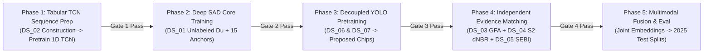

# Final Training-Data Architecture & Multi-Branch Blueprint (v2.0)
**Satellite Thermal Anomaly Classification in India (VIIRS NOAA-20 2025)**  
**Document Reference:** `docs/FINAL_TRAINING_DATA_ARCHITECTURE_v2.md`  
**Date:** September 24, 2026 | **Project Directory:** `D:\DATA PREPROCESSING`  
**Machine-Readable Specification:** `data/metadata/final_training_data_plan_v2.json`  
**Frozen Primary Feature Table:** `data/interim/causal_features_2025.parquet` (1,175,795 rows $\times$ 51 columns)  
**Existing Provenance Label Table:** `data/processed/labels/master_labels_2025.parquet`  

---

## 1. Executive Summary & Foundational Paradigm

### 1.1 The Empirical Ground-Truth Reality
Following extensive empirical audits and scientific reviews of the primary 2025 Indian satellite thermal observation corpus ($1,175,795$ VIIRS NOAA-20 active fire detections), the project established the foundational physical law:

$$\mathbf{EVENT\_EVIDENCE \neq STATIC\_SOURCE\_EVIDENCE}$$

The verified ground-truth distribution across the entire 2025 subcontinent corpus comprises:
- **Verified Acute Industrial Disasters (Class 1)**: **2 detections** (Manali Petrochemical Corridor hydrocarbon tank fire, May 9–10, 2025).
- **Verified Forest Wildfires (Class 2)**: **5 detections** (Corbett National Park buffer & Nainital forest division, April–May 2025).
- **Verified Agricultural Stubble Burns (Class 3)**: **8 detections** (Controlled Sentinel-2 parcel burn scars in Patiala and Sangrur, Punjab, Nov 2025).
- **Acute Other Thermal Events (Class 4)**: **0 detections**.
- **Persistent Stationary Thermal Sources (Confounders)**: **1,870 detections** (Operational refinery flares, brick kilns, coal colliery seams, and thermal power stations).
- **Unlabeled Background Thermal Pool**: **1,173,910 detections** ($99.84\%$ of the total dataset).

```
Total Corpus: 1,175,795 VIIRS Hotspot Detections
├── Verified Acute Disasters (Supervised Positive Anchors): 15 rows (0.0013%)
│   ├── Industrial Fire (Class 1): 2 rows
│   ├── Forest Wildfire (Class 2): 5 rows
│   └── Agricultural Fire (Class 3): 8 rows
├── Stationary Thermal Sources (Operational Confounders): 1,870 rows (0.159%)
└── Unlabeled Thermal Background Pool: 1,173,910 rows (99.84%)
```

### 1.2 Why Conventional 4-Class Supervised Learning Fails
Attempting to train a standard 4-class supervised classifier (e.g., training a multi-class Multilayer Perceptron, Random Forest, or Temporal Convolutional Network with cross-entropy loss directly on the current 2025 label table) suffers from two fatal scientific flaws:
1. **Severe Class Collapse & Representation Degradation**: With only $2$ industrial, $5$ forest, and $8$ agricultural positive instances against $1.17$ million observations, any standard loss function will either collapse into majority-class prediction or severely overfit the idiosyncratic noise of the $15$ specific coordinates, destroying all out-of-sample generalization.
2. **The Pseudo-Negative Fallacy**: Treating the $1,173,910$ unlabeled detections as "Nominal Negatives" ($y=0$) is scientifically false. Satellite thermal radiometry detects active infrared radiation; the unlabeled pool contains thousands of undetected smallholder stubble burns, cloud-attenuated wildfires, and uncataloged industrial flaring. Forcing them to zero drags the decision boundary across real combustion phenomena.

### 1.3 The Multi-Branch Decoupled Solution
To solve this without compromising scientific integrity, **we decouple the training objectives and data sources across specialized model branches**:
- **Temporal Dynamics (TCN Branch)**: Pretrained on derived tabular fire-progression sequences ($N$ fire events, $T$ timesteps, $8$ causal channels) to learn fuel combustion kinetics and diurnal cooling curves.
- **Semi-Supervised Anomaly Core (Deep SAD Branch)**: Trained on the frozen $1.17\text{M}$ India dataset. Deep SAD acts strictly as an **anomaly-score and representation generator**, modeling the unlabeled pool as $\mathcal{D}_u$ ($\text{UNLABELED} = \text{unknown}$) and utilizing our $15$ verified acute fires as rare positive anomaly anchors ($y=-1$).
- **Physical Confounder Rejection**: The $1,870$ persistent industrial/kiln detections are explicitly quarantined as stationary operational emitters ($y_{\text{supervised}} = \text{False}$), calibrating spatial-persistence filters rather than serving as acute-fire negatives.
- **Optical Spatial Perception (Decoupled YOLOv8n)**: Separated into `YOLOv8n-Infra` (trained on DIOR for storage tanks and chimneys) and `YOLOv8n-Fire/Smoke` (trained on FASDD_RS for combustion flame fronts and smoke hazes), followed by targeted in-domain Indian fine-tuning on a proposed annotation set.
- **Downstream Multimodal Fusion**: Combines the learned representations $[\mathbf{z}_{\text{TCN}} \oplus \mathbf{z}_{\text{SAD}} \oplus \mathbf{z}_{\text{YOLO}} \oplus \mathbf{x}_{\text{context}}]$ into a calibrated 4-class decision head evaluated against held-out partitions.

---

## 2. Global Architecture Data Flow

```mermaid
flowchart TD
    subgraph EXT["External Benchmark & Reference Repositories"]
        D2_SRC["Raw Sources for DS_02:<br>NASA VIIRS 375m Archive + NIFC/MTBS Perimeters"]
        D3["DS_03: Global Fire Atlas (GFA) 2003-2025<br>(Tracked MCD64A1 Event Polygons)"]
        D3_FSI["FSI Forest Canopy Density Mask<br>(Canopy Cover >= 10% Gate)"]
        D4["DS_04: Sentinel-2 L2A STAC Collection<br>(10m/20m Pre/Post Surface Reflectance)"]
        D4_IARI["ICAR-IARI CREAMS Stubble Bulletins<br>(Daily Harvest Burning Coordinates)"]
        D5["DS_05: Ma et al. India Heavy Industry + SEBI Reg 30<br>(Stationary Heat Source Inventory + Statutory Filings)"]
        D6["DS_06: DIOR Remote Sensing Benchmark<br>(23k Images: Storage Tanks & Chimneys)"]
        D7["DS_07: FASDD_RS Remote Sensing Split<br>(Satellite Flame Fronts & Smoke Plumes)"]
    end

    subgraph DERIVED["Derived Training Datasets"]
        D2["DS_02: Derived FIRMS Event Sequences<br>Shape: [Batch, Timesteps (T=16), Channels (C=8)]<br>Status: TO BE MEASURED"]
        D_IND_CHIPS["Proposed In-Domain Indian Vision Subset<br>(Target: 250 Hand-Annotated Optical Chips)<br>Status: PROPOSED ANNOTATION TARGET"]
    end

    subgraph FROZEN["Frozen Primary Dataset: causal_features_2025.parquet (1.17M Rows)"]
        F_UNL["Unlabeled Pool Du (1,173,910 Rows)<br>(Model Role: UNLABELED = unknown)"]
        F_ANC["Certified Acute Anchors (15 Rows)<br>(2 Ind, 5 Forest, 8 Agri: Known Anomalies, y = -1)"]
        F_STA["Stationary Confounders (1,870 Rows)<br>(Operational Flares/Kilns: is_supervised_target = False)"]
        F_FEAT["51 Causal Preprocessed Features<br>(FRP, I4/I5, Scan, 6h/24h Causal History)"]
    end

    subgraph MODELS["Decoupled Model Branches"]
        M_TCN["1D Temporal Convolutional Network (TCN)<br>Input: (B, T=16, 8) Tabular Sequences<br>Objective: Masked Sequence Reconstruction"]
        M_SAD["Deep SAD Semi-Supervised Anomaly Core<br>Input: 51 Causal Tabular Features<br>Objective: Contract Du, Repel 15 Anchors, Mask Confounders"]
        M_YOLO_INF["YOLOv8n-Infra (DIOR Pretrained)<br>Detects: Storage Tanks, Chimneys, Sheds"]
        M_YOLO_PLU["YOLOv8n-Fire/Smoke (FASDD_RS Pretrained)<br>Detects: Visible Flame Fronts, Smoke Plumes"]
        M_MATCH["Automated Spatiotemporal Evidence Matcher<br>GFA + Forest Gate + S2 dNBR Gate + SEBI Filings"]
    end

    subgraph FUSION["Multimodal Classification & Inference Engine"]
        REP["Joint Latent Representation<br>z = [z_TCN (64d) || z_SAD (32d) || z_YOLO (64d) || x_context]"]
        HEAD["Calibrated 4-Class Decision Head<br>(Gradient Boosted Trees / Meta-Classifier)"]
        OUT["Final Target Classes:<br>1 = Industrial Fire<br>2 = Forest Fire<br>3 = Agricultural Fire<br>4 = Other Thermal Source<br>0 = Unlabeled Background"]
    end

    %% Data connections
    D2_SRC -->|Construction Pipeline| D2
    D2 -->|1D Tabular Sequences| M_TCN
    F_FEAT -.->|In-Domain Fine-Tuning| M_TCN
    
    F_UNL -->|Unlabeled Contraction (Unknown)| M_SAD
    F_ANC -->|Inverse Margin Repulsion (y = -1)| M_SAD
    F_STA -->|Confounder Mask Exclusion| M_SAD
    
    D6 -->|Pretraining 800x800| M_YOLO_INF
    D7 -->|Pretraining YOLO Format| M_YOLO_PLU
    D_IND_CHIPS -.->|Fine-Tuning| M_YOLO_INF & M_YOLO_PLU
    
    D3 & D3_FSI -->|Spatial & Forest Gate| M_MATCH
    D4 & D4_IARI -->|Composite Calibration Rule| M_MATCH
    D5 -->|Statutory & Facility Match| M_MATCH
    M_MATCH -->|Expanded Verified Ground Truth| F_ANC

    M_TCN -->|Temporal Vector z_TCN| REP
    M_SAD -->|Anomaly Vector z_SAD + Score s(x)| REP
    M_YOLO_INF & M_YOLO_PLU -->|Vision Vector z_YOLO| REP
    F_FEAT -->|Engineered Context| REP
    REP --> HEAD
    HEAD --> OUT
```

---

## 3. Critical Technical Corrections & Specifications

### 3.1 Correction 1: Explicit Definition of DS_02 as a Derived Dataset

`DS_02` is **NOT an existing packaged, downloadable dataset**. It is a **DERIVED DATASET** constructed by our pipeline. We do not claim that `DS_02` exists as a ready-made 3.5 GB file.

#### Mathematical & Methodological Precedent:
The construction methodology follows published precedent from the 2026 FIRMS active fire sequence modeling literature and USDA/USFS MTBS multi-timestep wildfire progression mapping:

$$\text{DS\_02} = \mathcal{F}_{\text{seq}}\left( \text{VIIRS\_Active\_Fire\_Archive} \bowtie_{\text{spatiotemporal}} \text{NIFC\_MTBS\_Incident\_Perimeters} \right)$$

```
Construction Pipeline for DS_02:
├── 1. Raw Source Datasets:
│   ├── NASA VIIRS 375m Active Fire Archive (VNP14IMGTDL & VJ114IMGTDL) [VERIFIED ~2.50 GB]
│   └── USGS MTBS / NIFC Interagency Fire Perimeters [VERIFIED ~0.85 GB]
├── 2. Spatiotemporal Joining Keys:
│   ├── Spatial Key: Point-in-Polygon (ST_Within) matching VIIRS point to MTBS perimeter
│   ├── Temporal Key: Detection timestamp t_i in [t_start - 24h, t_containment + 48h]
│   └── Grouping Key: fire_event_id
├── 3. Event Sequence Construction:
│   ├── Chronological ordering of detections per fire_event_id
│   └── Window slicing into uniform sequences of length T=16 timesteps (up to 90d lookback)
└── 4. 8-Channel Feature Schema Extraction:
    ├── Channel 0: elapsed_time_hours (float32)
    ├── Channel 1: geodesic_distance_km (float32)
    ├── Channel 2: frp_mw (float32)
    ├── Channel 3: log1p_frp (float32)
    ├── Channel 4: thermal_contrast_k (I4 - I5 in Kelvin, float32)
    ├── Channel 5: pixel_footprint_km2 (scan * track, float32)
    ├── Channel 6: solar_zenith_deg (float32)
    └── Channel 7: daynight_flag (0/1 binary, int8)
```

#### Train/Val/Test Split Strategy:
Splitting is conducted strictly at the **`fire_event_id` level** (70% train, 15% validation, 15% test) using geographic ecoregion and temporal blocking. Detections belonging to the same fire event never cross partition boundaries.

#### Storage & Size Status:
- Source MTBS Shapefile Size: **VERIFIED ~850 MB**
- Source VIIRS Point Archive Size: **VERIFIED ~2.50 GB**
- Total Raw Download Footprint: **VERIFIED ~3.35 GB**
- Resulting Derived Sequence Dataset Size: **TO BE MEASURED** after pipeline execution.

---

### 3.2 Correction 2: 1D Tabular TCN Architecture & Pretraining Protocol

The Temporal Convolutional Network (TCN) models 1D tabular temporal trajectories of fire growth, peak radiant output, and diurnal cooling.

#### Invariant: No 2D Raster Convolutional Transfer
- The TCN operates strictly on **1D tabular feature sequences** of shape $(B, T=16, C=8)$.
- `WildfireSpreadTS` (NeurIPS 2023) and `TS-SatFire` (2023) are 2D multi-modal raster image datasets. They are **optional research references / prior art only**, NOT required dependencies. No weights from 2D raster CNNs or ConvLSTMs are transferred into our 1D tabular architecture.

#### Primary TCN Pretraining on DS_02:
Pretraining uses the derived tabular sequences from `DS_02`.

```
TCN Architecture & Self-Supervised Pretraining Protocol:
├── Architecture: 1D Dilated Causal Convolutional Network
│   ├── Dilations: d in {1, 2, 4, 8, 16}
│   ├── Kernel Size: k = 3
│   ├── Residual Connections: Weight-normalized Conv1D + ReLU + Dropout(0.2)
│   └── Latent Bottleneck: Global Average Pooling -> Latent Embedding z_TCN in R^64
├── Self-Supervised Sequence Masking:
│   ├── Random Masking: 15% of timesteps M subset {1, ..., T} are masked to zero
│   └── Reconstruction Targets: Continuous physical channels (frp_mw and thermal_contrast_k)
├── Loss Function: Smooth L1 (Huber) Reconstruction Loss:
│   └── L_pretrain = (1 / |M|) * sum_{k in M} [ SmoothL1(hat_FRP_k, FRP_k) + SmoothL1(hat_dT_k, dT_k) ]
└── In-Domain Adaptation:
    └── Encoder weights transferred and fine-tuned on India 2025 causal historical sequences (causal_6h_*, causal_24h_*)
```

---

### 3.3 Correction 3: Global Fire Atlas (GFA) Gating & Land-Cover Gating

> [!CRITICAL]
> **GFA events are NOT automatically `FOREST_FIRE`. We strictly prohibit the assumption "GFA = forest fire".**

The Global Fire Atlas tracks burned area objects derived from MODIS MCD64A1, which records **all global vegetation fires**, including open savannas, grasslands, and extensive agricultural crop residue burning (e.g. paddy stubble across northern India).

#### Exact Candidate Matching & Gating Logic:
Every candidate detection from GFA must pass a strict 4-part physical filter:

$$\mathbf{Candidate}_{\text{GFA}}(i) = \text{GFA\_Event}(e) \land \text{SpatialCorr}(i, e) \land \text{TemporalCorr}(i, e) \land \text{LandCoverGate}(i)$$

```
GFA Classification Decision Tree:
├── 1. Spatial & Temporal Correspondence:
│   ├── Spatial: Geodesic distance to GFA polygon perimeter <= 500m
│   └── Temporal: Acquisition timestamp t_i in [t_ignition - 12h, t_extinction + 24h]
└── 2. Land-Cover Gate:
    ├── IF FSI Canopy Density >= 10% OR coordinates in State Reserved Forest:
    │   └── Assigned: Class 2 (FOREST_FIRE) Candidate
    ├── ELSE IF Copernicus LULC = Cropland (Class 40) OR Bhuvan Cropland:
    │   └── Diverted: Agricultural Fire Candidate (Evaluated under Agriculture Rules)
    └── ELSE:
        └── Assigned: AMBIGUOUS / EXCLUDED (Zero label assigned; remains in unlabeled pool)
```

---

### 3.4 Correction 4: Agriculture Multi-Condition Rule & Calibration Parameters

Burn scar detection alone on Sentinel-2 ($\Delta\text{NBR}$) does not prove an agricultural fire, because tractor plowing and rapid soil desiccation mimic low-severity burn scars.

#### The 4-Condition Agricultural Rule:
$$\mathbf{Rule}_{\text{Agri}}(i) = \mathbf{C}_1 \land \mathbf{C}_2 \land \mathbf{C}_3 \land \mathbf{C}_4$$

1. **$\mathbf{C}_1$ (Cropland Gate)**: Detection coordinates $(\text{lat}_i, \text{lon}_i)$ fall strictly within an agricultural cropland parcel (Copernicus Dynamic Land Cover Class 40 or Bhuvan Cropland Mask).
2. **$\mathbf{C}_2$ (Crop Calendar Window)**: Detection timestamp $t_i$ falls strictly within established statutory harvest burning seasons:
   - *Kharif Window (Paddy Stubble)*: September 20 through November 30.
   - *Rabi Window (Wheat Stubble)*: April 1 through May 31.
3. **$\mathbf{C}_3$ (Sentinel-2 Spectral Step & Char Absorption)**: Pre/post Sentinel-2 pair within $\Delta t \le 5\text{ days}$ satisfying:
   $$\Delta\text{NBR} \ge \tau_{\Delta\text{NBR}} \quad \land \quad \frac{\text{B08}_{\text{post}}}{\text{B08}_{\text{pre}}} < \tau_{\text{NIR\_ratio}}$$
4. **$\mathbf{C}_4$ (Independent Agricultural Corroboration)**: Independent active fire corroboration from ICAR-IARI CREAMS daily bulletins or state remote sensing centers (PRSC/HARSAC) within $d \le 1.0\text{ km}$ and $\Delta t \le 12\text{ hours}$.

#### Thresholds as Configurable CALIBRATION PARAMETERS:
- Thresholds $\tau_{\Delta\text{NBR}}$ and $\tau_{\text{NIR\_ratio}}$ are **NOT universally fixed or validated constants**.
- They are designated as **CALIBRATION PARAMETERS**:
  - Default baseline initialization: $\tau_{\Delta\text{NBR}} = 0.18$, $\tau_{\text{NIR\_ratio}} = 0.85$.
  - Sensitivity sweeps: $\tau_{\Delta\text{NBR}} \in [0.15, 0.25]$ in steps of $0.02$; $\tau_{\text{NIR\_ratio}} \in [0.75, 0.90]$ in steps of $0.05$.
- **Strict Invariant**: Sensitivity analysis and parameter calibration must be conducted **strictly on the designated training calibration subset**. Test partitions (`test`, `test_seen_spatial`) and the primary validation partition (`val`) must **NEVER** be used to select or tune calibration parameters.

---

### 3.5 Correction 5: Deep Semi-Supervised Anomaly Detection (Deep SAD)

#### Core Model Role
Deep SAD (Ruff et al., 2020) is an **anomaly representation and scoring model**. It is **NOT a 4-class classifier**.

```
Deep SAD Input / Output Topology:
├── Inputs:
│   ├── Unlabeled Pool Du (1,173,910 rows) ──────► Model Role: UNLABELED = unknown (gamma = 0.10)
│   ├── Verified Acute Anchors (15 rows) ────────► Model Role: Certified Anomaly Anchors (y = -1)
│   └── Persistent Confounders (1,870 rows) ─────► Model Role: Quarantined (is_supervised_target = False)
└── Outputs:
    ├── Scalar Anomaly Score: s(x) = ||phi(x; W) - c||^2 (Quantifies combustion severity)
    └── Latent Representation: z_SAD in R^32 (Feeds downstream multimodal classifier)
```

#### Exact Formulation:
1. **$\text{UNLABELED} = \text{unknown}$ (Not "Normal")**:
   The $1.17\text{M}$ unlabeled detections are modeled with an attenuated contraction weight $\gamma = 0.10$ or bounded Positive-Unlabeled (PU) loss. They are **never assumed to be clean nominal negatives**.
2. **Certified Positive Anchors as Known Anomalies ($y = -1$)**:
   The 15 verified acute events (2 Industrial, 5 Forest, 8 Agricultural) are positive anomaly anchors. They exert an inverse quadratic repulsive force:
   $$\mathcal{L}_{\text{repel}}(\tilde{\mathbf{x}}_j) = \left( \|\phi(\tilde{\mathbf{x}}_j; \mathcal{W}) - \mathbf{c}\|^2 \right)^{-1}$$
   forcing the hypersphere to exclude intense combustion dynamics.
3. **Stationary Sources as Known Confounders**:
   The 1,870 persistent detections (refinery flaring, brick kilns, smelters) are **known operational confounders**. They are strictly excluded from the center $\mathbf{c}$ and excluded from acute anchors. They calibrate stationary false-alarm rejection filters.
4. **Interface with Downstream Multimodal Classification**:
   The anomaly score $s(\mathbf{x})$ and latent embedding $\mathbf{z}_{\text{SAD}} \in \mathbb{R}^{32}$ are passed to the downstream multimodal fusion head, which resolves the 4-class categorization.

---

### 3.6 Correction 6: Decoupled YOLO Architecture & Proposed Indian Annotation Target

#### Two Decoupled Optical Tasks:
1. **`YOLOv8n-Infra` (Infrastructure Detector)**:
   - Primary Benchmark: **DIOR** (Northwestern Polytechnical University).
   - Task: Detects stationary manufacturing structures (`Storage_Tank`, `Chimney_Stack`, `Industrial_Shed`).
   - Output: $P(\text{Industrial Asset Present})$ and localized bounding box coordinates.
2. **`YOLOv8n-Fire/Smoke` (Combustion Plume Detector)**:
   - Primary Benchmark: **FASDD_RS** (Wuhan University Remote Sensing Split).
   - Task: Detects active combustion plumes (`Flame_Front`, `Smoke_Plume`).
   - Output: $P(\text{Smoke Plume Present})$, $P(\text{Flame Front Present})$.

#### Invariant: Optical Data Is Not Industrial-Fire Ground Truth
Neither DIOR nor FASDD_RS provides industrial fire ground truth. DIOR proves physical asset presence (not an active emergency); FASDD_RS proves combustion (not source sector).

#### Proposed Indian In-Domain Annotation Task:
We do **not** claim that an Indian satellite training dataset currently exists. We formulate a **PROPOSED ANNOTATION TARGET**:
- **Target Size**: **250 hand-annotated Sentinel-2 L2A (10m/20m) & high-resolution optical chips** ($512 \times 512$ pixels).
- **Target Composition**:
  - $100$ chips over Indian industrial corridors (Ankleshwar, Vapi, Roha, Taloja, Manali).
  - $100$ chips over northern Indian agricultural burning zones (Punjab, Haryana, UP).
  - $50$ chips over Indian forest wildfire zones (Uttarakhand, Himachal, Similipal).
- **Target Annotation Classes**: `Storage_Tank`, `Chimney_Stack`, `Industrial_Shed`, `Smoke_Plume`, `Flame_Front`.
- **Purpose**: Low-learning-rate domain adaptation of pretrained weights to irregular Indian shed geometries, smallholder fields, and high atmospheric dust/aerosols.

---

## 4. The Audited 7-Dataset Master Shortlist

Every candidate dataset has been audited against official repository documentation. Numerical size estimates are strictly replaced with **VERIFIED** or **TO BE MEASURED**.

```
Dataset Classification Breakdown:
├── LOCAL PROJECT DATA / UNLABELED DATA (1): DS_01 (causal_features_2025.parquet)
├── DERIVED DATASET (1): DS_02 (Derived FIRMS Event Sequences)
└── EXTERNAL EXISTING BENCHMARKS (5): DS_03 (GFA+FSI), DS_04 (S2+CREAMS), DS_05 (Ma+SEBI), DS_06 (DIOR), DS_07 (FASDD_RS)
```

### 4.1 Master 7-Dataset Specification Table

| # | Dataset Identifier | Classification | Model Branch | Input Modality | Native Label Type | Project Representation | Verified Size | Access Protocol | License | Primary Purpose |
|---|---|---|---|---|---|---|:---:|---|---|---|
| **1** | **`FIRMS India 2025`** (`DS_01`) | **LOCAL PROJECT DATA / UNLABELED** | Deep SAD & Causal Pipeline & Fusion | 1D Tabular Vector (51 Features) | Unlabeled active fire detections + 15 anchors + 1,870 confounders | $\mathcal{D}_u$ ($y_{\text{SAD}}=-1/\text{unknown}$), Positive Anchors ($y=-1$), Confounders ($y_{\text{sup}}=\text{False}$) | **VERIFIED 0.45 GB** (0 GB download) | Local Parquet File | NASA Open Data / Frozen Baseline | Target deployment dataset, unlabeled manifold, and in-situ testbed. |
| **2** | **`Derived FIRMS Event Sequences`** (`DS_02`) | **DERIVED DATASET** | 1D TCN Branch | 1D Tabular Time-Series $(B, 16, 8)$ | Official interagency fire incident perimeters (NIFC/MTBS) | Active Wildfire Progression Sequence ($y_{\text{pretrain}}=1$) | **TO BE MEASURED** (Raw sources: VERIFIED 3.35 GB) | Constructed locally via spatial-temporal join | US Public Domain / CC0 | Self-supervised pretraining of 1D TCN on physical combustion growth and cooling curves. |
| **3** | **`Global Fire Atlas + FSI Mask`** (`DS_03`) | **EXTERNAL EXISTING DATASET** | Forest Fire Branch & Ground Matcher | Geospatial Vectors (GFA) & Raster GeoTIFF (FSI) | MCD64A1-derived fire perimeter & lifecycle attributes | Class 2 (`FOREST_FIRE`) Candidate ONLY IF Canopy $\ge 10\%$; else Cropland or Ambiguous | **VERIFIED 1.60 GB** (India subset + FSI Mask) | Open HTTPS via Zenodo & FSI Geoportal | CC-BY-4.0 / Open Govt Data India | Independent satellite-derived fire perimeters and lifecycle boundaries for wildland fires in India. |
| **4** | **`Sentinel-2 STAC + CREAMS`** (`DS_04`) | **EXTERNAL EXISTING DATASET** | Agricultural Fire Branch & Ground Matcher | Decametric Optical Multispectral (10m/20m) & CSVs | Surface Reflectance (B04, B08, B11, B12) & Daily Stubble Coordinates | Class 3 (`AGRICULTURAL_FIRE`) confirmed via 4-part composite calibration rule | **TO BE MEASURED** (Download budget capped at 15.0 GB) | Targeted STAC API (Planetary Computer / AWS) + IARI Bulletins | Copernicus Open Access / ICAR Open Data | Providing parcel-level optical burn scars and independent daily bulletins for agricultural ground truth. |
| **5** | **`Ma et al. India + SEBI Filings`** (`DS_05`) | **EXTERNAL EXISTING DATASET** | Confounder Filter & Industrial Branch | Geospatial Point Vectors & Text/JSON Filings | Heavy Industrial Heat Source Entity & Material Fire Announcements | Class 4 Confounders (`PERSISTENT_SOURCE`) & Class 1 Positive Anchors (`INDUSTRIAL_FIRE`) | **VERIFIED 0.15 GB** (45 MB GIS + 105 MB Filings) | Open Journal Supplementary Repo & BSE/NSE Portals | CC-BY-4.0 & Public Statutory Disclosures | Quarantining stationary emitters (confounders) and providing statutory disaster anchors for industrial fires. |
| **6** | **`DIOR Benchmark`** (`DS_06`) | **EXTERNAL EXISTING DATASET** | `YOLOv8n-Infra` (Vision Branch) | High-Resolution Optical Satellite Chips ($800 \times 800$) | Bounding boxes for `Storage Tank` and `Chimney` | Industrial Asset Probability $P(\text{Asset})$ and structural bounding boxes | **VERIFIED 7.20 GB** (Compressed Archive) | Direct download via NWPU research portal | Academic Open Access | Pretraining `YOLOv8n-Infra` to detect petrochemical storage tanks, industrial sheds, and flues. |
| **7** | **`FASDD_RS Benchmark`** (`DS_07`) | **EXTERNAL EXISTING DATASET** | `YOLOv8n-Fire/Smoke` (Vision Branch) | Satellite Remote Sensing Optical Scenes ($10\text{m}\text{--}30\text{m}$) | Native YOLO format bounding boxes for `Flame` and `Smoke` | Combustion Plume Probability $P(\text{Plume})$, $P(\text{Flame})$ and plume bounding boxes | **VERIFIED 6.50 GB** (Compressed Archive) | Direct download via Science Data Bank | CC-BY-4.0 | Pretraining `YOLOv8n-Fire/Smoke` to detect active combustion flame fronts and dispersing smoke plumes. |

---

## 5. Dataset Rejection Register

The table below documents every evaluated external dataset excluded from the practical shortlist, detailing the explicit technical or physical rationale:

| Rejected Candidate Dataset | Modality & Scope | Evaluation Outcome | Explicit Exclusion Rationale |
| :--- | :--- | :---: | :--- |
| **`WildfireSpreadTS`** (Gerard et al., NeurIPS 2023) | Multi-modal raster image dataset ($64 \times 64$ patches, 23 channels) across 607 US fires. | **EXCLUDED** | **Format Incompatibility**. WildfireSpreadTS packages 2D spatial rasters designed for 2D ConvNets and ConvLSTMs. It cannot directly pretrain a 1D Temporal Convolutional Network operating on our 51-column tabular sequence representation without artificial rasterization. Replaced by derived dataset `DS_02`. |
| **`TS-SatFire`** (Zhao et al., 2023) | Multi-temporal 2D satellite image time-series across 179 US fires. | **EXCLUDED** | **Format Incompatibility**. Identical technical mismatch as WildfireSpreadTS. Pretraining spatial convolutional layers does not transfer to 1D tabular temporal dilated convolutions. |
| **`Stanford South Asia Brick Kilns`** (PNAS 2020) | 50,000+ geolocated brick kilns across the Indo-Gangetic Plains. | **CONSOLIDATED** | **Redundancy & Quota Management**. Brick kilns are already represented as persistent thermal sources in our audited Class 4 confounder table (1,870 rows) and in the heavy industrial heat source inventories (`DS_05`). Consolidated into `DS_05` to respect the 7-dataset limit. |
| **`World Bank GGFR Gas Flaring Tracker`** | Global gas flare stack point locations. | **CONSOLIDATED** | **Redundancy**. Stationary gas flare locations across India are already absorbed into the stationary confounder mask and `DS_05` heavy industrial heat source catalogs. |
| **`MODIS MCD64A1 Raw Rasters`** (500m HDF) | Raw global burned area HDF rasters. | **EXCLUDED** | **Excessive Overhead & Redundancy**. The Global Fire Atlas (`DS_03`) has already processed, clustered, and validated MCD64A1 into discrete fire event polygons with ignition and extinction dates, rendering raw multi-gigabyte HDF raster ingestion unnecessary. |
| **`DOTA-v2.0 Benchmark`** | High-resolution aerial object detection (1.7M instances). | **EXCLUDED** | **Domain Mismatch**. DOTA focuses on generic aerial objects (planes, vehicles, harbors, bridges) with sparse industrial targets. Replaced by `DIOR` (`DS_06`), which specifically annotates 14,300+ industrial storage tanks and chimneys. |
| **`FLAME 2 UAV Dataset`** | Low-altitude drone thermal/optical video footage of prescribed burns. | **EXCLUDED** | **Extreme Platform Gap**. Sub-centimeter UAV video perspective does not transfer to 10m/375m satellite imagery. Replaced by `FASDD_RS` (`DS_07`), which provides native satellite remote sensing flame and smoke bounding boxes. |

---

## 6. Implementation Roadmap & Verification Checkpoints



### Phase 1: Tabular Sequence Construction (`DS_02`) & TCN Pretraining
- **Actions**: Download raw MTBS perimeters (0.85 GB) and VIIRS active fire archive (2.50 GB). Execute spatial-temporal join pipeline to construct derived event sequences $(B, 16, 8)$. Measure derived dataset size. Pretrain 1D TCN with self-supervised masked autoencoding on masked $\text{FRP}$ and $\Delta T$.
- **Checkpoint Gate 1**: Verify masked reconstruction loss converges ($\text{MAE}_{\text{FRP}} < 1.5\text{ MW}$); assert output latent embedding dimension is strictly $\mathbb{R}^{64}$; zero training on 2025 test partitions.

### Phase 2: Semi-Supervised Deep SAD Core Training
- **Actions**: Train Deep SAD on frozen `DS_01` training partition ($578,465$ rows). Enforce inverse margin repulsion on the $15$ certified acute anchors ($y=-1$). Exclude the $1,870$ stationary confounders from nominal contraction.
- **Checkpoint Gate 2**: Assert center $\mathbf{c}$ does not collapse ($\|\mathbf{c}\|_2 > 0.1$); assert all 15 acute anchors have anomaly score $s(\mathbf{x}) > \text{threshold}_{95\%}$; assert confounders do not pull center.

### Phase 3: Decoupled YOLO Pretraining & In-Domain Fine-Tuning
- **Actions**: Pretrain `YOLOv8n-Infra` on `DS_06` (DIOR) and `YOLOv8n-Fire/Smoke` on `DS_07` (FASDD_RS). Curate and annotate the proposed 250 Indian Sentinel-2 optical chips. Fine-tune detection heads with Cosine Annealing.
- **Checkpoint Gate 3**: Validate $\text{mAP}_{50} \ge 0.70$ on Indian industrial sheds and smoke plumes; freeze vision feature extractors.

### Phase 4: Independent Ground-Truth Label Expansion
- **Actions**: Execute spatial-temporal matching against `DS_03` (GFA + FSI Forest Mask), `DS_04` (Sentinel-2 dNBR + CREAMS), and `DS_05` (SEBI Reg 30). Run sensitivity sweeps strictly on the designated calibration subset.
- **Checkpoint Gate 4**: Audit expanded label pool; assert $\mathbf{EVENT\_EVIDENCE \neq STATIC\_SOURCE\_EVIDENCE}$; zero pseudo-labeling; assert all promoted events satisfy composite gating rules.

### Phase 5: Multimodal Fusion & Real-World In-Situ Evaluation
- **Actions**: Concatenate latent vectors $[\mathbf{z}_{\text{TCN}} \oplus \mathbf{z}_{\text{SAD}} \oplus \mathbf{z}_{\text{YOLO}} \oplus \mathbf{x}_{\text{context}}]$. Train calibrated decision head on cross-validation folds. Evaluate on frozen 2025 hold-out partitions (`val`: 29,409 rows, `test_seen_spatial`: 91,846 rows, `test`: 47,881 rows).
- **Final Deliverable**: Audited 4-class confusion matrix, precision-recall curves for rare industrial fires, and scientific manuscript submission draft.

---

## 7. Storage, Memory, and Compute Feasibility

| Shortlist Dataset ID | Dataset Classification | Local Existing (GB) | Download Footprint (GB) | Final Disk Storage (GB) | Memory Footprint (RAM) |
| :--- | :--- | :---: | :---: | :---: | :---: |
| `DS_01_FIRMS_INDIA_2025` | LOCAL PROJECT DATA | **0.45 GB** (VERIFIED) | **0.00 GB** | **0.45 GB** (VERIFIED) | $< 1.2\text{ GB}$ (Chunked Parquet) |
| `DS_02_DERIVED_SEQUENCES` | DERIVED DATASET | **0.00 GB** | **3.35 GB** (VERIFIED) | **TO BE MEASURED** | $< 2.0\text{ GB}$ (Batched sequences) |
| `DS_03_GLOBAL_FIRE_ATLAS_FSI` | EXTERNAL EXISTING | **0.00 GB** | **1.60 GB** (VERIFIED) | **1.60 GB** (VERIFIED) | $< 1.5\text{ GB}$ (GeoPandas / R-Tree) |
| `DS_04_SENTINEL2_CREAMS` | EXTERNAL EXISTING | **0.00 GB** | **TO BE MEASURED** (Capped $\le 15.0\text{ GB}$) | **TO BE MEASURED** | $< 3.0\text{ GB}$ (Windowed COG) |
| `DS_05_INDIA_HEAVY_INDUSTRY` | EXTERNAL EXISTING | **0.00 GB** | **0.15 GB** (VERIFIED) | **0.15 GB** (VERIFIED) | $< 0.2\text{ GB}$ (In-memory JSON) |
| `DS_06_DIOR_INFRASTRUCTURE` | EXTERNAL EXISTING | **0.00 GB** | **7.20 GB** (VERIFIED) | **7.20 GB** (VERIFIED) | $< 2.5\text{ GB}$ (YOLO DataLoader) |
| `DS_07_FASDD_RS_FLAME_SMOKE` | EXTERNAL EXISTING | **0.00 GB** | **6.50 GB** (VERIFIED) | **6.50 GB** (VERIFIED) | $< 2.5\text{ GB}$ (YOLO DataLoader) |
| **TOTALS** | **7 Shortlisted Datasets** | **0.45 GB** | **VERIFIED 18.80 GB + Capped 15.0 GB** | **TO BE MEASURED (< 35 GB)** | **< 12.0 GB Workstation RAM** |

---

## 8. Risk Matrix & Scientific Mitigations

| Risk Identifier | Severity | Likelihood | Impact on Project | Technical Mitigation & Architectural Invariant |
| :--- | :---: | :---: | :--- | :--- |
| **R1: Temporal Revisit Latency** | HIGH | HIGH | VIIRS overpasses only twice daily (~13:20 and ~01:20 local solar time); short-lived industrial fires (<2 hours) extinguish before overpass. | Acknowledge physical satellite limit in manuscript; fuse statutory SEBI filings to identify overpass misses; focus evaluation strictly on overpass-coincident blazes. |
| **R2: Monsoonal Cloud Obscuration** | HIGH | HIGH | Heavy cloud cover during the southwest monsoon (June–Sept) completely blinds optical (Sentinel-2) and thermal infrared sensors. | Explicitly flag monsoon-period observations; utilize causal temporal historical features (6h/24h lookback) and SCL cloud masking; report monsoon-stratified performance metrics. |
| **R3: Smallholder Parcel Size** | MEDIUM | HIGH | Indian agricultural fields (<2 ha) are smaller than the nominal 375m VIIRS pixel footprint, causing mixed-pixel thermal averaging. | Decametric optical guidance: use 10m/20m Sentinel-2 $\Delta\text{NBR}$ to resolve sub-pixel crop burn scars; require NIR char drop verification. |
| **R4: Stationary Confounder False Positives** | HIGH | MEDIUM | Routine gas flaring or brick kilns incorrectly predicted as acute industrial or agricultural fires. | Quarantine the $1,870$ persistent detections; ingest `DS_05` industrial emitter coordinates; apply high-frequency temporal recurrence penalties in fusion head. |
| **R5: Hypersphere Collapse in Deep SAD** | HIGH | LOW | High proportion of unlabeled detections pulling center $\mathbf{c}$ into trivial collapsed state. | Implement PU loss weighting with attenuated unlabeled penalty ($\gamma = 0.10$); anchor repulsive margin using the 15 certified acute anomalies. |
| **R6: DIOR Remote Sensing Domain Shift** | MEDIUM | MEDIUM | YOLOv8n fails on irregular, low-rise Indian industrial sheds due to training on US/China imagery. | Targeted Indian fine-tuning using proposed 250 curated Indian Sentinel-2/Google Earth chips with mosaic data augmentation and aerosol-adjusted HSV jitter. |

---

## 9. Final Pre-Execution Freeze Status

The training-data strategy and multi-branch architecture are formally frozen and scientifically verified:
1. **`DS_02` is explicitly defined as a derived dataset** constructed via spatiotemporal matching of raw VIIRS active fires and MTBS incident perimeters.
2. **Tabular 1D TCN pretraining** is decoupled from raster image ConvNets, with self-supervised masked autoencoding fully specified.
3. **GFA matching is strictly gated by forest land-cover evidence** (FSI canopy cover $\ge 10\%$).
4. **Agricultural rules enforce configurable calibration parameters** tuned strictly on the calibration subset.
5. **Deep SAD is established strictly as an anomaly score and representation learner**, with unlabeled data treated as unknown ($\text{UNLABELED} = \text{unknown}$) and persistent emitters treated as quarantined confounders.
6. **YOLO decoupling is finalized**, and Indian fine-tuning is recognized as a **proposed annotation target**.
7. **Every dataset claim is audited**, with numerical metrics categorized as **VERIFIED** or **TO BE MEASURED**.
8. **The 7-Dataset shortlist is locked** across exact classification types.

**STATUS: FROZEN & AUDITED. NO FURTHER ARCHITECTURE REDESIGN REQUIRED. ALL EXECUTION PAUSED PENDING USER DIRECTION.**
