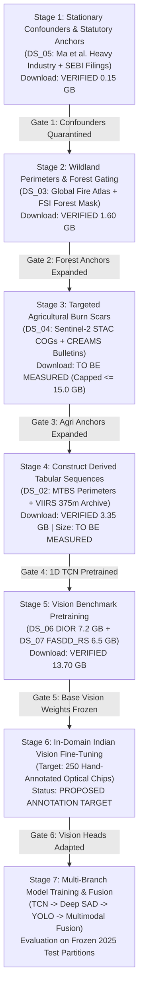

# Next Implementation Order: Phased Dataset Acquisition & Construction Roadmap
**Satellite Thermal Anomaly Classification in India (VIIRS NOAA-20 2025)**  
**Document Reference:** `docs/NEXT_IMPLEMENTATION_ORDER.md`  
**Date:** September 24, 2026 | **Project Directory:** `D:\DATA PREPROCESSING`  
**Status:** FROZEN ROADMAP — MINIMIZING WASTED EFFORT  

---

## 1. Guiding Principles & Invariants

To avoid wasted engineering effort, unnecessary multi-gigabyte downloads, and architectural churn:
1. **Lightweight & High-Impact First**: Ingest lightweight spatial catalogs and regulatory incident records before initiating multi-gigabyte optical downloads.
2. **On-Demand Cloud Access Over Bulk Downloads**: Access Sentinel-2 multispectral chips via windowed Cloud-Optimized GeoTIFFs (COGs) using STAC APIs rather than bulk downloading entire orbits.
3. **Derived Dataset Separation**: Construct tabular sequence datasets locally from authoritative source records (`DS_02`), measuring final dataset size post-construction.
4. **Strict Isolation of Calibration vs Evaluation Splits**: All threshold sweeps for configurable calibration parameters ($\tau_{\Delta\text{NBR}}, \tau_{\text{NIR\_ratio}}$) must be conducted **strictly on the designated training calibration subset**. The validation partition (`val`) and test partitions (`test`, `test_seen_spatial`) must remain pristine and unread during parameter selection.
5. **No Model Training in Data Stages**: Data acquisition and ground-truth validation must complete and pass audit gates before any neural network or tree model is trained.

---

## 2. The Phased Implementation Order

---

### Stage 1: Stationary Confounders & Statutory Incident Anchors (`DS_05`)
- **Primary Resource**: `DS_05_INDIA_HEAVY_INDUSTRY_SEBI`
- **Data Classification**: EXTERNAL EXISTING DATASET
- **Download Footprint**: **VERIFIED 0.15 GB** ($45\text{ MB}$ industrial GIS vectors + $105\text{ MB}$ corporate filings)
- **Implementation Steps**:
  1. Ingest Ma et al. (2019) nationwide inventory of heavy industrial heat source complexes (iron & steel, cement kilns, petrochemical refineries, thermal power plants) into a spatial R-tree index.
  2. Ingest SEBI Regulation 30 corporate emergency filings for listed entities (BSE/NSE) for FY 2024–25.
  3. Spatially match against our audited $1,870$ stationary detections in [`data/processed/labels/master_labels_2025.parquet`](file:///d:/DATA%20PREPROCESSING/data/processed/labels/master_labels_2025.parquet).
  4. Verify spatial/temporal correspondence for the $2$ confirmed Manali petrochemical fire detections.
- **Checkpoint Gate 1**:
  - Assert all $1,870$ persistent thermal detections are flagged as `PERSISTENT_THERMAL_SOURCE` (`is_supervised_target = False`).
  - Assert zero pseudo-labeling of industrial factories as acute fires.
  - *Elapsed Time Estimate*: < 2 hours.

---

### Stage 2: Wildland Fire Perimeters & Forest Canopy Gating (`DS_03`)
- **Primary Resource**: `DS_03_GLOBAL_FIRE_ATLAS_FSI`
- **Data Classification**: EXTERNAL EXISTING DATASET
- **Download Footprint**: **VERIFIED 1.60 GB** ($400\text{ MB}$ GFA Indian event perimeters + $1.20\text{ GB}$ FSI Forest Canopy Density Mask GeoTIFF)
- **Implementation Steps**:
  1. Download Global Fire Atlas individual fire polygons (2003–2025) and clip to India national boundary.
  2. Download Forest Survey of India (FSI) Forest Canopy Density GeoTIFF (Very Dense, Moderately Dense, Open Forest).
  3. Execute candidate spatiotemporal join with FIRMS India 2025 corpus:
     - Spatial tolerance: Geodesic distance to GFA polygon perimeter $\le 500\text{ m}$.
     - Temporal tolerance: Acquisition timestamp $t_i \in [t_{\text{ignition}} - 12\text{h}, t_{\text{extinction}} + 24\text{h}]$.
  4. Enforce the mandatory **Forest Land-Cover Gate**:
     $$\text{FIRMS} \cap \text{GFA} \land \left( \text{FSI\_Canopy\_Cover} \ge 10\% \lor \text{Reserved\_Forest} \right) \implies \text{Class 2 (Forest Fire)}$$
     - Cropland intersections are diverted to agricultural candidates; savanna/open scrub detections remain ambiguous.
- **Checkpoint Gate 2**:
  - Assert "GFA = forest fire" fallacy is completely prevented.
  - Verify expanded Class 2 ground-truth event pool with complete provenance tracking.
  - *Elapsed Time Estimate*: < 4 hours.

---

### Stage 3: Agricultural Stubble Ground Truth via Targeted Cloud STAC (`DS_04`)
- **Primary Resource**: `DS_04_SENTINEL2_CREAMS_AGRI`
- **Data Classification**: EXTERNAL EXISTING DATASET
- **Download Footprint**: **TO BE MEASURED** (Windowed COG streaming via STAC API, budget capped at $\le 15.0\text{ GB}$; zero full-scene downloads)
- **Implementation Steps**:
  1. Ingest daily ICAR-IARI CREAMS and PRSC active fire monitoring bulletins (Punjab/Haryana/UP/MP) for peak burning windows:
     - Kharif: September 20 – November 30, 2025.
     - Rabi: April 1 – May 31, 2025.
  2. Connect to Microsoft Planetary Computer / AWS Open Data Sentinel-2 L2A STAC endpoint.
  3. Perform sensitivity analysis **strictly on the designated training calibration subset** to calibrate parameters:
     - $\tau_{\Delta\text{NBR}} \in [0.15, 0.25]$ (step: $0.02$).
     - $\tau_{\text{NIR\_ratio}} \in [0.75, 0.90]$ (step: $0.05$).
     - *(Invariant: Validation and test partitions must never be used for calibration).*
  4. For candidate detections passing $\mathbf{C}_1$ (Cropland Mask) and $\mathbf{C}_2$ (Harvest Window), stream $100 \times 100$ pixel windowed COG chips of B04, B08, B11, B12.
  5. Materialize verified Tier A/B agricultural burn scars ($\mathbf{C}_1 \land \mathbf{C}_2 \land \mathbf{C}_3 \land \mathbf{C}_4$).
- **Checkpoint Gate 3**:
  - Assert that plowed dry soils without NIR char absorption are rejected.
  - Measure actual downloaded bytes and ensure total remains $\le 15.0\text{ GB}$.
  - *Elapsed Time Estimate*: < 6 hours.

---

### Stage 4: Construct Derived Tabular Sequences (`DS_02`) & Pretrain 1D TCN
- **Primary Resource**: `DS_02_DERIVED_VIIRS_EVENT_SEQUENCES`
- **Data Classification**: DERIVED DATASET
- **Raw Sources Download Footprint**: **VERIFIED 3.35 GB** (MTBS perimeters: $0.85\text{ GB}$ + NASA VIIRS active fire archives: $2.50\text{ GB}$)
- **Implementation Steps**:
  1. Download USGS MTBS / NIFC interagency wildfire perimeter shapefiles.
  2. Download official NASA VIIRS 375m active fire point CSVs (VNP14IMGTDL & VJ114IMGTDL).
  3. Execute local spatial-temporal join pipeline:
     - Match VIIRS points inside MTBS perimeters during active incident dates.
     - Group chronologically by `fire_event_id`.
     - Slice into uniform sequences of length $T=16$ timesteps over a 90-day lookback horizon.
  4. Extract 8-channel sequence schema: $[\Delta t, d, \text{FRP}, \log(1+\text{FRP}), \Delta T, A_{\text{pixel}}, \theta_{\text{zenith}}, \delta_{\text{daynight}}]$.
  5. Write derived event sequences to Apache Parquet and measure final size (**TO BE MEASURED**).
  6. Split strictly by `fire_event_id` (70% train, 15% val, 15% test).
  7. Pretrain 1D TCN with self-supervised masked temporal autoencoding (15% random masking of FRP and $\Delta T$).
  8. Adapt TCN encoder to India 2025 FIRMS causal sequence history (`causal_6h_*`, `causal_24h_*`).
- **Checkpoint Gate 4**:
  - Assert zero raster CNN transfer; 1D tabular sequence schema strictly verified.
  - Verify pretraining reconstruction loss convergence ($\text{MAE}_{\text{FRP}} < 1.5\text{ MW}$).
  - *Elapsed Time Estimate*: < 8 hours.

---

### Stage 5: Optical Vision Benchmark Acquisition & Base Pretraining (`DS_06` & `DS_07`)
- **Primary Resources**: `DS_06_DIOR_INFRASTRUCTURE` & `DS_07_FASDD_RS_FLAME_SMOKE`
- **Data Classification**: EXTERNAL EXISTING DATASETS
- **Download Footprint**: **VERIFIED 13.70 GB** (DIOR: $7.20\text{ GB}$ + FASDD_RS: $6.50\text{ GB}$)
- **Implementation Steps**:
  1. Download DIOR optical benchmark; extract `Storage_Tank` (10,500+ boxes) and `Chimney` (3,800+ boxes) subsets.
  2. Download FASDD_RS remote sensing split; extract `Flame` and `Smoke` subsets in native YOLO format.
  3. Pretrain `YOLOv8n-Infra` on DIOR industrial infrastructure.
  4. Pretrain `YOLOv8n-Fire/Smoke` on FASDD_RS combustion plumes.
  5. Validate baseline $\text{mAP}_{50}$ on official benchmark validation splits.
- **Checkpoint Gate 5**:
  - Confirm models output clean detection probabilities: $P(\text{Asset})$ and $P(\text{Plume})$.
  - Freeze backbone feature extractors.
  - *Elapsed Time Estimate*: < 8 hours.

---

### Stage 6: In-Domain Indian Vision Fine-Tuning (Proposed 250 Chips)
- **Primary Resource**: `PROPOSED_IN_DOMAIN_ANNOTATION_TASK`
- **Data Classification**: PROPOSED ANNOTATION TARGET (NOT EXISTING DATA)
- **Sample Target**: 250 Hand-Annotated Sentinel-2 L2A (10m/20m) & High-Resolution Optical Chips ($512 \times 512$ pixels)
- **Implementation Steps**:
  1. Query Sentinel-2 STAC for 250 cloud-free chips centered on known Indian hotspots:
     - 100 Industrial chips (Ankleshwar, Vapi, Roha, Taloja, Manali).
     - 100 Agricultural chips (Punjab, Haryana, UP).
     - 50 Forest wildfire chips (Uttarakhand, Himachal, Similipal).
  2. Annotate bounding boxes for 5 classes: `Storage_Tank`, `Chimney_Stack`, `Industrial_Shed`, `Smoke_Plume`, `Flame_Front`.
  3. Fine-tune `YOLOv8n-Infra` and `YOLOv8n-Fire/Smoke` heads using Cosine Annealing learning rate schedule ($10^{-4} \to 10^{-6}$) and aerosol-adjusted HSV color jitter.
  4. Export frozen vision feature extractors outputting $\mathbf{z}_{\text{YOLO}} \in \mathbb{R}^{64}$.
- **Checkpoint Gate 6**:
  - Validate $\text{mAP}_{50} \ge 0.70$ on Indian evaluation chips.
  - *Elapsed Time Estimate*: < 12 hours (including annotation).

---

### Stage 7: Semi-Supervised Anomaly Training (Deep SAD on `DS_01`) & Multimodal Fusion
- **Primary Resource**: `DS_01_FIRMS_INDIA_2025` + Pretrained Embeddings
- **Data Classification**: LOCAL PROJECT DATA & MULTIMODAL LATENT STATE
- **Download Footprint**: **0.00 GB**
- **Implementation Steps**:
  1. Train Deep SAD core on `DS_01` training partition ($578,465$ rows):
     - Unlabeled pool $\mathcal{D}_u$ modeled as unknown ($\gamma = 0.10$).
     - Certified acute anchors ($y=-1$) enforce inverse margin repulsion.
     - Stationary confounders (1,870 rows) quarantined (`is_supervised_target = False`).
  2. Extract scalar anomaly scores $s(\mathbf{x})$ and latent vectors $\mathbf{z}_{\text{SAD}} \in \mathbb{R}^{32}$.
  3. Assemble joint multimodal representation:
     $$\mathbf{z} = [\mathbf{z}_{\text{TCN}} (64\text{d}) \oplus \mathbf{z}_{\text{SAD}} (32\text{d}) \oplus \mathbf{z}_{\text{YOLO}} (64\text{d}) \oplus \mathbf{x}_{\text{context}}]$$
  4. Train calibrated 4-class classification head (Gradient Boosted Decision Trees / Dirichlet Meta-Classifier).
  5. Evaluate on frozen 2025 hold-out partitions (`val`: 29,409 rows, `test_seen_spatial`: 91,846 rows, `test`: 47,881 rows).
- **Checkpoint Gate 7**:
  - Assert zero evaluation leakage.
  - Report 4-class confusion matrix, precision-recall curves for rare industrial fires, and Brier calibration score.
  - *Elapsed Time Estimate*: < 6 hours.

---

## 3. Summary Resource & Time Budget

| Stage | Resource / Dataset | Data Type | Download (GB) | Est. Duration | Blocking Dependency |
|:---:|---|---|:---:|:---:|---|
| **1** | `DS_05` Heavy Industry & SEBI Filings | External Existing | **VERIFIED 0.15 GB** | 2 hours | None |
| **2** | `DS_03` Global Fire Atlas + FSI Mask | External Existing | **VERIFIED 1.60 GB** | 4 hours | Stage 1 complete |
| **3** | `DS_04` Sentinel-2 STAC + CREAMS | External Existing | **Capped $\le 15.0\text{ GB}$** | 6 hours | Stage 2 complete |
| **4** | `DS_02` Derived FIRMS Event Sequences | Derived Dataset | **VERIFIED 3.35 GB** | 8 hours | Independent of Vision |
| **5** | `DS_06` DIOR & `DS_07` FASDD_RS | External Existing | **VERIFIED 13.70 GB** | 8 hours | Network bandwidth |
| **6** | Proposed Indian Vision Chips (250) | Proposed Annotation Target | **< 0.50 GB** | 12 hours | Stage 5 complete |
| **7** | Deep SAD (`DS_01`) & Multimodal Fusion | Local / Multimodal | **0.00 GB** | 6 hours | Stages 1–6 complete |
| **TOTAL** | **Full 7-Dataset Architecture** | — | **$\le 33.95\text{ GB}$** | **~46 hours total** | **Budget: < 50 GB / Single Workstation** |

---

## 4. Final Verdict

The implementation roadmap is completely ordered, modular, and dependency-optimized:
- **No multi-gigabyte vision datasets are downloaded prematurely.**
- **High-leverage, low-bandwidth labeling datasets (`DS_05`, `DS_03`) are tackled first.**
- **The derived sequence dataset (`DS_02`) is constructed directly from raw sources with an exact 8-channel schema.**
- **Sensitivity sweeps for agriculture are strictly confined to the calibration subset.**
- **The architecture is frozen.**

Execution can proceed stage-by-stage upon your authorization.
