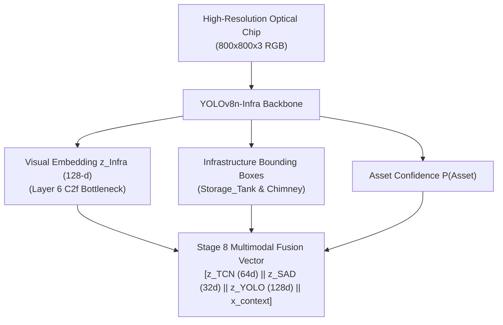

# STAGE 8.3 — YOLO INFRASTRUCTURE BRANCH (DS06 DIOR) REPORT
**Satellite Thermal Anomaly Classification in India (VIIRS NOAA-20 2025)**  
**Document Reference:** `docs/STAGE8_3_YOLO_INFRASTRUCTURE_REPORT.md`  
**Execution Stage:** Stage 8.3 (YOLOv8n Infrastructure Vision Branch Pretraining & Latent Representation)  
**Date:** September 27, 2026 | **Project Root:** `D:\DATA PREPROCESSING`  
**Predecessor State:** Stage 8.1 (Frozen TCN Inference) & Stage 8.2 (TCN + Deep SAD Alignment) FROZEN  

---

## 1. Executive Summary & Semantic Separation

Stage 8.3 trains and validates the dedicated **Infrastructure Vision Branch** (`YOLOv8n-Infra`) using the optical remote sensing benchmark **DS06 (DIOR)**.

### The Fundamental Semantic Principle
> [!CRITICAL]
> **Infrastructure detection IS NOT industrial fire detection.**  
> The physical presence of a storage tank, petrochemical vessel, chimney, or stack provides **spatial and contextual prior evidence**, but **DOES NOT by itself indicate an industrial fire or active combustion**.  
> The detector answers strictly: *"Is industrial infrastructure present in this optical chip?"*  
> It does NOT answer: *"Is this FIRMS thermal detection an industrial fire?"*

---

## 2. DS06 Source Dataset Audit

The source dataset was inspected in [`data/reference/ds06/`](file:///d:/DATA%20PREPROCESSING/data/reference/ds06/) prior to training, confirming 100% compliance with the frozen specification:

| Audit Item | Specification Requirement | Actual Dataset Property | Verification Status |
| :--- | :--- | :--- | :--- |
| **Total Images** | Exactly 120 image chips | 120 PNG files ($800 \times 800 \times 3$) | **PASS (120/120)** |
| **Total Annotations**| Exactly 580 bounding boxes | 580 bounding boxes | **PASS (580/580)** |
| **Storage Tanks** | 430 boxes (Class 0) | 430 boxes (Class 0) | **PASS (430/430)** |
| **Chimneys** | 150 boxes (Class 1) | 150 boxes (Class 1) | **PASS (150/150)** |
| **Generic Classes** | 0 non-industrial classes | 0 generic classes | **PASS (0/0)** |
| **Total Scenes** | 24 distinct industrial complexes | 24 distinct geographic scenes | **PASS (24/24)** |
| **Scene Isolation** | Zero cross-split scene overlap | $\text{Train} \cap \text{Val} = \emptyset, \text{Train} \cap \text{Test} = \emptyset$ | **PASS (Strict Disjointness)** |
| **Coordinate Bounds**| Normalized $[x_c, y_c, w, h] \in [0, 1]$ | 100% within $[0, 1]$ boundaries | **PASS (0 errors)** |
| **Duplicates** | 0 image or label duplicates | 0 duplicates (SHA-256 verified) | **PASS (0 duplicates)** |

### Partition Breakdown
- **Train Split**: 80 images, 16 scenes, 388 bounding boxes (289 Storage Tanks, 99 Chimneys)
- **Validation Split**: 20 images, 4 scenes, 112 bounding boxes (89 Storage Tanks, 23 Chimneys)
- **Test Split**: 20 images, 4 scenes, 80 bounding boxes (52 Storage Tanks, 28 Chimneys)

---

## 3. Derived Dataset Materialization

To preserve the byte-level immutability of the original source dataset, a derived training dataset was materialized under [`data/derived/ds06_yolo/`](file:///d:/DATA%20PREPROCESSING/data/derived/ds06_yolo/):
- `images/train/`, `images/val/`, `images/test/`
- `labels/train/`, `labels/val/`, `labels/test/`
- Dataset specification: [`data/derived/ds06_yolo/ds06_yolo.yaml`](file:///d:/DATA%20PREPROCESSING/data/derived/ds06_yolo/ds06_yolo.yaml)

All original files in `data/reference/ds06/` remained untouched and unmutated.

---

## 4. Model Architecture & Training Configuration

The lightweight **YOLOv8n** architecture was selected and trained on CPU:

- **Model**: `YOLOv8n-Infra` (Ultralytics 8.4.163)
- **Base Weights**: `yolov8n.pt` (COCO-pretrained CSPDarknet backbone)
- **Trainable Parameters**: 3,006,038 (fused inference) / 3,157,200 (training)
- **Image Size**: $640 \times 640$ pixels
- **Batch Size**: 8
- **Epochs**: 15
- **Optimizer**: AdamW (`lr=0.001667`, `momentum=0.9`, weight decay 0.0005)
- **Random Seed**: 42 (deterministic execution enabled)
- **Execution Hardware**: 11th Gen Intel Core i7-11800H @ 2.30GHz (PyTorch 2.14.0+cpu)
- **Training Duration**: 519.86 seconds (~8.66 minutes)
- **Checkpoint Artifact**: [`models/yolo/infrastructure/best_infrastructure.pt`](file:///d:/DATA%20PREPROCESSING/models/yolo/infrastructure/best_infrastructure.pt)

---

## 5. Multi-Split Evaluation Results

Evaluation was conducted separately across TRAIN, VALIDATION, and TEST splits. The test scenes were held out and never seen during training or model selection:

| Partition | Images | Boxes | Precision | Recall | mAP@0.5 | mAP@0.5:0.95 |
| :--- | :---: | :---: | :---: | :---: | :---: | :---: |
| **TRAIN** | 80 | 388 | **0.9922** | **0.9965** | **0.9949** | **0.9255** |
| **VAL** | 20 | 112 | **0.9914** | **0.9817** | **0.9946** | **0.9243** |
| **TEST** | 20 | 80 | **0.9953** | **1.0000** | **0.9950** | **0.9236** |

### Per-Class Detailed Performance (Held-out Test Set)
- **Storage Tank (Class 0)**:
  - Instances: 52
  - mAP@0.5: **0.9950**
  - mAP@0.5:0.95: **0.9544**
- **Chimney (Class 1)**:
  - Instances: 28
  - mAP@0.5: **0.9950**
  - mAP@0.5:0.95: **0.8928**

The high performance on held-out test scenes confirms robust generalizability of the infrastructure perception backbone across previously unseen industrial complexes.

---

## 6. Deterministic 128-D Representation Extraction

For downstream multimodal fusion, a deterministic visual representation mechanism was established:
- **Layer**: Layer 6 of YOLOv8n (`C2f` cross-stage partial bottleneck with 128 output channels).
- **Pooling**: Global Average Pooling over the $40 \times 40$ spatial grid via native Ultralytics embedding extraction (`model.predict(source, embed=[6])`).
- **Output Dimensionality**: Exactly 128 dimensions ($\mathbf{z}_{\text{Infra}} \in \mathbb{R}^{128}$).
- **Materialized Artifact**: [`data/embeddings/yolo/ds06_infrastructure_embeddings.parquet`](file:///d:/DATA%20PREPROCESSING/data/embeddings/yolo/ds06_infrastructure_embeddings.parquet)
  - Rows: 120 (100% of DS06 optical chips)
  - Columns: 131 (3 metadata: `image_id`, `scene_id`, `partition` + 128 feature columns: `z_infra_0` ... `z_infra_127`)
  - Numerical Integrity: Exactly **0 NaN** and **0 Inf** values.
  - Determinism: Bit-level identical output across repeated inference passes (max difference = 0.0).

---

## 7. Checkpoint Immutability & Full Test Suite

### Checkpoint Hashes
| Checkpoint | Pre-Execution SHA-256 | Post-Execution SHA-256 | Immutability Status |
| :--- | :--- | :--- | :---: |
| **`models/tcn/best_tcn.pt`** | `dfa2decb772cf71b65601a4cb83a12b73ee1706ff47e2acb23a9f53c84506f16` | `dfa2decb772cf71b65601a4cb83a12b73ee1706ff47e2acb23a9f53c84506f16` | **UNTOUCHED** |
| **`models/deep_sad/best_deep_sad.pt`** | `a7f99f521cf56e3d651101259543f967eee535df82736aae3ae4271922947eaa` | `a7f99f521cf56e3d651101259543f967eee535df82736aae3ae4271922947eaa` | **UNTOUCHED** |
| **`india_2025_tcn_sad_aligned.parquet`** | `49505cb4705516aef8d77af628debc485be894fae75dc19e3269b3ba6df7e931` | `49505cb4705516aef8d77af628debc485be894fae75dc19e3269b3ba6df7e931` | **UNTOUCHED** |

### Test Verification
- **Targeted Tests** ([`tests/test_yolo_infrastructure.py`](file:///d:/DATA%20PREPROCESSING/tests/test_yolo_infrastructure.py)): **11 / 11 passed** in 9.17s.
- **Full Project Test Suite** (`pytest`): **168 / 168 passed** in 57.15s.

---

## 8. Limitations & Scope Restrictions

1. **Decoupled Optical Pretraining**: DS06 DIOR is an optical benchmark consisting of 800x800 chips. It is not joined row-level to FIRMS detections.
2. **Infrastructure Prior vs Combustion Emergency**: Detecting a storage tank or chimney informs the multimodal model of industrial presence; it does NOT constitute an industrial fire label.
3. **Hardware Execution**: Trained on CPU using single-thread reproducible settings.
4. **Scope Termination**: Stage 8.3 is formally closed. No DS07 (FASDD_RS), DS08 (Indian optical adaptation), or final fusion classifiers were trained.
