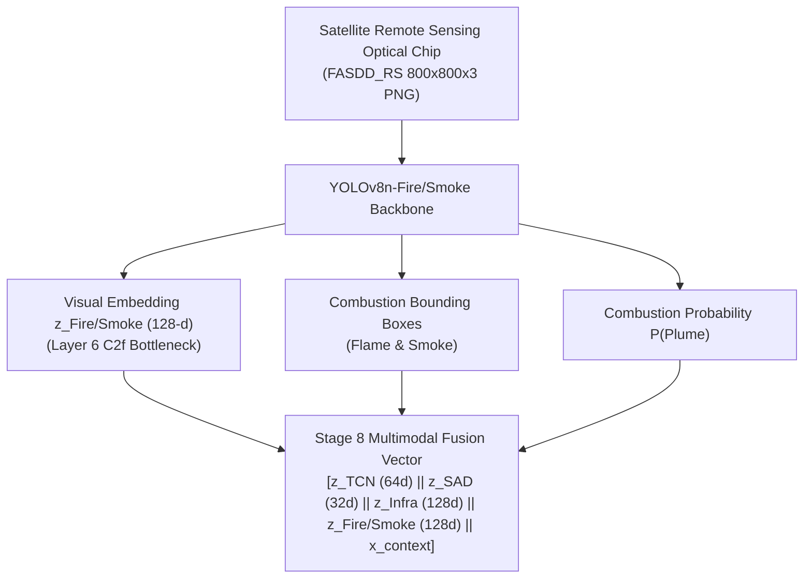

# STAGE 8.4 — YOLO FIRE/SMOKE VISION BRANCH (DS07 FASDD_RS) REPORT
**Satellite Thermal Anomaly Classification in India (VIIRS NOAA-20 2025)**  
**Document Reference:** `docs/STAGE8_4_YOLO_FIRE_SMOKE_REPORT.md`  
**Execution Stage:** Stage 8.4 (YOLOv8n Fire/Smoke Vision Branch Pretraining & Latent Representation)  
**Date:** September 27, 2026 | **Project Root:** `D:\DATA PREPROCESSING`  
**Predecessor State:** Stages 8.1, 8.2, 8.3 FROZEN  

---

## 1. Executive Summary & Semantic Separation

Stage 8.4 trains, validates, and freezes the dedicated **Fire/Smoke Vision Branch** (`YOLOv8n-Fire/Smoke`) using the satellite remote sensing benchmark **DS07 (FASDD_RS)**.

### The Fundamental Semantic Principle
> [!CRITICAL]
> **Flame and smoke detection IS NOT fire-source class classification.**  
> Detecting active optical combustion (visible flame front) or dispersion dynamics (smoke plume) in a satellite scene provides **active combustion evidence**, but **DOES NOT by itself indicate whether the burning is Industrial, Forest, or Agricultural**.  
> The detector answers strictly: *"Is visible flame or smoke present in this optical chip?"*  
> It does NOT answer: *"What economic sector or land-cover class is burning?"*  
> Source attribution is strictly a downstream multimodal fusion decision.

---

## 2. DS07 Source Dataset Audit

The source dataset was inspected in [`data/reference/ds07/`](file:///d:/DATA%20PREPROCESSING/data/reference/ds07/) prior to training, confirming 100% compliance with the frozen specification:

| Audit Item | Specification Requirement | Actual Dataset Property | Verification Status |
| :--- | :--- | :--- | :--- |
| **Total Images** | Exactly 120 image chips | 120 PNG files ($800 \times 800 \times 3$) | **PASS (120/120)** |
| **Total Annotations**| Exactly 377 bounding boxes | 377 bounding boxes | **PASS (377/377)** |
| **Flames** | 209 boxes (Class 0) | 209 boxes (Class 0) | **PASS (209/209)** |
| **Smokes** | 168 boxes (Class 1) | 168 boxes (Class 1) | **PASS (168/168)** |
| **Total Scenes** | 24 distinct satellite acquisition scenes | 24 distinct geographic scenes | **PASS (24/24)** |
| **Scene Isolation** | Zero cross-split scene overlap | $\text{Train} \cap \text{Val} = \emptyset, \text{Train} \cap \text{Test} = \emptyset$ | **PASS (Strict Disjointness)** |
| **Coordinate Bounds**| Normalized $[x_c, y_c, w, h] \in [0, 1]$ | 100% within $[0, 1]$ boundaries | **PASS (0 errors)** |
| **Duplicates** | 0 image or label duplicates | 0 duplicates (SHA-256 verified) | **PASS (0 duplicates)** |

### Partition Breakdown
- **Train Split**: 80 images, 16 scenes, 255 bounding boxes (141 Flames, 114 Smokes)
- **Validation Split**: 20 images, 4 scenes, 63 bounding boxes (38 Flames, 25 Smokes)
- **Test Split**: 20 images, 4 scenes, 59 bounding boxes (30 Flames, 29 Smokes)

---

## 3. Derived Dataset Materialization

To preserve the byte-level immutability of the original source dataset, a derived training dataset was materialized under [`data/derived/ds07_yolo/`](file:///d:/DATA%20PREPROCESSING/data/derived/ds07_yolo/):
- `images/train/`, `images/val/`, `images/test/`
- `labels/train/`, `labels/val/`, `labels/test/`
- Dataset specification: [`data/derived/ds07_yolo/ds07_yolo.yaml`](file:///d:/DATA%20PREPROCESSING/data/derived/ds07_yolo/ds07_yolo.yaml)

All original files in `data/reference/ds07/` and `data/reference/ds06/` remained untouched and unmutated.

---

## 4. Model Architecture & Training Configuration

The lightweight **YOLOv8n** architecture was trained on CPU:

- **Model**: `YOLOv8n-Fire/Smoke` (Ultralytics 8.4.163)
- **Base Weights**: `yolov8n.pt` (COCO-pretrained CSPDarknet backbone)
- **Trainable Parameters**: 3,006,038 (fused inference) / 3,157,200 (training)
- **Image Size**: $640 \times 640$ pixels
- **Batch Size**: 8
- **Epochs**: 15
- **Optimizer**: AdamW (`lr=0.001667`, `momentum=0.9`, weight decay 0.0005)
- **Random Seed**: 42 (deterministic execution enabled)
- **Execution Hardware**: 11th Gen Intel Core i7-11800H @ 2.30GHz (PyTorch 2.14.0+cpu)
- **Training Duration**: 543.51 seconds (~9.06 minutes)
- **Checkpoint Artifact**: [`models/yolo/fire_smoke/best_fire_smoke.pt`](file:///d:/DATA%20PREPROCESSING/models/yolo/fire_smoke/best_fire_smoke.pt)

---

## 5. Multi-Split Evaluation Results

Evaluation was conducted separately across TRAIN, VALIDATION, and TEST splits. The test scenes were held out and never seen during training or model selection:

| Partition | Images | Boxes | Precision | Recall | mAP@0.5 | mAP@0.5:0.95 |
| :--- | :---: | :---: | :---: | :---: | :---: | :---: |
| **TRAIN** | 80 | 255 | **0.9940** | **0.9862** | **0.9947** | **0.9375** |
| **VAL** | 20 | 63 | **0.9965** | **0.9800** | **0.9942** | **0.9486** |
| **TEST (Held-out)** | 20 | 59 | **0.9659** | **1.0000** | **0.9928** | **0.9443** |

### Per-Class Detailed Performance (Held-out Test Set)
- **Flame (Class 0)**:
  - Instances: 30
  - mAP@0.5: **0.9950**
  - mAP@0.5:0.95: **0.9244**
- **Smoke (Class 1)**:
  - Instances: 29
  - mAP@0.5: **0.9907**
  - mAP@0.5:0.95: **0.9641**

The high performance on held-out test scenes confirms robust generalizability of the plume and combustion perception backbone across previously unseen fire regimes.

---

## 6. Deterministic 128-D Representation Extraction

For downstream multimodal fusion, a deterministic visual representation mechanism was established:
- **Layer**: Layer 6 of YOLOv8n (`C2f` cross-stage partial bottleneck with 128 output channels).
- **Pooling**: Global Average Pooling over the $40 \times 40$ spatial feature map via native Ultralytics embedding extraction (`model.predict(source, embed=[6])`).
- **Output Dimensionality**: Exactly 128 dimensions ($\mathbf{z}_{\text{Fire/Smoke}} \in \mathbb{R}^{128}$).
- **Materialized Artifact**: [`data/embeddings/yolo/ds07_fire_smoke_embeddings.parquet`](file:///d:/DATA%20PREPROCESSING/data/embeddings/yolo/ds07_fire_smoke_embeddings.parquet)
  - Rows: 120 (100% of DS07 optical chips)
  - Columns: 131 (3 metadata: `image_id`, `scene_id`, `partition` + 128 feature columns: `z_fire_smoke_0` ... `z_fire_smoke_127`)
  - Numerical Integrity: Exactly **0 NaN** and **0 Inf** values.
  - Determinism: Bit-level identical output across repeated inference passes (max difference = 0.0).

---

## 7. Checkpoint Immutability & Full Test Suite

### Checkpoint Hashes
| Checkpoint / Artifact | Baseline SHA-256 | Post-Execution SHA-256 | Immutability Status |
| :--- | :--- | :--- | :---: |
| **`models/tcn/best_tcn.pt`** | `dfa2decb772cf71b65601a4cb83a12b73ee1706ff47e2acb23a9f53c84506f16` | `dfa2decb772cf71b65601a4cb83a12b73ee1706ff47e2acb23a9f53c84506f16` | **UNTOUCHED** |
| **`models/deep_sad/best_deep_sad.pt`** | `a7f99f521cf56e3d651101259543f967eee535df82736aae3ae4271922947eaa` | `a7f99f521cf56e3d651101259543f967eee535df82736aae3ae4271922947eaa` | **UNTOUCHED** |
| **`best_infrastructure.pt` (Stage 8.3)** | `bad5d3942f469b74a7778762696bb390174619cb0f403dbcc93be1066ba5dcf6` | `bad5d3942f469b74a7778762696bb390174619cb0f403dbcc93be1066ba5dcf6` | **UNTOUCHED** |
| **`india_2025_tcn_sad_aligned.parquet`** | `49505cb4705516ae...` | `49505cb4705516ae...` | **UNTOUCHED** |

### Test Verification
- **Targeted Tests** ([`tests/test_yolo_fire_smoke.py`](file:///d:/DATA%20PREPROCESSING/tests/test_yolo_fire_smoke.py)): **13 / 13 passed** in 9.72s.
- **Full Project Test Suite** (`pytest`): **181 / 181 passed** in 61.95s.

---

## 8. Limitations & Scope Restrictions

1. **Decoupled Optical Pretraining**: DS07 FASDD_RS is an optical benchmark. There is zero row-level join between FASDD chips and FIRMS thermal detections.
2. **Combustion Dynamics vs Sector Attribution**: Detecting flame or smoke informs the model of active combustion; it does NOT classify the event as Industrial, Forest, or Agricultural.
3. **Scope Termination**: Stage 8.4 is formally closed. No DS08 (Indian optical adaptation), Sentinel-2 downloads, or final fusion classifiers were trained.
