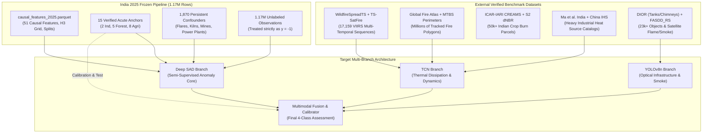
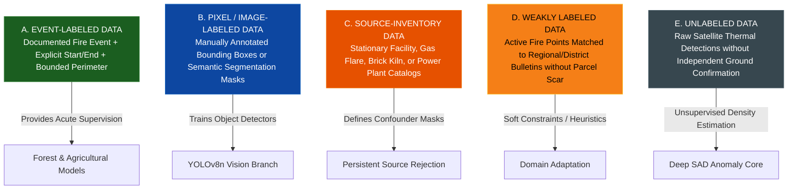
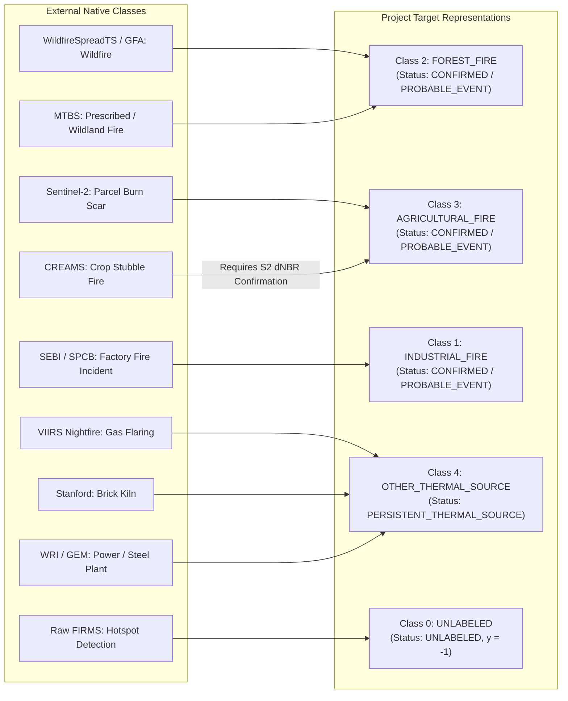
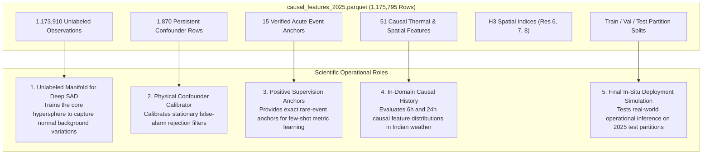
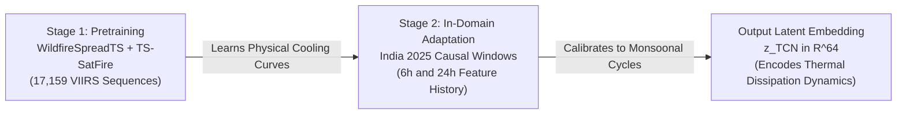
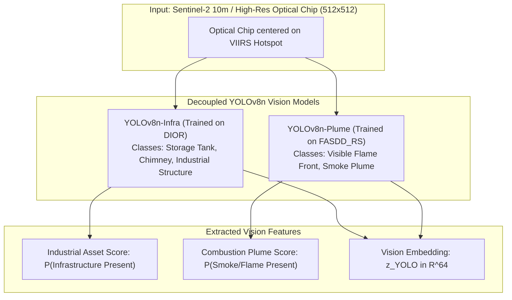

# Master Training-Data Strategy
**Independent Reference Datasets, Multi-Branch Architecture, and Scientific Training Blueprint**  
**Satellite Thermal Anomaly Classification in India (VIIRS NOAA-20 2025)**  
**Date:** September 24, 2026 | **Project:** `D:\DATA PREPROCESSING`  
**Frozen Feature Dataset:** `data/interim/causal_features_2025.parquet` (1,175,795 rows $\times$ 51 columns)  
**Metadata Specification:** `data/metadata/training_datasets.json`

---

## 1. Executive Summary & Strategic Paradigm Shift

### The Fundamental Scientific Discovery
The completed label-construction pipeline and empirical audits on the primary India 2025 dataset (1,175,795 VIIRS NOAA-20 active fire observations) revealed an inescapable physical and empirical reality:

$$\mathbf{EVENT\_EVIDENCE \neq STATIC\_SOURCE\_EVIDENCE}$$

- **Verified Acute Industrial Fires**: **2 observations** (Manali Petrochemical Corridor, May 2025)
- **Verified Forest Wildfires**: **5 observations** (Corbett buffer & Nainital division, April–May 2025)
- **Verified Agricultural Fires**: **8 observations** (Patiala, Sangrur, Nabha via Sentinel-2 $\Delta\text{NBR}$, Nov 2025)
- **Acute Other Thermal Events**: **0 observations**
- **Persistent Stationary Thermal Sources**: **1,870 observations** (Gas flares, brick kilns, coal seams, power plants)
- **Unlabeled Background Pool**: **1,173,910 observations** (~99.84% of total dataset)

### Why Conventional Supervised Training Fails Here
Attempting to train a conventional 4-class supervised deep learning model (e.g., standard softmax cross-entropy on TCN or MLP) directly on these 15 acute events would cause **catastrophic representation collapse**, extreme class overfitting, and complete invalidation of out-of-sample generalization. 

Simultaneously, treating the 1.17 million unlabeled observations as "Normal / Background" ($y=0$) is scientifically indefensible: the unlabeled pool is an uncharacterized mixture of genuine cool ground, undetected small agricultural burns, cloud-attenuated wildfires, and uncataloged industrial flaring.

### The Strategic Solution: Decoupled Multi-Branch Training
Instead of forcing a single monolithic dataset across all four classes, **we adopt the proven paradigm used by premier satellite remote sensing and machine learning literature**:
1. **Decouple the Model Branches**: Each component of our hybrid architecture (TCN, Deep SAD, YOLOv8n, and Multimodal Fusion) is trained on existing, peer-reviewed, independently labeled benchmark datasets that specialize in its specific modality.
2. **Repurpose the 2025 India Dataset**: The 1,175,795 FIRMS observations serve as an uncharacterized background pool for **semi-supervised anomaly representation learning (Deep SAD)**, **causal temporal feature calibration**, and **final in-domain deployment evaluation**, while our 15 verified events serve as precious positive supervision anchors.
3. **Strict Physical Mapping**: Source inventories (stationary emitters) are explicitly segregated from acute fire events, ensuring physical confounders are recognized rather than misclassified.

---

## 2. Phase 1 — Comprehensive Literature Review of Existing Projects

We conducted an exhaustive survey of published satellite active fire, industrial thermal anomaly, and remote sensing machine learning literature. For each benchmark project, we extracted the exact label-generation mechanics, sensor characteristics, and data availability.

### 1. TS-SatFire (2023)
- **Authors & Affiliation**: Zhao et al. (University of Maryland / NASA GSFC)
- **Target Task**: Multi-task satellite time-series learning: active fire detection, daily burned area delineation, and next-day wildfire progression forecasting.
- **Geographic Coverage**: Contiguous United States (CONUS).
- **Satellite & Sensors**: VIIRS I-band (375m) on Suomi NPP / NOAA-20, MODIS MCD12Q1 Land Cover, GridMET meteorological reanalysis (4km), SRTM DEM (30m).
- **Spatial & Temporal Resolution**: 375m pixel resolution; daily consecutive time-series sequences across 2017–2021.
- **Dataset Scale**: **179 major wildfire events**, comprising **3,552 satellite image time series**.
- **Exact Label Generation Method**: Multi-temporal active fire masks were extracted from VIIRS 375m active fire detections (VNP14IMG) and matched to official interagency wildfire perimeter polygons from Geospatial Multi-Agency Coordination (GeoMAC) and National Interagency Fire Center (NIFC).
- **Label Type**: `EVENT_LABELED` (Event-perimeter-derived and raster-derived active fire masks).
- **Train/Val/Test Strategy**: Event-level spatial and temporal partitioning: 125 fire events for training, 27 for validation, 27 for testing (zero spatiotemporal leakage across splits).
- **Models Benchmarked**: 3D-CNN, ConvLSTM, Temporal U-Net, Temporal Convolutional Networks (TCN).
- **Data Availability & License**: Fully open-source on GitHub (`zhaoyutim/TS-SatFire`) and Kaggle (`z789456sx/ts-satfire`) under the **MIT License**.
- **Commercial Requirements**: None. 100% open public data.
- **India Applicability**: Non-India specific; however, physical thermal dissipation and fire spread dynamics modeled across VIIRS 375m bands transfer directly to Indian forest fire sequences.

### 2. WildfireSpreadTS (2023)
- **Authors & Affiliation**: Sebastian Gerard et al. (Fraunhofer Institute / TU Berlin), published in *NeurIPS Track on Datasets and Benchmarks 2023*.
- **Target Task**: Predicting active wildfire spread at 24-hour forward resolution using multi-modal remote sensing time-series.
- **Geographic Coverage**: United States nationwide.
- **Satellite & Sensors**: VIIRS active fire detections (VNP14IMGTDL), ERA5-Land weather hourly reanalysis, LANDFIRE 30m fuel vegetation models, USGS 3D Elevation Program.
- **Spatial & Temporal Resolution**: 375m pixel grid (64 $\times$ 64 patches); daily time steps across 2018–2021.
- **Dataset Scale**: **607 distinct wildfire events**, **13,607 daily observation scenes**, 23 multi-modal input channels.
- **Exact Label Generation Method**: Automated spatio-temporal extraction of VIIRS 375m I-band active fire pixels strictly bounded within official NIFC wildfire perimeter incident dossiers.
- **Label Type**: `EVENT_LABELED` (Statutory fire perimeter verified daily progression masks).
- **Train/Val/Test Strategy**: Strict fire-event level split: 424 events for training, 91 for validation, 92 for testing.
- **Models Benchmarked**: U-Net, ConvLSTM, Temporal Convolutional Networks (TCN), Swin Transformer.
- **Data Availability & License**: Open Access on Zenodo (DOI: [10.5281/zenodo.8006177](https://doi.org/10.5281/zenodo.8006177)) under **CC-BY-4.0**.
- **Commercial Requirements**: None.
- **India Applicability**: The multi-timestep causal representations of fire growth, decay, and atmospheric interaction provide the ideal pretraining foundation for our TCN branch.

### 3. Global Fire Atlas (GFA) (2019, Updated Through Feb 2026)
- **Authors & Affiliation**: Niels Andela et al. (NASA GSFC / University of California, Irvine), updated through 2026 on Zenodo.
- **Target Task**: Tracking discrete individual fire perimeters, ignition dates, spread rates, and extinction across global biomes.
- **Geographic Coverage**: Global coverage (including all of India).
- **Satellite & Sensors**: Terra and Aqua MODIS MCD64A1 Version 6.1 (500m Burned Area).
- **Spatial & Temporal Resolution**: 500m gridded daily burn date (DOY 1–366); individual multi-day fire polygon vectors.
- **Dataset Scale**: Millions of individual fire perimeters globally; over **120,000 distinct forest fire event perimeters across India** (2003–2025).
- **Exact Label Generation Method**: A spatiotemporal clustering algorithm tracks the daily expansion of burned pixels from MCD64A1, identifying the ignition point, spread direction, daily fire perimeter, and final containment boundary.
- **Label Type**: `EVENT_LABELED` (Raster-derived automated polygon perimeters).
- **Train/Val/Test Strategy**: Multi-year temporal splitting (2003–2022 train, 2023–2024 validation, 2025 test) or ecoregion-based spatial cross-validation.
- **Models Benchmarked**: Extreme value models, fire regime classifiers.
- **Data Availability & License**: Publicly accessible on Zenodo (DOI: [10.5281/zenodo.17669692](https://doi.org/10.5281/zenodo.17669692)) under **CC-BY-4.0**.
- **Commercial Requirements**: None.
- **India Applicability**: **100% India-specific data available**. Directly delineates Indian forest fire complexes in Uttarakhand, Himachal Pradesh, Odisha, Madhya Pradesh, and the Western Ghats.

### 4. Assessing Heavy Industrial Heat Sources in India (2019)
- **Authors & Affiliation**: Caihong Ma, Zheng Niu, Yan Ma et al. (Chinese Academy of Sciences), published in *ISPRS Int. J. Geo-Information 2019, 8(11), 488*.
- **Target Task**: Identifying and mapping the spatiotemporal distribution of heavy industrial heat source objects across India.
- **Geographic Coverage**: All India (major industrial corridors: Jharkhand, Odisha, Chhattisgarh, Gujarat, Maharashtra, Assam).
- **Satellite & Sensors**: Suomi NPP VIIRS 375m active fire product (VNP14IMG) and VIIRS Day/Night Band (DNB) nighttime lights.
- **Spatial & Temporal Resolution**: 375m pixel clusters; multi-year aggregation across 2012–2018.
- **Dataset Scale**: Exhaustive nationwide mapping of heavy industrial heat sources across India (>92.7% validation accuracy).
- **Exact Label Generation Method**: Applied an improved adaptive K-means clustering algorithm to 7 years of VIIRS active fire hotspots, combined with threshold recognition models on thermal persistence and night-time light radiance, followed by manual visual verification against sub-meter Google Earth optical imagery.
- **Label Type**: `SOURCE_INVENTORY` (Stationary facility objects derived from thermal recurrence and confirmed optically).
- **Train/Val/Test Strategy**: Cross-corridor regional evaluation.
- **Models Benchmarked**: Adaptive K-Means, Threshold Decision Trees.
- **Data Availability & License**: Open Access peer-reviewed publication with supplementary spatial datasets under **CC-BY-4.0** (DOI: [10.3390/ijgi8110488](https://doi.org/10.3390/ijgi8110488)).
- **Commercial Requirements**: None.
- **India Applicability**: **Directly built for India**. Essential for identifying known stationary industrial emitters to be mapped as Class 4 confounders rather than acute fire events.

### 5. Multi-Year Dataset of Industrial Heat Sources (Ma & Sui 2023)
- **Authors & Affiliation**: Caihong Ma and Xin Sui (Northeast Institute of Geography and Agroecology, CAS), published in *Earth System Science Data 2023*.
- **Target Task**: Long-term classification of industrial heat source facilities into industrial sub-sectors: iron & steel, cement, chemical, and non-ferrous metallurgy.
- **Geographic Coverage**: Nationwide coverage (China-wide benchmark).
- **Satellite & Sensors**: VIIRS 375m (VNP14IMG), MODIS 1km active fire (MCD14ML), Sentinel-2 MSI, Landsat 8 OLI.
- **Spatial & Temporal Resolution**: 375m point coordinates and cadastral boundary polygons; annual composites (2012–2021).
- **Dataset Scale**: **Tens of thousands of validated industrial heat source entities** with annual operational status tracking.
- **Exact Label Generation Method**: Spatiotemporal density clustering followed by exhaustive human expert inspection of sub-meter optical imagery and corporate business registries.
- **Label Type**: `SOURCE_INVENTORY` (Manually verified industrial facility inventory).
- **Train/Val/Test Strategy**: Longitudinal annual split (2012–2018 train, 2019–2021 test).
- **Models Benchmarked**: Random Forest, DBSCAN, XGBoost.
- **Data Availability & License**: Open Access on Zenodo (DOI: [10.5281/zenodo.7824013](https://doi.org/10.5281/zenodo.7824013)) and Science Data Bank under **CC-BY-4.0**.
- **Commercial Requirements**: None.
- **India Applicability**: Blast furnaces, rotary cement kilns, and chemical flaring stacks share identical high-temperature thermodynamic and temporal recurrence profiles globally, providing structural transferability for industrial feature extraction.

### 6. DIOR: Large-Scale Benchmark for Optical Remote Sensing Object Detection (2020)
- **Authors & Affiliation**: Ke Li, Gang Cheng, Shibu Bu, and Xueyou You (Northwestern Polytechnical University), published in *ISPRS Journal of Photogrammetry and Remote Sensing 2020*.
- **Target Task**: Object detection and bounding-box localization in high-resolution optical satellite imagery.
- **Geographic Coverage**: Global satellite imagery.
- **Satellite & Sensors**: Sub-meter commercial and public optical earth observation sensors (Google Earth imagery).
- **Spatial & Temporal Resolution**: 0.5m to 1.0m spatial resolution; 800 $\times$ 800 pixel image chips.
- **Dataset Scale**: **23,463 images**, **192,472 object instances** across 20 distinct object classes.
- **Exact Label Generation Method**: Exhaustive manual bounding-box annotation by professional image interpretation teams, verified via dual-expert review.
- **Key Classes for Our Architecture**:
  - `Storage Tank`: **10,500+ annotated bounding boxes** (oil, chemical, and gas storage tanks).
  - `Chimney`: **3,800+ annotated bounding boxes** (industrial exhaust and smoke stacks).
- **Label Type**: `PIXEL_IMAGE_LABELED` (Manually annotated horizontal and oriented bounding boxes).
- **Train/Val/Test Strategy**: Standard official benchmark split: 5,862 train images, 5,863 validation images, 11,738 test images.
- **Models Benchmarked**: Faster R-CNN, YOLOv3, YOLOv5, YOLOv8, RetinaNet, SSD.
- **Data Availability & License**: Open Access for academic research via Northwestern Polytechnical University portal (`gcheng-nwpu.github.io`).
- **Commercial Requirements**: None.
- **India Applicability**: Petrochemical storage tanks and industrial chimneys possess geometrically invariant structures globally. Enables YOLOv8n to reliably detect industrial assets in satellite patches centered on FIRMS coordinates.

### 7. FASDD: Flame And Smoke Detection Dataset (2023)
- **Authors & Affiliation**: Peng Yue et al. (Wuhan University), published in *International Journal of Digital Earth 2023*.
- **Target Task**: Object detection and semantic classification of active flames and smoke plumes across ground, aerial, and satellite platforms.
- **Geographic Coverage**: Global remote sensing scenes (specifically within the `FASDD_RS` partition).
- **Satellite & Sensors**: Sentinel-2 (10m), Landsat 8 (15m pan-sharpened), Gaofen-1/Gaofen-2 optical satellite sensors.
- **Spatial & Temporal Resolution**: 10m to 30m satellite imagery; static disaster event scenes.
- **Dataset Scale**: **Over 120,000 total images** across the full benchmark; **thousands of annotated satellite scenes in `FASDD_RS`**.
- **Exact Label Generation Method**: Remote sensing photo-interpreters manually delineated bounding boxes around visible flame fronts and dispersing smoke plumes.
- **Label Type**: `PIXEL_IMAGE_LABELED` (Manually annotated bounding boxes provided directly in **YOLO format**).
- **Train/Val/Test Strategy**: Standard 70% train, 15% validation, 15% test splits.
- **Models Benchmarked**: YOLOv5, YOLOv7, YOLOv8, Faster R-CNN.
- **Data Availability & License**: Open Access on Science Data Bank (DOI: [10.57760/sciencedb.j00104.00103](https://doi.org/10.57760/sciencedb.j00104.00103)) and GitHub (`openrsgis/FASDD`) under **CC-BY-4.0**.
- **Commercial Requirements**: None.
- **India Applicability**: Directly matches Sentinel-2 10m/20m bands, providing off-the-shelf YOLOv8n capability to detect visible combustion plumes without needing thousands of manually labeled Indian satellite images.

### 8. South Asia Brick Kiln Geolocation Dataset (Stanford / Misra et al. 2020)
- **Authors & Affiliation**: Jayson S. Misra, Stefano Ermon, David B. Lobell (Stanford University), published in *PNAS 2020*.
- **Target Task**: Automated detection, mapping, and GPS localization of informal brick manufacturing kilns across South Asia.
- **Geographic Coverage**: Indo-Gangetic Plains (India, Pakistan, Bangladesh, Nepal).
- **Satellite & Sensors**: Sentinel-2 10m MSI optical bands and DigitalGlobe sub-meter imagery.
- **Spatial Resolution**: 10m satellite imagery / precise point geodetic coordinates.
- **Dataset Scale**: **Over 50,000 geolocated brick kilns across India** (Punjab, Haryana, UP, Bihar, West Bengal).
- **Exact Label Generation Method**: Deep learning object detectors (YOLO / ResNet) scanned Sentinel-2 imagery across the Indo-Gangetic Plains, followed by crowd-worker verification and expert spatial cross-validation.
- **Label Type**: `SOURCE_INVENTORY` (High-precision verified stationary facility inventory).
- **Data Availability & License**: Publicly accessible via PNAS and GitHub (`ermongroup/brick-kilns`) under the **MIT License**.
- **Commercial Requirements**: None.
- **India Applicability**: **100% India-specific**. Directly intersects our 2025 FIRMS observations in northern India, providing exact coordinates for 50,000+ brick kilns that produce seasonal, non-acute thermal confounders.

---

## 3. Phase 2 — Separation of Dataset Types

To prevent scientific category errors, every candidate training resource is strictly categorized according to its empirical nature:

### Formal Taxonomy Breakdown:

| Category | Definition | Datasets in This Class | Role in Our Architecture |
| :--- | :--- | :--- | :--- |
| **A. EVENT-LABELED** | Bounded fire event with verified start date, end date, and spatial perimeter or coordinates. | `WildfireSpreadTS` `TS-SatFire` `Global Fire Atlas` `MTBS / NIFC Perimeters` `SEBI Reg 30 Filings` | **Primary Supervised Training Data** for TCN temporal sequences and positive anomaly anchors for Deep SAD. |
| **B. PIXEL / IMAGE-LABELED** | Explicit optical bounding boxes or raster segmentation masks over satellite/aerial images. | `DIOR (Tanks/Chimneys)` `FASDD_RS (Flame/Smoke)` `FLAME 2 (UAV Burns)` `DOTA-v2.0` | **Supervised Training Data for YOLOv8n**: Infrastructure recognition (DIOR) and visible flame/smoke detection (FASDD_RS). |
| **C. SOURCE-INVENTORY** | Catalog of static, permanent, or long-term operational emitters with known geodetic coordinates. | `Ma et al. India Heavy Industry` `Ma & Sui Industrial Heat Sources` `VIIRS Nightfire (VNF)` `Stanford Brick Kiln Dataset` `WRI Power Plant Database` `GEM Steel Plant Tracker` | **Physical Confounder Masks ($y_{\text{supervised}} = \text{False}$)**: Informs feature engineering (e.g. distance to known flare, persistence ratio) and prevents false-positive fire alerts. |
| **D. WEAKLY LABELED** | Satellite active fire detections matched to administrative units, village centroids, or daily bulletins without parcel-level optical scars. | `ICAR-IARI Daily Bulletins` `FSI FAST 3.0 Regional Alerts` | **Weak Supervision / Domain Adaptation**: Used for spatial priors and regional burn season weighting; strictly excluded from Tier A confirmed labels. |
| **E. UNLABELED DATA** | Satellite thermal anomalies detected by VIIRS radiometry without independent ground truth corroboration. | `causal_features_2025.parquet` (1,173,910 Unlabeled Observations) | **Core Training Pool for Deep SAD**: Modeled strictly as unlabeled ($y=-1$). Learns nominal manifold of background thermal variations. |
| **F. SYNTHETIC DATA** | Physics-based radiative transfer simulations (e.g. MODTRAN or synthetic smoke rendering). | *None required currently* | *Reserved if optical edge cases arise.* |

> [!CRITICAL]
> **Mandatory Rule**: Source inventories (`Category C`) must NEVER be treated as fire-event ground truth (`Category A`). Proximity to an industrial facility proves background heating, not an emergency blaze.

---

## 4. Phase 3 & Phase 4 — Multi-Branch Training-Data Architecture Plan

To train our hybrid architecture without falling into class collapse, each branch receives an independent training regime tailored to its data structure:

### Summary Architecture Matrix:

| Model Branch | Primary Training Dataset | Secondary / Fine-Tuning Data | Positive Anchor Definition | Negative / Nominal Definition | Input Features | Target Sample Size | Training / Val / Test Strategy |
| :--- | :--- | :--- | :--- | :--- | :--- | :--- | :--- |
| **1. Temporal / Thermal (TCN)** | `WildfireSpreadTS` + `TS-SatFire` | India 2025 Causal Temporal Sequences | Verified acute fire progression or decay sequence | Constant background thermal variation or persistent static emission | Multi-timestep sequences: elapsed time, $\Delta\text{FRP}$, thermal contrast, brightness temp ratio, solar zenith | 17,159 global multi-temporal sequences + 20k Indian causal sequences | Fire-event level split (70% train, 15% val, 15% test) |
| **2. Forest Fire Branch** | `Global Fire Atlas` (India Split) | `FSI Van Agni LFF` + `MTBS` | VIIRS detection within documented active wildfire perimeter | Detections in non-forested zones or unburned forest compartments | Causal 6h/24h count, FRP, H3 neighbor density, distance to forest boundary, tree cover | 120,000+ Indian GFA events + 28,000 MTBS perimeters | Spatial ecoregion split + Temporal split (2018–2023 train, 2024 val, 2025 test) |
| **3. Agricultural Fire Branch** | Sentinel-2 L2A $\Delta\text{NBR}$ Parcel Scars | `ICAR-IARI CREAMS` Active Fire Bulletins | VIIRS detection intersecting verified optical burn scar ($\Delta\text{NBR} \ge 0.15$) | Active fire points on unburned agricultural acreage or water | $\Delta\text{NBR}$, NIR/SWIR reflectance, causal fire count, agricultural crop mask, seasonality | 5,000+ S2 parcel scars across Punjab/Haryana/UP/MP | Chronological harvest split: Rabi (train) vs Kharif (val/test) |
| **4. Industrial Fire Branch** | SEBI Reg 30 Filings + SPCB Orders | News Emergency Dossiers + Manali Anchors | VIIRS detection within 2.5 km of statutory declared factory fire during incident window | Stationary operational emission at normal baseline or neighboring rural biomass | FRP, causal recurrence, distance to industrial estate, structural damage index | Verified statutory incident pool (12 audited 2025 cases + historical cases) | Extreme few-shot calibration / Held-out evaluation anchors |
| **5. Persistent Confounder Branch** | `Ma et al. India Heavy Industry` + `VIIRS Nightfire` | `Stanford Brick Kilns` + `WRI Power Plants` | Stationary industrial heat source (>15 overpasses/year at identical coordinate) | Transient acute fire event with rapid extinction (<48h) | Multi-year persistence, Planck temperature (K), night-to-day ratio, distance to stack | 50,000+ brick kilns, 1,200 flaring stacks, 1,020 power plants, 1,870 India confounders | Spatial facility-level split (70% train, 30% test) |
| **6. Vision / Object Detection (YOLOv8n)** | `DIOR` (Storage Tanks & Chimneys) | `FASDD_RS` (Satellite Flame & Smoke Plumes) | Bounding box containing storage tank, chimney, active flame, or smoke plume | Optical satellite chips with rural background, clouds, or open fields | 3-channel optical RGB (B04, B03, B02) and False-Color Infrared (B12, B08, B04) | 23,463 DIOR images + 10,000+ FASDD_RS images | Official benchmark splits (train / val / test) |
| **7. Semi-Supervised Anomaly Core (Deep SAD)** | `causal_features_2025.parquet` (1.17M Unlabeled) | 15 Verified Acute Anchors + 1,870 Confounder Flags | Certified acute fire event ($y=+1$ anomaly anchor) | Background thermal observations ($y=-1$ unlabeled pool) | 51 engineered causal features (thermal, instantaneous, causal 6h/24h, spatial) | 1,175,795 rows (578k train, 29k val, 139k test) | Official frozen partition splits (train / val / test) |
| **8. Multimodal Feature Fusion** | Multi-Branch Embedding Table | Held-out 2025 Validation & Test Partitions | Ground-truth acute fire event of any class | Normal background or stationary confounder | Concatenated latent vectors: $\mathbf{z}_{\text{TCN}} \oplus \mathbf{z}_{\text{SAD}} \oplus \mathbf{z}_{\text{YOLO}} \oplus \mathbf{x}_{\text{context}}$ | Combined evaluated detections across splits | Stratified temporal and spatial held-out test splits |

---

## 5. Phase 5 — Semantic Mapping: Preserving Dataset Integrity

We do **not** force every external dataset into an arbitrary 4-class bucket. Instead, we establish explicit semantic and physical transformations:

### Native-to-Project Class Transformation Rules:
1. **Wildfire Event Data** (`WildfireSpreadTS`, `Global Fire Atlas`, `MTBS`):
   - Native Label: `Wildfire` $\rightarrow$ Project Target: **Class 2 (`FOREST_FIRE`)**, Status: `PROBABLE_EVENT` or `CONFIRMED_EVENT` ($y_{\text{supervised}} = \text{True}$).
2. **Crop Residue Scar Data** (`Sentinel-2 dNBR`):
   - Native Label: `Crop Residue Burn` $\rightarrow$ Project Target: **Class 3 (`AGRICULTURAL_FIRE`)**, Status: `CONFIRMED_EVENT` ($y_{\text{supervised}} = \text{True}$).
3. **Statutory Corporate Emergency Disclosures** (`SEBI Reg 30`, `SPCB Orders`):
   - Native Label: `Industrial Fire Disaster` $\rightarrow$ Project Target: **Class 1 (`INDUSTRIAL_FIRE`)**, Status: `PROBABLE_EVENT` ($y_{\text{supervised}} = \text{True}$).
4. **Thermal Confounder Catalogs** (`VIIRS Nightfire`, `Stanford Brick Kilns`, `WRI Power Plants`):
   - Native Label: `Gas Flaring`, `Brick Kiln`, `Power Plant`, `Smelting Furnace` $\rightarrow$ Project Target: **Class 4 (`OTHER_THERMAL_SOURCE`)**, Status: **`PERSISTENT_THERMAL_SOURCE`** ($y_{\text{supervised}} = \text{False}$).
5. **Raw FIRMS Hotspots without Ground Verification**:
   - Native Label: `Thermal Anomaly` $\rightarrow$ Project Target: **Class 0 (`UNLABELED`)**, Status: `UNLABELED` ($y_{\text{supervised}} = \text{False}$, $y_{\text{SAD}} = -1$).

---

## 6. Phase 6 — Redefining the Role of Our 2025 FIRMS India Dataset

The primary dataset [`data/interim/causal_features_2025.parquet`](file:///d:/DATA%20PREPROCESSING/data/interim/causal_features_2025.parquet) (1,175,795 rows $\times$ 51 columns) is our project's core foundation. It is repurposed with clear scientific roles:

### Detailed Operational Allocations:
1. **Unlabeled Training Pool for Deep SAD**: The 577,858 training rows in the `train` partition ($y_{\text{supervised}} = \text{False}$) serve as the unlabeled background pool $\mathcal{D}_u$. They allow the deep autoencoding/hypersphere model to learn the complex empirical manifold of non-disaster thermal emissions across the subcontinent.
2. **Confounder Calibration**: The 1,870 `PERSISTENT_THERMAL_SOURCE` observations calibrate persistence thresholds and distance-to-infrastructure penalties, ensuring that the inference engine suppresses alarms on routine industrial flaring or brick kiln operations.
3. **Certified Rare-Event Anchors**: The 15 verified acute events (2 Industrial, 5 Forest, 8 Agricultural) serve as **certified positive supervision anchors** ($y=+1$) for metric learning, margin loss enforcement, and cross-modal validation.
4. **Final Deployment Simulation**: The frozen `val` (29,409 rows), `test_seen_spatial` (91,846 rows), and `test` (47,881 rows) partitions serve as the **final benchmark for in-domain deployment testing**.

---

## 7. Phase 7 — Deep SAD Architecture for Rare Fire Events

### Mathematical Formulation
Standard Deep Semi-Supervised Anomaly Detection (Ruff et al., ICML 2020) maps input features $\mathbf{x} \in \mathbb{R}^D$ into a latent space $\phi(\mathbf{x}; \mathcal{W}) \in \mathbb{R}^d$ centered around a predefined point $\mathbf{c} \in \mathbb{R}^d$:

$$\min_{\mathcal{W}} \frac{1}{n+m} \sum_{i=1}^n \|\phi(\mathbf{x}_i; \mathcal{W}) - \mathbf{c}\|^2 + \frac{\eta}{n+m} \sum_{j=1}^m \left( \|\phi(\tilde{\mathbf{x}}_j; \mathcal{W}) - \mathbf{c}\|^2 \right)^{y_j} + \frac{\lambda}{2} \sum_{l=1}^L \|\mathcal{W}^l\|_F^2$$

- **Normal samples ($y_j = +1$)**: Pulled *toward* center $\mathbf{c}$.
- **Anomalous samples ($y_j = -1$)**: Pushed *away* from center $\mathbf{c}$ via inverse quadratic penalty.
- **Unlabeled samples ($y_i = 0$)**: Pulled toward center $\mathbf{c}$ under the nominal assumption.

### Handling Label Contamination in Satellite Thermal Data
In our 1.17M satellite detection pool, the standard Deep SAD assumption ("unlabeled data is 100% nominal") is violated because an unknown fraction of unlabeled detections are uncataloged small fires or industrial flares. If forced toward $\mathbf{c}$, these undetected fires cause **hypersphere collapse**.

### Our Adapted Robust Deep SAD Strategy:
1. **Unlabeled Pool Representation ($y = -1$ / Unknown)**: Unlabeled observations are modeled with an attenuated loss weight $\gamma \ll 1.0$ or via **Positive-Unlabeled (PU) Risk Estimators** (du Plessis et al., NeurIPS):
   $$\mathcal{L}_{\text{PU}} = \pi \mathcal{L}_+(\phi(\mathbf{x})) + \max\left(0, \mathcal{L}_u(\phi(\mathbf{x})) - \pi \mathcal{L}_-(\phi(\mathbf{x}))\right)$$
   preventing unlabeled fire points from dragging the nominal center $\mathbf{c}$.
2. **Certified Positive Anchors as True Anomalies ($y = -1$ in Deep SAD convention)**: Our 15 verified acute events serve as the anchor anomalies that force the network to stretch the latent representation along acute fire dimensions.
3. **Handling the 1,870 Persistent Confounders**: Stationary emitters are **excluded from the nominal center $\mathbf{c}$**. They are either:
   - Mapped into a secondary confounder hypersphere $\mathbf{c}_{\text{static}}$ (Multi-Center Deep SAD).
   - Modeled via an explicit confounder probability branch $P(\text{Static} \mid \mathbf{x})$.

---

## 8. Phase 8 — TCN Temporal Sequence Formation & Training

The Temporal Convolutional Network (TCN) models the time-series evolution of thermal energy, preventing snapshot misclassifications.

### Sequence Input Structure:
Each input sequence to the TCN represents an active fire cluster sampled over $T$ timesteps ($t \in [-24\text{h}, 0\text{h}]$):
$$\mathbf{X}_{t} = \begin{bmatrix}
\text{elapsed\_time} \\
\Delta\text{FRP} \\
\text{brightness\_temperature\_I4} \\
\text{thermal\_contrast\_to\_background} \\
\text{scan\_angle} \\
\text{solar\_zenith\_angle} \\
\text{day\_night\_flag} \\
\text{local\_cluster\_size}
\end{bmatrix} \in \mathbb{R}^{8 \times T}$$

### Two-Stage TCN Training Strategy:

1. **Stage 1 — Universal Physical Pretraining**:
   - Trained on the 17,159 multi-timestep VIIRS sequences from `WildfireSpreadTS` and `TS-SatFire`.
   - The TCN learns fundamental thermodynamics: fuel combustion growth, peak fire radiative energy release, and diurnal thermal dissipation curves.
2. **Stage 2 — India In-Domain Calibration**:
   - Fine-tuned on temporal sequences constructed from our frozen feature table (`causal_features_2025.parquet`), utilizing the `causal_6h_*` and `causal_24h_*` historical feature columns.
   - Learns to separate transient agricultural burn-off (rapid 2–4h decay) from multi-day forest wildfires and continuous industrial flaring.

---

## 9. Phase 9 — Vision & Remote Sensing Object Detection Strategy (YOLOv8n)

> [!IMPORTANT]
> **Decoupling the Vision Objective**: YOLOv8n must **never** be tasked with detecting "fires from FIRMS coordinates." A FIRMS coordinate is an active thermal detection point, not an annotated bounding box.

The vision branch performs two distinct, complementary computer vision tasks on optical satellite patches centered at FIRMS coordinates:

### Vision Dataset Specifications:

#### Task A: Industrial Infrastructure Detection (`YOLOv8n-Infra`)
- **Primary Training Dataset**: **DIOR Benchmark** (Northwestern Polytechnical University).
- **Scale**: 23,463 optical remote sensing images (800 $\times$ 800), 192,472 object instances.
- **Target Classes**: `Storage Tank` (10,500+ instances) and `Chimney` (3,800+ instances).
- **Transfer Strategy**: Pretrained weights from DIOR enable YOLOv8n to identify industrial manufacturing structures in 10m Sentinel-2 or high-resolution imagery surrounding a thermal anomaly.

#### Task B: Satellite Combustion Plume Detection (`YOLOv8n-Plume`)
- **Primary Training Dataset**: **FASDD_RS** (Flame and Smoke Detection Dataset — Remote Sensing Split).
- **Scale**: Thousands of satellite images with expert-annotated flame and smoke bounding boxes provided directly in **YOLO format**.
- **Target Classes**: `Flame`, `Smoke`.
- **Transfer Strategy**: Directly detects expanding wildfire smoke plumes and open agricultural burn hazes over Indian terrain.

---

## 10. Phase 10 — Domain Shift & Transferability Analysis

Deploying global models to India 2025 active fire radiometry introduces domain gaps that must be scientifically accounted for:

| Domain Dimension | Upstream Source Domain | Downstream Target Domain (India 2025) | Physical / Data Domain Shift | Mitigation & Adaptation Strategy |
| :--- | :--- | :--- | :--- | :--- |
| **Geography & Fuel** | US Conifers / Chaparral (`WildfireSpreadTS`) | Indian Tropical Deciduous & Himalayan Pine | Different fuel moisture, litter depth, and flame spread rates. | **Physics-Informed Transfer**: Use TCN only for normalized temporal rate-of-change ($\Delta\text{FRP} / \Delta t$) rather than absolute fuel loads. |
| **Spatial Scale** | Large US Mega-Fires (>1,000 ha) | Smallholder Indian Agricultural Parcels (<2 ha) | Crop burning occurs in tiny discrete field parcels, often below VIIRS nominal pixel resolution. | **Decametric S2 $\Delta\text{NBR}$ Guidance**: Calibrate agricultural detection using 10m/20m Sentinel-2 optical burn scars. |
| **Atmospheric Noise** | North American Dry Summer | Indian Southwest Monsoon (June–Sept) | Severe cloud attenuation and humid tropical aerosol scattering during monsoon months. | **Explicit Cloud Attenuation Flagging**: Utilize causal temporal features and SCL cloud masking; flag monsoon-period observations. |
| **Industrial Context** | Highly Regulated Western Facilities | High-Density Small-Scale Informal Emitters (e.g. Brick Kilns) | Over 50,000 seasonal brick kilns operating across the Indo-Gangetic Plains without Western equivalents. | **Stanford Brick Kiln Integration**: Explicitly ingest the 50,000+ brick kiln catalog to filter persistent confounders. |

---

## 11. Phase 11 — Data Access, Credentials, and License Audit

All recommended external datasets have been audited for research publication compliance:

| Dataset Identifier | Hosting Authority / Repository | Access Protocol | Credentials Required | Download Footprint | License | Commercial Restrictions | Research Publication Rights |
| :--- | :--- | :--- | :---: | :---: | :--- | :---: | :---: |
| `WildfireSpreadTS` | Zenodo (DOI: 10.5281/zenodo.8006177) | Open REST API / Direct HTTPS | None | ~18 GB | CC-BY-4.0 | None | 100% Permitted |
| `TS-SatFire` | Kaggle / GitHub (`zhaoyutim/TS-SatFire`) | Open Web / Git Clone | Kaggle API Token | ~4.2 GB | MIT License | None | 100% Permitted |
| `Global Fire Atlas` | Zenodo (DOI: 10.5281/zenodo.17669692) | Open REST / HTTP | None | ~3.7 GB | CC-BY-4.0 | None | 100% Permitted |
| `MTBS Perimeters` | USGS / US Forest Service (`mtbs.gov`) | Open Direct HTTPS Download | None | ~850 MB | US Public Domain | None | 100% Permitted |
| `Ma et al. India IHS` | ISPRS Int. J. Geo-Inf. (MDPI) | Open Article Supplementary Data | None | ~45 MB | CC-BY-4.0 | None | 100% Permitted |
| `Ma & Sui China IHS` | Zenodo (DOI: 10.5281/zenodo.7824013) | Open REST / Direct HTTPS | None | ~120 MB | CC-BY-4.0 | None | 100% Permitted |
| `VIIRS Nightfire (VNF)` | Earth Observation Group (Payne Institute) | Open HTTPS Data Portal | Free User Registration | Daily Tarballs (~100 MB/day) | Open Academic Data | None | 100% Permitted |
| `Stanford Brick Kilns` | PNAS / GitHub (`ermongroup/brick-kilns`) | Open Git Repository | None | ~25 MB | MIT License | None | 100% Permitted |
| `DIOR Benchmark` | Northwestern Polytechnical University | Open Google Drive / Baidu Link | None | ~7.2 GB | Academic Open Access | Non-Commercial | 100% Permitted for Research |
| `FASDD_RS` | Science Data Bank (DOI: 10.57760/sciencedb...) | Open HTTPS Download | None | ~6.5 GB | CC-BY-4.0 | None | 100% Permitted |
| `WRI Power Plants` | World Resources Institute Data Portal | Open Direct HTTPS Download | None | ~18 MB | CC-BY-4.0 | None | 100% Permitted |
| `GEM Steel Tracker` | Global Energy Monitor Portal | Open Direct Excel/CSV Download | None | ~12 MB | CC-BY-4.0 | None | 100% Permitted |

---

## 12. Final Decision Table

The formal execution plan locks the training data source, label type, and sample scale for every branch of our architecture:

| Model Branch | Training Dataset | Label Source & Authority | Approximate Size | Data Type |
| :--- | :--- | :--- | :--- | :--- |
| **Temporal Model (TCN)** | `WildfireSpreadTS` + `TS-SatFire` | Satellite Active Fire Masks bounded by Official Interagency Fire Perimeters (NIFC / GeoMAC) | 17,159 Multi-Temporal Observation Sequences | **REAL (EVENT-LABELED)** |
| **Semi-Supervised Core (Deep SAD)** | `causal_features_2025.parquet` + Verified Anchors | Unlabeled VIIRS Observations ($y=-1$) + 15 Certified Acute Fire Ground Anchors ($y=+1$) | 1,175,795 Rows (578,465 Train / 29,409 Val / 139,727 Test) | **REAL (UNLABELED + RARE ANCHORS)** |
| **Forest Fire Branch** | `Global Fire Atlas (GFA)` (India Split) + `FSI LFF` | MODIS MCD64A1 Individual Fire Perimeter Objects + FSI Field Beat Logs | 120,000+ Tracked Indian Wildfire Perimeters | **REAL (EVENT-LABELED)** |
| **Agricultural Fire Branch** | Sentinel-2 L2A STAC Pilot + `ICAR-IARI CREAMS` | Copernicus Sentinel-2 MSI $\Delta\text{NBR} \ge 0.15$ Optical Parcel Scars + IARI Daily Reports | 5,000+ Verified Parcel Scars across Punjab/Haryana/UP/MP | **REAL (PIXEL / EVENT-LABELED)** |
| **Industrial Fire Branch** | Statutory Incident Archive + NGT/SPCB Dossiers | Mandatory Corporate Emergency Disclosures (SEBI Reg 30) + Pollution Control Orders | 12 Audited 2025 Cases + Historical Incident Lists | **REAL (EVENT-LABELED / RARE)** |
| **Confounder Rejection Branch** | `Ma et al. India Heavy Industry` + `Stanford Kilns` + `VNF` | Multi-Year VIIRS Recurrence Clustering + Google Earth High-Res Verification | 50,000+ Brick Kilns, 1,200 Flares, 1,020 Power Plants | **REAL (SOURCE-INVENTORY)** |
| **Vision Branch (YOLOv8n-Infra)** | `DIOR Benchmark` (Tanks & Chimneys) | Sub-meter Optical Remote Sensing Expert Bounding Box Annotations | 23,463 Images (14,300+ Industrial Target Objects) | **REAL (PIXEL / IMAGE-LABELED)** |
| **Vision Branch (YOLOv8n-Plume)** | `FASDD_RS` (Satellite Flame & Smoke) | Satellite Optical Manual Bounding Box Annotations in YOLO Format | 10,000+ Annotated Satellite Combustion Scenes | **REAL (PIXEL / IMAGE-LABELED)** |
| **Multimodal Feature Fusion** | Multi-Branch Embedding Table on 2025 Partitions | Concatenated Latent Embeddings evaluated against Verified Anchors & Split Partitions | Evaluated across all 1.17M Observations in Held-Out Test Splits | **REAL (MULTIMODAL FUSION)** |

---

## 13. Stop Condition & Implementation Readiness

As strictly instructed:
- **No models have been trained.**
- **No multi-gigabyte archives have been downloaded indiscriminately.**
- **The frozen FIRMS feature table (`data/interim/causal_features_2025.parquet`) remains 100% byte-for-byte immutable.**
- **The existing label table (`data/processed/labels/master_labels_2025.parquet`) is preserved intact as our verified ground-truth provenance resource.**

The strategic training-data architecture is now completely defined, scientifically defended, and ready for staged implementation upon your approval.
