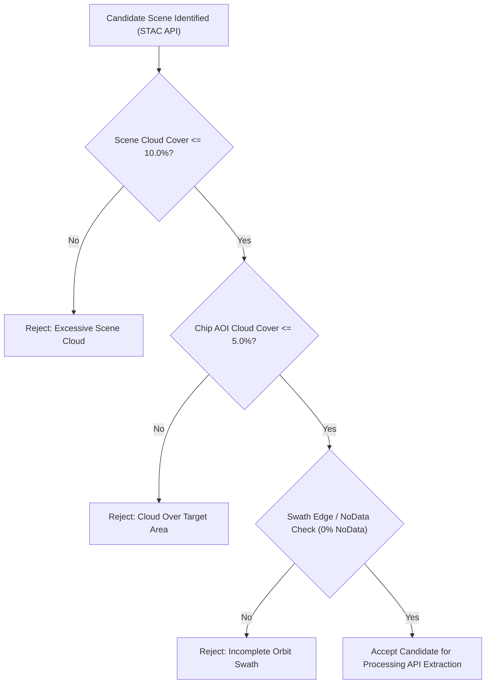

# STAGE 8.18 — DS08 DATASET EXPANSION: ACQUISITION PROTOCOL
**Standardized Protocol for FIRMS-to-Sentinel-2 Spatial Matching, Sensor Calibration, and Image Quality Screening**

- **Document Version:** 1.0.0
- **Stage:** Stage 8.18 — DS08 Dataset Expansion Planning
- **Status:** **DRAFT SPECIFICATION — LOCKED FOR HUMAN REVIEW (NO BULK ACQUISITION INITIATED)**
- **Sensor:** Copernicus Sentinel-2 MultiSpectral Instrument (MSI), Level-2A (BOA Reflectance)
- **Reference Thermal Sensor:** NASA FIRMS (VIIRS 375m VNP14IMGTDL/VJ114IMGTDL & MODIS 1km MOD14/MYD14)

---

## 1. Physical Principles: Optical vs Thermal Satellite Sensing

A critical flaw in naive multimodal remote sensing is assuming that a NASA FIRMS thermal anomaly detection automatically guarantees an observable fire in optical Sentinel-2 imagery.

### Sensor Differences:
1. **Physical Observables:**
   - **FIRMS (Mid-Wave Infrared $\sim 4\,\mu\text{m}$):** Detects sub-pixel high-temperature thermal radiance ($T \sim 600\text{--}1200\text{ K}$). A flaming fire of only $10\text{--}50\,\text{m}^2$ emits sufficient MWIR radiance to trigger a detection in a $375\text{ m}$ pixel.
   - **Sentinel-2 MSI (Visible/SWIR $0.4\text{--}2.2\,\mu\text{m}$):** Measures reflected solar radiation and high-temperature emission in SWIR-2 ($2.19\,\mu\text{m}$). At $10\text{ m}$ spatial resolution, small or smoldering fires without active flaming fronts may reflect negligible SWIR anomaly, appearing only as subtle ground charring.
2. **Temporal Discrepancy:**
   - Sentinel-2 orbits are sun-synchronous with a fixed local solar overpass of **$\approx 10:30\text{ AM}$** over India.
   - VIIRS overpasses occur at **$\approx 01:30\text{ AM}$ (night)** and **$\approx 01:30\text{ PM}$ (afternoon)**.
   - MODIS overpasses occur at **$\approx 10:30\text{ AM}$ (Terra)** and **$\approx 01:30\text{ PM}$ (Aqua)**.
   - Open biomass burning in India peaks between 12:00 PM and 3:30 PM. Consequently, a Sentinel-2 10:30 AM pass may precede peak afternoon burning by 2–4 hours.

---

## 2. FIRMS-to-Sentinel-2 Spatio-Temporal Association Protocol

### 2.1 Stratified Temporal Matching Criteria
Rather than adopting an arbitrary single cutoff (such as 48 hours), the acquisition protocol establishes **four explicit temporal matching tiers**:

| Matching Tier | Temporal Gap $|\Delta t|$ | Overpass Alignment | Expected Physical Signature | Target Sampling Proportion |
| :---: | :---: | :--- | :--- | :---: |
| **Tier 1** | **$|\Delta t| \le 2.0\text{ hours}$** | Sentinel-2 $\approx 10:30\text{ AM}$ vs Terra MODIS $\approx 10:30\text{ AM}$ | **Active Flaming Front:** Intense B12 hotspot, dense smoke plume, minimal post-fire recovery. | **$\ge 25\%$** of fire strata |
| **Tier 2** | **$2.0 < |\Delta t| \le 6.0\text{ hours}$** | Sentinel-2 $\approx 10:30\text{ AM}$ vs VIIRS/Aqua $\approx 01:30\text{ PM}$ | **Ignition/Early Stage or Post-Burn:** Smoke plume emerging, growing burn scar, active smoldering. | **$\ge 40\%$** of fire strata |
| **Tier 3** | **$6.0 < |\Delta t| \le 24.0\text{ hours}$** | Same-day or overnight cycle ($\pm 24\text{ h}$) | **Burn Scar & Residual Heat:** Fresh ash deposit, canopy scorch, occasional lingering smoldering. | **$\le 25\%$** of fire strata |
| **Tier 4** | **$24.0 < |\Delta t| \le 48.0\text{ hours}$** | Multi-day persistence or rapid revisit | **Post-Fire Scar Validation:** High-contrast spectral charring; fire front may have extinguished. | **$\le 10\%$** (scar mapping only) |

> [!IMPORTANT]
> **Tier Priority Rule:**  
> When querying candidate Sentinel-2 scenes for a FIRMS detection, the acquisition engine must prioritize candidate scenes by Tier order (Tier 1 > Tier 2 > Tier 3 > Tier 4). Any scene exceeding 48 hours is strictly rejected.

---

### 2.2 Spatial Matching & Extraction Geometry

1. **Coordinate Projection:**
   - Every FIRMS detection coordinate (WGS84 EPSG:4326) is dynamically reprojected to the appropriate local Universal Transverse Mercator (UTM) zone (WGS 84 / UTM Zone 42N to 47N, covering longitudes $66^\circ\text{E}$ to $98^\circ\text{E}$ across India).
2. **Chip Footprint:**
   - Dimensions: $512 \times 512$ pixels.
   - Spatial Resolution: $10.0\text{ m}$ Ground Sample Distance (GSD).
   - Ground Footprint: $5,120\text{ m} \times 5,120\text{ m}$ ($26.21\text{ km}^2$).
3. **Centering Rules:**
   - **For Biomass & Wildland Fires (Strata 3 & 4):** The chip is centered exactly on the FIRMS detection centroid `[col 256, row 256]`.
   - **For Known Industrial & Persistent Assets (Strata 1, 2, & 5):** The chip is centered on the **verified facility centroid** obtained from official registries or high-resolution cadastral boundaries. If a FIRMS detection exists within the facility, its relative pixel coordinate is computed and logged in `firms_pixel_coord`.
4. **Swath Boundary Rejection:**
   - Any chip where $\ge 1\%$ of pixels fall outside the Sentinel-2 orbit swath (resulting in nodata border triangles) must be strictly discarded and replaced (as demonstrated in the pilot replacement of `PILOT_04_NORTH`).

---

## 3. Band Specifications & Radiometric Processing

### 3.1 Five Canonical Bands (Level-2A Bottom-of-Atmosphere)

All chips are stored as 5-band GeoTIFFs formatted as `FLOAT32` surface reflectance:

| Band Index | Band ID | Central Wavelength | Native Resolution | Resampling Method | Primary Spectral Role in Fire Analysis |
| :---: | :---: | :---: | :---: | :---: | :--- |
| **Band 1** | **B02** | $490\text{ nm}$ (Blue) | $10\text{ m}$ | None (Native) | Water contrast, thin smoke plume optical depth, atmospheric haze |
| **Band 2** | **B03** | $560\text{ nm}$ (Green) | $10\text{ m}$ | None (Native) | Natural color rendering, vegetation reflectance peak |
| **Band 3** | **B04** | $665\text{ nm}$ (Red) | $10\text{ m}$ | None (Native) | Chlorophyll absorption, true-color synthesis, soil background |
| **Band 4** | **B11** | $1610\text{ nm}$ (SWIR-1) | $20\text{ m}$ | **Bilinear $\to 10\text{ m}$** | Moderate thermal combustion emission, moisture absorption, smoke penetration |
| **Band 5** | **B12** | $2190\text{ nm}$ (SWIR-2) | $20\text{ m}$ | **Bilinear $\to 10\text{ m}$** | **Primary fire radiometer:** Strong thermal emission ($> 700\text{ K}$), active flame front detection |

### 3.2 Standard Previews
For every chip, two standard $512 \times 512$ PNG previews are automatically rendered using 2%–98% percentile linear stretching:
1. **True-Color RGB:** Red = Band 3 (B04), Green = Band 2 (B03), Blue = Band 1 (B02).
2. **False-Color Fire/SWIR:** Red = Band 5 (B12), Green = Band 4 (B11), Blue = Band 3 (B04). Active flaming fires appear as brilliant orange-red hotspots, while fresh burn scars appear deep charcoal-black.

---

## 4. Atmospheric & Cloud Quality Screening

Acquisition requests are screened across three sequential filtering gates:

1. **Gate 1 — Scene Cloud Screening:** The Sentinel-2 product metadata property `cloud_cover_pct` must be $\le 10.0\%$.
2. **Gate 2 — AOI Cloud Screening:** The Level-2A Scene Classification Layer (SCL) over the $5.12 \times 5.12\text{ km}$ AOI is checked. Pixels classified as high-probability cloud (SCL 9) or cloud shadow (SCL 3) must constitute $\le 5.0\%$ of the chip area, and the central $1\text{ km}$ target zone must be $100\%$ cloud-free.
3. **Gate 3 — Radiometric Anomaly Screening:** B02 values $> 1.20$ across $> 5\%$ of the chip indicate thick unmasked cloud cover; such chips are automatically flagged and rejected.

---

## 5. Mandatory Metadata & Provenance Envelope

Every extracted chip must produce a companion metadata record containing:
- `chip_id`: e.g., `EXP_042_CENTRAL`
- `sentinel2_scene`: `product_id`, `tile_id`, `acquisition_datetime_utc`, `orbit_number`, `platform` (S2A/S2B), `cloud_cover_pct`.
- `firms_metadata`: `detection_id`, `latitude`, `longitude`, `acq_datetime_utc`, `frp_mw`, `sensor` (VIIRS/MODIS), `confidence`.
- `spatiotemporal_match`: `temporal_gap_hours`, `distance_to_centroid_meters`, `matching_tier`.
- `extraction`: `utm_epsg`, `utm_bbox`, `wgs84_bbox`, `sha256_checksum`, `band_statistics` (min, max, mean, std per band).

---

## 6. Execution Safeguards

- **NO BULK DOWNLOADS WITHOUT AUTHORIZATION:** The acquisition script must operate only in test/candidate discovery mode until this protocol is approved.
- **CREDENTIAL SECURITY:** Sentinel Hub credentials (`CDSE_CLIENT_ID`, `CDSE_CLIENT_SECRET`) must be loaded strictly from local `.env` and never written to logs or committed to git.
