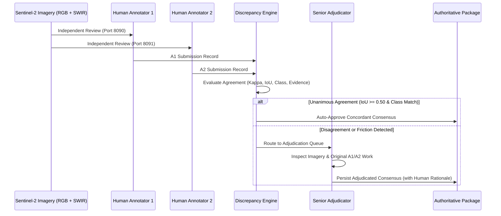

# STAGE 8.18 — DS08 DATASET EXPANSION: ANNOTATION PROTOCOL
**Standardized Double-Pass Manual Annotation Protocol, Taxonomy, and Disagreement Adjudication Workflow**

- **Document Version:** 1.0.0
- **Stage:** Stage 8.18 — DS08 Dataset Expansion Planning
- **Status:** **DRAFT SPECIFICATION — LOCKED FOR HUMAN REVIEW (NO ANNOTATION INITIATED)**
- **Baseline Protocol:** `DS08_ANNOTATION_GUIDELINES_v1.md` & `STAGE8_16_CORRECTION_SCHEMA.md`
- **Target Schema:** `ds08_annotation_schema.json`

---

## 1. Scope & Core Annotation Principles

This protocol governs the human interpretation, bounding-box delimitation, and visual evidence attribution for expanding the DS08 dataset toward 250 real Sentinel-2 Level-2A chips.

### Guiding Principles:
1. **Physical Observability First:** Annotations must represent visually discernible features in the Sentinel-2 bands (10m true-color RGB and false-color SWIR). Annotators must never draw bounding boxes around invisible, hypothetical, or model-predicted targets.
2. **Context vs Ground Truth Independence:** Auxiliary information (e.g., FIRMS coordinates, industrial facility databases, fire weather indices) serves strictly as contextual guidance and must **never** be used to invent an optical ground-truth box.
3. **Double-Pass Independence:** Every chip must be independently inspected and annotated by two separate human reviewers (Annotator 1 and Annotator 2) through isolated UI sessions without access to each other's submissions.
4. **Zero Model Authority:** No model predictions (YOLO, TCN, Deep SAD) may be shown to annotators, used as default boxes, or used to resolve adjudication disputes.

---

## 2. Object Classes & Physical Criteria

| Class ID | Class Name | Definitive Optical Manifestation | Key Distinguishing Factors |
| :---: | :--- | :--- | :--- |
| **1** | **Industrial Fire** | High-temperature flaming/smoldering combustion occurring within the active boundary of an industrial facility, manufacturing plant, refinery, or storage terminal. | Direct spatial coincidence with industrial buildings, tanks, or yard infrastructure; heavy black/gray hydrocarbon smoke plume; distinct from routine operational flaring. |
| **2** | **Forest Fire** | Vegetative combustion occurring in natural forest canopy, woodland, or wildland scrub terrain. | Continuous natural canopy context; expansive or dendritic charcoal-black burn scars; diffuse biomass smoke; active flame front at vegetation perimeter. |
| **3** | **Agricultural Fire** | Open combustion of crop residue, post-harvest straw, or clearing burns within agrarian field boundaries. | Bounded by rectilinear agricultural field lines; shallow/light smoke drifting across farmed parcels; localized post-burn field blackening. |
| **4** | **Other Thermal Source** | Continuous or planned non-emergency thermal process emitting strong SWIR radiance. | Permanent industrial flare stacks, active coal seam smoldering, operational brick kilns, thermal power generation discharge. |
| **0** | **UNRESOLVED** | Observation where optical data is ambiguous, partially occluded, or insufficient to distinguish between plausible classes. | Preserves honest human uncertainty; prevents forced label noise from corrupting downstream models. |

---

## 3. Evidence Taxonomy & Strict Consistency Rules

Every bounding box must be assigned one or more visual evidence tags from the standardized closed vocabulary:

### 3.1 Physical Evidence Tags (Direct Combustion & Disturbance)
- `DIRECT_FIRE_VISIBLE`: Observable flaming front characterized by intense B12/B11 SWIR saturation ($> 0.60$ BOA reflectance) and bright orange-yellow coloration in SWIR composite.
- `SMOKE_VISIBLE`: Distinct atmospheric aerosol plume (white, gray, or dark) with identifiable ground dispersion point.
- `BURN_SCAR_VISIBLE`: Surface charring, ash deposition, or canopy scorch exhibiting sharp drop in visible/SWIR reflectance relative to pre-fire baseline.
- `NO_CLEAR_VISUAL_EVIDENCE`: Clear ground surface with no discernible fire front, smoke plume, or fresh burn scar.

### 3.2 Contextual Evidence Tags (Surrounding Landscape)
- `INDUSTRIAL_INFRASTRUCTURE_VISIBLE`: Identifiable man-made factory complexes, storage tanks, smokestacks, industrial buildings, or rail yards.
- `FOREST_CONTEXT_VISIBLE`: Continuous woodland, dense tree canopy, or wildland terrain.
- `CROPLAND_CONTEXT_VISIBLE`: Cultivated field parcels, irrigation grids, or agricultural plots.
- `PERSISTENT_THERMAL_SOURCE_CONTEXT`: Observable flaring pipe, kiln trench, or industrial furnace structure.

### 3.3 Inviolable Consistency Rules:
> [!CAUTION]
> **Mutual Exclusion Invariant:**  
> A bounding box **CANNOT** simultaneously contain `NO_CLEAR_VISUAL_EVIDENCE` and any positive combustion tag (`DIRECT_FIRE_VISIBLE` or `BURN_SCAR_VISIBLE`). The validator will immediately reject conflicting submissions.

---

## 4. Observation Statuses & Empty-Annotation Cases

The chip-level property `chip_annotation_status` determines the top-level consensus state:

1. **`HAS_ANNOTATIONS`:**
   - One or more valid target objects/regions are discernible.
   - The `annotations` list must contain **$\ge 1$ bounding boxes**.
   - `source_classes` must list the assigned classes.
2. **`NO_VISIBLE_TARGET`:**
   - The scene has clear atmospheric visibility, but no fire front, smoke plume, burn scar, or abnormal thermal emitter is present.
   - The `annotations` list must be strictly empty (`[]`).
   - `source_classes` must be `["NO_VISIBLE_TARGET"]`.
   - `visual_evidence` must be `["NO_CLEAR_VISUAL_EVIDENCE"]`.
3. **`UNRESOLVED`:**
   - The scene exhibits ambiguous visual features that cannot be authoritatively resolved even after senior adjudication.
   - Requires substantive documented justification.

---

## 5. Bounding-Box Geometry Guidelines

1. **Pixel Coordinate Bounds:**
   - All coordinates must lie strictly within $[0, 512]$:
     $$0 \le x_{\min} < x_{\max} \le 512 \quad \text{and} \quad 0 \le y_{\min} < y_{\max} \le 512$$
   - Minimum box dimensions: $w = x_{\max} - x_{\min} \ge 4\text{ px}$ ($40\text{ m}$) and $h = y_{\max} - y_{\min} \ge 4\text{ px}$ ($40\text{ m}$).
2. **Bounding Active Fire Fronts:**
   - When active flaming is visible, the box should tightly encompass the active flame front and the immediately adjacent fresh burn front.
   - If a long, diffuse smoke plume extends for kilometers, **do not draw a giant box around the entire dispersing plume**. The bounding box must center tightly on the plume source and active combustion zone.
3. **Bounding Multiple Discrete Fires:**
   - If multiple separate agricultural fields are burning independently within the $5.12\text{ km}$ chip, each burning field must receive its own distinct bounding box (`EXP_042_01`, `EXP_042_02`).
   - Do not merge distant burn patches into one sprawling box.
4. **Prohibition of Placeholder Coordinates:**
   - Coordinates matching $[200, 200, 300, 300]$ or any uniform centered rectangle are programmatically blocked.

---

## 6. Two-Pass Annotation & Senior Adjudication Workflow

### Discrepancy Thresholds:
- **Status Mismatch:** `HAS_ANNOTATIONS` vs `NO_VISIBLE_TARGET` $\implies$ **Mandatory Adjudication**.
- **Class Mismatch:** Different assigned classes for overlapping boxes $\implies$ **Mandatory Adjudication**.
- **Spatial Friction:** Overlapping boxes with $\text{IoU} < 0.50$ $\implies$ **Mandatory Adjudication**.
- **Evidence Contradiction:** Conflicting visual tags $\implies$ **Mandatory Adjudication**.

---

## 7. Concrete Case Studies & Ambiguity Resolution

### Case 1: Refinery Operational Flaring vs Acute Industrial Disaster
- **Scenario:** A VIIRS detection ($FRP = 12\text{ MW}$) is located inside an Indian Oil Corporation refinery. Optical imagery shows a persistent localized SWIR hotspot at the top of a $60\text{ m}$ flare stack with minor clean heat shimmer, but no ground structures are burned, no black smoke plume drifts across units, and emergency response is absent.
- **Decision:** Classify as **`Other Thermal Source` (Class ID 4)** with evidence `["INDUSTRIAL_INFRASTRUCTURE_VISIBLE", "PERSISTENT_THERMAL_SOURCE_CONTEXT"]`.  
- **Rule:** Operational flaring is NOT an Industrial Fire.

### Case 2: Agricultural Fire Adjacent to an Industrial Facility
- **Scenario:** A factory is located at pixel $[120, 150]$. A FIRMS detection is recorded at pixel $[160, 220]$, $400\text{ m}$ southeast in an open agricultural field. Optical imagery reveals rectangular furrowed crop residue blackening and light straw smoke drifting over wheat stubble.
- **Decision:** Classify as **`Agricultural Fire` (Class ID 3)** with evidence `["BURN_SCAR_VISIBLE", "CROPLAND_CONTEXT_VISIBLE"]`.  
- **Rule:** Industrial proximity does not convert a farm burn into an industrial fire.

### Case 3: High FRP Thermal Anomaly with Zero Optical Target
- **Scenario:** MODIS reports a $25\text{ MW}$ fire at night ($\Delta t = 8\text{ hours}$ before S2 morning pass). In the 10:30 AM Sentinel-2 imagery, the entire terrain is clear bare soil with zero burn scar, zero smoke, and normal reflectance.
- **Decision:** Classify as **`NO_VISIBLE_TARGET` (Class ID 0)** with `annotations = []`.  
- **Rule:** Thermal detections indicate transient radiant energy; if no optical manifestation remains, do not invent a ground truth box.
