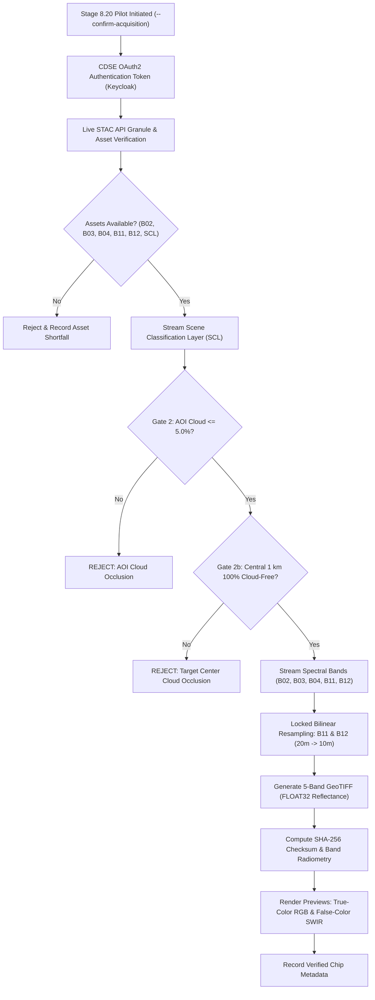

# Stage 8.20 — Controlled Acquisition Pilot Protocol & Execution Specification

## Document Metadata
- **Stage:** Stage 8.20 Preparation (Defined in Stage 8.19B)
- **Status:** **DRAFT SPECIFICATION — LOCKED FOR OWNER APPROVAL**
- **Governing Constraint:** **NO IMAGERY ACQUISITION AUTHORIZED UNTIL OWNER SIGNS OFF**
- **Scope:** Controlled 8-chip pilot batch exercising end-to-end CDSE retrieval, SCL cloud screening, radiometric resampling, and quality audit.
- **Model Training / Annotation Status:** **STRICTLY PROHIBITED IN THIS STAGE**

---

## 1. Executive Protocol & Execution Safeguards

Before downloading any bulk Sentinel-2 imagery for the 235 expansion candidates, Stage 8.20 requires an **explicit, controlled acquisition pilot** limited to a designated 8-chip batch.

### Mandatory Operational Guardrails:
1. **Explicit Owner Sign-Off Required:** The acquisition script will terminate immediately unless executed with the explicit command-line confirmation flag:
   ```bash
   python scripts/stage8_20_pilot_acquisition.py --confirm-acquisition
   ```
2. **Read-Only Dry-Run Mode by Default:** Running the script without `--confirm-acquisition` performs read-only live STAC catalog asset inspection, authentication checks, and quota verification with **zero bytes of imagery downloaded**.
3. **Environment Security:** Credentials (`CDSE_CLIENT_ID`, `CDSE_CLIENT_SECRET`) are loaded strictly from the existing `.env` file via `python-dotenv`. Credentials and auth tokens are never logged, echoed, or committed to git.
4. **No Model Training or Annotation:** The pilot is restricted to raster acquisition, cloud screening, and radiometric quality assurance. Annotation and model training remain locked.

---

## 2. Proposed 8-Chip Pilot Batch Specification

The proposed 8-chip pilot cohort is engineered to test all six strata, all sensor platforms (S2A, S2B, S2C), and specifically evaluate the two **DEC-U5 conditional cloud exception scenes**:

| Pilot Index | Candidate Chip ID | Candidate Stratum | Expected Target Class | ESA Sentinel-2 Product ID | Scene Cloud % | Assigned Fold (v3) | Specific Engineering & Scientific Rationale |
|:---:|:---|:---|:---|:---|:---:|:---:|:---|
| **P-01** | `DS08_EXP_S1_003` | `STR-1` | Industrial Fire | `S2B_MSIL2A_20250413T052649_N0511_R105_T43RFN_20250413T074009.SAFE` | $0.00\%$ | Fold 1 | **Baseline Clear Acute Industrial Fire:** Tests Same-Day Post combustion scar on Panipat polymer warehouse under clear skies. |
| **P-02** | `DS08_EXP_S1_002` | `STR-1` | Industrial Fire | `S2B_MSIL2A_20250325T045659_N0511_R119_T44QQE_20250325T074633.SAFE` | $14.74\%$ | Fold 1 | **DEC-U5 Cloud Exception Test 1:** Vizag API Pharma disaster. Tests SCL-based AOI ($\le 5\%$) and Center 1 km (0% cloud) screening. |
| **P-03** | `DS08_EXP_S1_004` | `STR-1` | Industrial Fire | `S2C_MSIL2A_20251028T053951_N0511_R005_T42QZH_20251028T084920.SAFE` | $19.32\%$ | Fold 4 | **DEC-U5 Cloud Exception Test 2:** Tarapur Chemical disaster (S2C overpass). Tests SCL-based AOI and Center 1 km screening. |
| **P-04** | `DS08_EXP_S2_001` | `STR-2` | Other Thermal Source | `S2A_MSIL2A_20250118T051111_N0511_R063_T43QDA_20250118T082633.SAFE` | $2.60\%$ | Fold 1 | **Persistent High-FRP Non-Biomass Anomaly:** Tests SWIR-2 saturation on continuous industrial flare / thermal asset. |
| **P-05** | `DS08_EXP_S3_001` | `STR-3` | Forest Fire | `S2B_MSIL2A_20250214T054230_N0511_R106_T43RFM_20250214T085752.SAFE` | $1.80\%$ | Fold 2 | **Active Forest Wildfire:** Tests B12 flame-front anomaly and B02 smoke plume detection in dense forest canopy. |
| **P-06** | `DS08_EXP_S4_001` | `STR-4` | Agricultural Fire | `S2A_MSIL2A_20250310T053121_N0511_R006_T43REQ_20250310T084620.SAFE` | $1.20\%$ | Fold 4 | **Agricultural Crop Residue Burn:** Tests smoldering crop residue burn in small agricultural parcels. |
| **P-07** | `DS08_EXP_S5_001` | `STR-5` | NO_VISIBLE_TARGET | `S2C_MSIL2A_20250115T054807_N0511_R006_T43QEB_20250115T090329.SAFE` | $0.10\%$ | Fold 1 | **Industrial Negative Control:** Major refinery complex under normal non-burning baseline operation. |
| **P-08** | `DS08_EXP_S6_001` | `STR-6` | NO_VISIBLE_TARGET | `S2B_MSIL2A_20250212T051909_N0511_R063_T43RED_20250212T083431.SAFE` | $0.20\%$ | Fold 3 | **Natural Background Negative Control:** Clear-sky agrarian/rural mosaic with zero thermal emission. |

---

## 3. End-to-End Acquisition & Quality Screening Pipeline



### 3.1 Step 1: CDSE OAuth2 Authentication
- Endpoint: `https://identity.dataspace.copernicus.eu/auth/realms/CDSE/protocol/openid-connect/token`
- Uses `client_credentials` grant with `CDSE_CLIENT_ID` and `CDSE_CLIENT_SECRET`.
- Auto-refreshes token 5 minutes before the 60-minute expiry.

### 3.2 Step 2: Live STAC Asset Verification
- Endpoint: `https://catalogue.dataspace.copernicus.eu/stac/search`
- Queries STAC by product identifier and bounding box.
- Confirms the presence of all 6 required assets:
  - `B02` (Blue, 10m)
  - `B03` (Green, 10m)
  - `B04` (Red, 10m)
  - `B11` (SWIR-1, 20m)
  - `B12` (SWIR-2, 20m)
  - `SCL` (Scene Classification Layer, 20m)

### 3.3 Step 3: SCL-Based AOI and Center-Area Cloud Screening
Before downloading full-resolution spectral bands, the 20m SCL raster over the $5.12\text{ km} \times 5.12\text{ km}$ AOI is retrieved and evaluated:
- **Cloud/Shadow Classes:** SCL 3 (Cloud Shadows), SCL 8 (Cloud Medium Probability), SCL 9 (Cloud High Probability), SCL 10 (Thin Cirrus).
- **Gate 2 (AOI Cloud Screening):**
  $$\text{AOI Cloud Ratio} = \frac{\sum \text{Pixels}(\text{SCL} \in \{3, 8, 9, 10\})}{\text{Total AOI Pixels}} \le 0.050 \quad (5.0\%)$$
- **Gate 2b (Center-Area Target Cloud Screening):**
  A central $1.0\text{ km} \times 1.0\text{ km}$ sub-window centered at pixel $(256, 256)$ is evaluated:
  $$\text{Center Cloud Ratio} = \frac{\sum \text{Center Pixels}(\text{SCL} \in \{3, 8, 9, 10\})}{\text{Total Center Pixels}} == 0.000 \quad (100\%\text{ Cloud-Free})$$
- If either condition fails, download of spectral bands is aborted immediately.

### 3.4 Step 4: Radiometric Resampling (Locked Algorithm)
- Native 10m bands (B02, B03, B04) are read directly onto a $512 \times 512$ pixel grid.
- Native 20m bands (B11, B12) are sampled on a $256 \times 256$ grid and resampled to the $512 \times 512$ 10m grid using **bilinear interpolation**, perfectly co-registered to the native 10m pixel coordinates.
- Radiometric values are normalized to Bottom-of-Atmosphere (BOA) surface reflectance:
  $$\text{Reflectance} = \frac{\text{DN}}{10,000.0}$$
  Stored as standard IEEE 754 `FLOAT32`.

### 3.5 Step 5: Safe Atomic Download & Integrity Verification
- Downloads write to temporary files (`.part`).
- Files are verified for complete Byte size and valid GeoTIFF headers before renaming.
- SHA-256 cryptographic hashes are computed and stored in the chip provenance manifest.

---

## 4. Failure, Shortfall, and Retry Policies

1. **Throttling & Backoff (DEC-U3):**
   - Minimum 2.0-second delay between STAC requests.
   - Exponential backoff on HTTP 429 / 503: initial delay 2.0s, doubling up to max 32.0s, with maximum 3 retry attempts.
2. **Handling Screening Failures:**
   - If `DS08_EXP_S1_002` or `DS08_EXP_S1_004` fails SCL screening (Gate 2 or 2b), the candidate is marked `REJECTED_CLOUD_OCCLUDED`.
   - **No automatic substitution:** The shortfall is recorded in the pilot report, and human sign-off is required before sampling a replacement.
3. **Band Corruptions:**
   - Any raster containing NaN, Inf, or out-of-range reflectance values ($< 0.0$ or $> 2.0$) across $> 1\%$ of non-nodata pixels is flagged for immediate human review.

---

## 5. Pilot Report Template

Following execution of the 8-chip pilot, the automated pipeline will generate `docs/stage8_20/STAGE8_20_PILOT_ACQUISITION_REPORT.md` following this structure:
- **Pilot Summary:** Total proposed (8), Successfully acquired ($k$), Rejected ($8-k$).
- **Authentication & Latency:** Auth latency, average download time per chip.
- **Gate 2 & 2b Cloud Results:** Observed AOI cloud % and Center cloud % for each of the 8 chips.
- **DEC-U5 Exception Disposition:** Definitive status of `DS08_EXP_S1_002` and `DS08_EXP_S1_004`.
- **Radiometric Quality:** Band min/max/mean reflectance and preview generation status.
- **Human Approval Request:** Formally requesting permission to proceed to bulk expansion acquisition.
