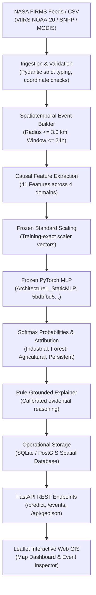

# DS08 System Architecture

This document provides a comprehensive technical overview of the end-to-end DS08 operational system architecture, detailing each subsystem from NASA satellite ingestion to interactive GIS visualization.

---

## 1. High-Level Architectural Flow

---

## 2. Subsystem Breakdown

### Subsystem 1: Ingestion & Validation (`src/stage8_37/ingestion/`)
- **Sources Supported:** NASA FIRMS Near-Real-Time (NRT) API and standard archival CSV formats (VIIRS 375m, MODIS 1km).
- **Validation Rules:**
  - Latitude strictly bounded to $[-90.0, 90.0]$.
  - Longitude strictly bounded to $[-180.0, 180.0]$.
  - Brightness temperatures (`bright_ti4`, `bright_ti5`) strictly positive ($> 0.0$ K).
  - Fire Radiative Power (`frp`) non-negative ($\ge 0.0$ MW).
  - Orbit deduplication: Filters exact spatial-temporal duplicate readings within identical satellite passes.
- **Fail-Safe Processing:** Corrupted or invalid records are safely rejected with structured error diagnostics without dropping valid records in the batch.

### Subsystem 2: Spatiotemporal Event Clustering (`src/stage8_37/events/`)
- Satellite observations represent point soundings; physical fires span spatial clusters across time.
- **Clustering Heuristic:**
  - Spatial radius threshold: $\Delta r \le 3.0$ km.
  - Temporal grouping window: $\Delta t \le 24$ hours from the initial detection timestamp.
- **Event Properties:**
  - Deterministic Event ID: `EVT_YYYYMMDD_<SHA256>` generated from centroid coordinates and start time.
  - Spatial centroid calculated from constituent detection points.
  - Retains full provenance array of underlying detection IDs.

### Subsystem 3: Causal Feature Engineering (`src/stage8_37/inference/feature_builder.py`)
Computes 41 causal numerical features divided into four distinct groups:
1. **Thermal Dynamics (14 features, $t \le t_0$):**
   - Latest and baseline FRP, brightness temperatures (TI4, TI5), differential $\Delta\text{TI} = \text{TI4} - \text{TI5}$.
   - Temporal dynamics: Detections observed so far, elapsed observation hours, mean/max/std FRP so far, daytime vs nighttime ratio, spatial cluster extent (km), FRP rate-of-change trend.
2. **Industrial Context (6 features):**
   - Great-circle distance to nearest registered industrial facility (km).
   - Binary indicator flags for $\le 1$ km and $\le 5$ km proximity.
   - Facility baseline FRP, absolute deviation from facility baseline, and baseline z-score.
3. **Land Cover / Ecoregion Context (3 features):**
   - Indian Forest biome indicator score (Western Ghats, Central Highlands, Northeast, Himalayas, Odisha).
   - Prime agricultural heartland indicator score (Indo-Gangetic Plain, Krishna-Godavari, Cauvery, Malwa).
   - High-resolution optical chip availability flag.
4. **Historical Recurrence (18 features, $t \le t_0 - 7\text{ days}$):**
   - Multi-year historical detection counts within 1km, 2km, and 5km radii.
   - Distinct historical active calendar months and years.
   - Recurrence temporal span, days since most recent historical detection, historical mean FRP and night ratio.
   - Strictly registry-free (no test-derived lookup files).

### Subsystem 4: Deep Neural Inference (`src/stage8_37/inference/`)
- Model checkpoint: `models/stage8_36/final_neural_model.pt`.
- Features normalized using training-time vector parameters: $z = \frac{x - \mu}{\sigma + \epsilon}$.
- Forward pass executes four group-specific MLP encoders, concatenates into an 88-dimensional latent vector, and computes logits through a multi-layer classification head.
- Softmax output ensures calibrated class probabilities summing to 1.0.

### Subsystem 5: Grounded Explanation Engine (`src/stage8_37/explanation/`)
- Translates neural confidence and feature states into structured operational intelligence across 4 domains: Thermal Evidence, Ecological Evidence, Industrial Evidence, and Recurrence Evidence.
- **Evidential Calibration:** All statements strictly use calibrated evidential language (*"supports"*, *"consistent with"*, *"contributes to"*, *"indicates"*). Deterministic or ungrounded claims (*"proves"*, *"guarantees"*, *"definitely"*) are prohibited.

### Subsystem 6: Operational Storage & Database (`src/stage8_37/database/`)
- Relational schema defined in `database/schema.sql`.
- Supports lightweight local SQLite for single-node development and PostGIS for production spatial querying.
- Tables:
  - `thermal_events`: Centroid coordinates, start timestamp, detection count, status.
  - `event_detections`: Raw satellite sounding points linked by foreign key.
  - `event_attributions`: Model version, predicted class, probabilities, confidence, evidence level.
  - `event_explanations`: Domain-specific natural language statements and summaries.

### Subsystem 7: API Backend & Interactive GIS Dashboard
- **FastAPI Backend:** Asynchronous Python 3.10 microservice serving OpenAPI/Swagger endpoints.
- **Web GIS Dashboard (`frontend/`):**
  - Built with Leaflet.js, OpenStreetMap tiles, and modern vanilla CSS.
  - Interactive map displaying color-coded attribution markers:
    - 🔴 **Red:** Industrial Fire
    - 🌲 **Green:** Forest Fire
    - 🌾 **Amber:** Agricultural Fire
    - 🟣 **Purple:** Other / Persistent Source
  - Filtering by class, minimum confidence slider, and date range.
  - Event Inspector pane showing full probability breakdown, facility proximity, and domain evidence bullets.
